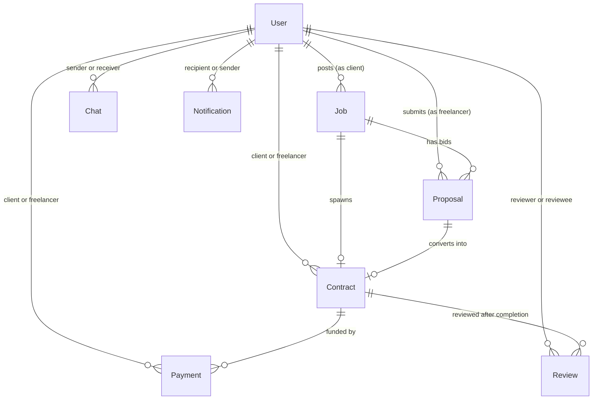

# Freelancr — Current State Repository Audit

> **Execution Context:** Read-only repository audit executed according to [PRD 00](file:///c:/Users/hp/OneDrive/Desktop/Freelancr/docs/prd/00_PRD_MASTER_ROADMAP.md), [PRD 01](file:///c:/Users/hp/OneDrive/Desktop/Freelancr/docs/prd/01_PRD_BASELINE_CHANGE_SAFETY.md), [PRD 02](file:///c:/Users/hp/OneDrive/Desktop/Freelancr/docs/prd/02_PRD_TARGET_ARCHITECTURE_NETWORKING.md), [PRD 03](file:///c:/Users/hp/OneDrive/Desktop/Freelancr/docs/prd/03_PRD_SECURITY_RBAC_CYBERSECURITY.md), and [PRD 12](file:///c:/Users/hp/OneDrive/Desktop/Freelancr/docs/prd/12_AI_AGENT_EXECUTION_PROTOCOL.md).
> **Rule:** Strictly factual analysis based on actual source code in the repository. No assumptions made from documentation alone.

---

## A. Current Backend Architecture

The backend is built with **Node.js**, **Express 5.2.1**, **TypeScript 7.0.2**, and **Mongoose 9.7.4**. It uses a modular, domain-driven 3-tier structure:

```text
HTTP Request
     │
     ▼
[Express Middlewares: helmet, morgan, cors, express-rate-limit, cookieParser, express.json]
     │
     ▼
[Route Layer: server/src/modules/<domain>/<domain>.routes.ts]
     │ (authenticate, authorize, express-validator, validate)
     ▼
[Controller Layer: server/src/modules/<domain>/<domain>.controller.ts]
     │ (Translates HTTP params, query, body to service calls)
     ▼
[Service Layer: server/src/modules/<domain>/<domain>.service.ts]
     │ (Core business logic, state machines, permission checks, external calls)
     ▼
[Repository Layer: server/src/modules/<domain>/<domain>.repository.ts]
     │ (Database queries, projections, populates, sorts)
     ▼
[Model Layer: server/src/modules/<domain>/<domain>.model.ts]
     │ (Mongoose Schemas & Model definitions)
     ▼
[MongoDB Atlas Database]
```

### Module Distribution
The backend contains 12 domain modules in [server/src/modules/](file:///c:/Users/hp/OneDrive/Desktop/Freelancr/server/src/modules):
1. `admin`: Platform statistics, user moderation (ban/unban, delete), job moderation.
2. `analytics`: Platform-wide aggregation metrics for users, jobs, proposals, contracts, payments.
3. `auth`: Registration, login, logout, refresh tokens, password reset/change.
4. `chat`: 1-to-1 messaging, conversation retrieval, message deletion.
5. `contracts`: Contract creation from accepted proposal, contract details, completion, cancellation.
6. `jobs`: Job posting, updating, deleting, listing, keyword search, filtering.
7. `notifications`: In-app notification creation, retrieval, unread counts, mark-as-read, deletion.
8. `payments`: Razorpay order creation, payment verification, webhook processing, refund issuance.
9. `proposals`: Freelancer bids on jobs, editing, withdrawal, client retrieval by job.
10. `reviews`: Post-contract mutual reviews (rating 1–5, comments), rating aggregation.
11. `uploads`: Multer memory upload, streaming to Cloudinary, deletion by public ID.
12. `users`: Profile fetching, profile updating, resume upload, portfolio management, account deletion.

---

## B. Current Frontend Architecture

The frontend is a Single Page Application (SPA) built with **React 19.2.7**, **TypeScript ~6.0.2**, **Vite 8.1.1**, **React Router 7.18.1**, **Redux Toolkit 2.12.0**, and **Tailwind CSS 4.3.2**.

```text
index.html -> main.tsx -> Redux Provider -> QueryClientProvider -> App.tsx
                                                                      │
     ┌────────────────────────────────────────────────────────────────┴─────────────────────────┐
     ▼                                                                                          ▼
AuthInitializer (Re-hydrates /auth/me)                                        SocketProvider (Socket.IO client auth)
     │                                                                                          │
     └────────────────────────────────┬─────────────────────────────────────────────────────────┘
                                      ▼
                        RouterProvider (React Router v7)
                                      │
              ┌───────────────────────┴────────────────────────┐
              ▼                                                ▼
     Public Routes:                                   ProtectedRoute:
     /login, /register,                                       │
     /forgot-password, /reset-password                        ▼
                                                          MainLayout (Navbar + Outlet)
                                                              │
                                       ┌──────────────────────┼──────────────────────┐
                                       ▼                      ▼                      ▼
                               General Pages:            AdminRoute:             ChatRoute:
                               /, /jobs, /my-jobs,       /admin, /admin/users,   /chat/:userId
                               /contracts, /proposals    /admin/jobs, /admin/analytics
```

### State Management Separation
- **Redux Store ([client/src/store/](file:///c:/Users/hp/OneDrive/Desktop/Freelancr/client/src/store)):** Holds `authSlice` (`user`, `isAuthenticated`, `initialized`).
- **TanStack Query ([client/src/app/providers.tsx](file:///c:/Users/hp/OneDrive/Desktop/Freelancr/client/src/app/providers.tsx)):** Configured in providers, but **completely unused in UI components**.
- **Local Component State:** All pages manage asynchronous data with raw `useState()`, `useEffect()`, `loading`, and `error` booleans.

---

## C. Current Routes and API Endpoints

All endpoints are mounted under `/api/v1` in [server/src/app.ts](file:///c:/Users/hp/OneDrive/Desktop/Freelancr/server/src/app.ts):

| Domain | HTTP Method | Endpoint Path | Authentication | Authorization | Validator Schema | Response Shape |
| :--- | :--- | :--- | :--- | :--- | :--- | :--- |
| **Auth** | `POST` | `/api/v1/auth/register` | None (`authRateLimiter`) | Public | `registerValidation` | `{ success, message, data: { user, accessToken } }` |
| **Auth** | `POST` | `/api/v1/auth/login` | None (`authRateLimiter`) | Public | `loginValidation` | `{ success, message, data: { user, accessToken } }` + Cookie `refreshToken` |
| **Auth** | `GET` | `/api/v1/auth/me` | `authenticate` | Any active user | None | `{ success, data: user }` |
| **Auth** | `POST` | `/api/v1/auth/logout` | `authenticate` | Any active user | None | `{ success, message }` + Cleared cookie |
| **Auth** | `POST` | `/api/v1/auth/refresh` | None | Cookie/Body token | None | `{ success, data: { accessToken } }` |
| **Auth** | `PATCH` | `/api/v1/auth/change-password` | `authenticate` | Any active user | `changePasswordValidation` | `{ success, message }` |
| **Auth** | `POST` | `/api/v1/auth/forgot-password` | None (`passwordResetRateLimiter`) | Public | `forgotPasswordValidation` | `{ success, message }` |
| **Auth** | `POST` | `/api/v1/auth/reset-password` | None (`passwordResetRateLimiter`) | Public | `resetPasswordValidation` | `{ success, message }` |
| **Users** | `GET` | `/api/v1/users/profile` | `authenticate` | Any active user | None | `{ success, data: user }` |
| **Users** | `PATCH` | `/api/v1/users/profile` | `authenticate` | Any active user | `updateProfileValidation` | `{ success, data: user }` |
| **Users** | `GET` | `/api/v1/users/:username` | None | Public | None | `{ success, data: user }` |
| **Users** | `GET` | `/api/v1/users` | None | Public | None | `{ success, data: User[] }` (**Unbounded**) |
| **Users** | `DELETE` | `/api/v1/users/me` | `authenticate` | Any active user | None | `{ success, message }` |
| **Users** | `POST` | `/api/v1/users/resume` | `authenticate` | Any active user | `resumeUpload.single("resume")` | `{ success, message, data: user }` |
| **Users** | `POST` | `/api/v1/users/portfolio` | `authenticate` | Any active user | `upload.single("image")` | `{ success, message, data: user }` |
| **Users** | `DELETE` | `/api/v1/users/portfolio` | `authenticate` | Any active user | None (reads `req.body.publicId`) | `{ success, message, data: user }` |
| **Jobs** | `POST` | `/api/v1/jobs` | `authenticate` | **None** (Any role) | `createJobValidation` | `{ success, message, data: job }` |
| **Jobs** | `PATCH` | `/api/v1/jobs/:id` | `authenticate` | Job owner only | `updateJobValidation` | `{ success, message, data: job }` |
| **Jobs** | `DELETE` | `/api/v1/jobs/:id` | `authenticate` | Job owner only | None | `{ success, message }` |
| **Jobs** | `GET` | `/api/v1/jobs/my-jobs` | `authenticate` | Any active user | None | `{ success, data: Job[] }` (**Unbounded**) |
| **Jobs** | `GET` | `/api/v1/jobs/search` | None | Public | None | `{ success, data: Job[] }` (**Unbounded**) |
| **Jobs** | `GET` | `/api/v1/jobs/filter` | None | Public | None | `{ success, data: Job[] }` (**Unbounded**) |
| **Jobs** | `GET` | `/api/v1/jobs/:id` | None | Public | None | `{ success, data: job }` |
| **Jobs** | `GET` | `/api/v1/jobs` | None | Public | None | `{ success, data: Job[] }` (**Unbounded**) |
| **Proposals** | `POST` | `/api/v1/proposals` | `authenticate` | `authorize("freelancer")` | `applyProposalValidation` | `{ success, message, data: proposal }` |
| **Proposals** | `GET` | `/api/v1/proposals/my` | `authenticate` | `authorize("freelancer")` | None | `{ success, data: Proposal[] }` (**Unbounded**) |
| **Proposals** | `GET` | `/api/v1/proposals/job/:jobId` | `authenticate` | `authorize("client", "admin")` + owner check | None | `{ success, data: Proposal[] }` (**Unbounded**) |
| **Proposals** | `GET` | `/api/v1/proposals/:id` | `authenticate` | `authorize("client", "freelancer", "admin")` + owner check | None | `{ success, data: proposal }` |
| **Proposals** | `PATCH` | `/api/v1/proposals/:id` | `authenticate` | `authorize("freelancer")` + owner check | `updateProposalValidation` | `{ success, message, data: proposal }` |
| **Proposals** | `DELETE` | `/api/v1/proposals/:id` | `authenticate` | `authorize("freelancer")` + owner check | None | `{ success, message }` |
| **Contracts** | `POST` | `/api/v1/contracts` | `authenticate` | `authorize("client")` + proposal/job owner check | `createContractValidation` | `{ success, message, data: contract }` |
| **Contracts** | `GET` | `/api/v1/contracts` | `authenticate` | Any active user (filters user's own) | None | `{ success, data: Contract[] }` (**Unbounded**) |
| **Contracts** | `GET` | `/api/v1/contracts/:id` | `authenticate` | Contract participants only | None | `{ success, data: contract }` |
| **Contracts** | `PATCH` | `/api/v1/contracts/:id/complete` | `authenticate` | `authorize("client")` + client owner check | None | `{ success, message, data: contract }` |
| **Contracts** | `PATCH` | `/api/v1/contracts/:id/cancel` | `authenticate` | `authorize("client", "freelancer")` + participant check | None | `{ success, message, data: contract }` |
| **Payments** | `POST` | `/api/v1/payments/create-order` | `authenticate` | Any active user + contract client check | `createOrderValidation` | `{ success, message, data: { payment, order } }` |
| **Payments** | `POST` | `/api/v1/payments/verify` | `authenticate` | Any active user + contract client check | `verifyPaymentValidation` | `{ success, message, payment }` |
| **Payments** | `GET` | `/api/v1/payments/my-payments` | `authenticate` | Any active user (filters user's own) | None | `{ success, data: Payment[] }` (**Unbounded**) |
| **Payments** | `GET` | `/api/v1/payments/:id` | `authenticate` | Payment participants only | None | `{ success, data: payment }` |
| **Payments** | `PATCH` | `/api/v1/payments/refund/:id` | `authenticate` | Payment client only | `refundValidation` | `{ success, message, data: payment }` |
| **Payments** | `POST` | `/api/v1/payments/webhook` | None | Raw-body HMAC verification | None | `{ success, message }` |
| **Reviews** | `POST` | `/api/v1/reviews` | `authenticate` | Contract participant only | `createReviewValidation` | `{ success, message, data: review }` |
| **Reviews** | `GET` | `/api/v1/reviews/user/:userId` | None | Public | None | `{ success, data: Review[] }` (**Unbounded**) |
| **Reviews** | `GET` | `/api/v1/reviews/job/:jobId` | None | Public | None | `{ success, data: Review[] }` (**Unbounded**) |
| **Reviews** | `GET` | `/api/v1/reviews/contract/:contractId` | `authenticate` | Any active user | None | `{ success, data: Review[] }` (**Unbounded**) |
| **Reviews** | `GET` | `/api/v1/reviews/:id` | None | Public | None | `{ success, data: review }` |
| **Chat** | `POST` | `/api/v1/chat` | `authenticate` | Any active user (validates receiver exists) | `sendMessageValidation` | `{ success, message, data: chat }` |
| **Chat** | `GET` | `/api/v1/chat/conversation/:userId`| `authenticate`| Any active user (returns mutual messages) | None | `{ success, data: Chat[] }` (**Unbounded**) |
| **Chat** | `GET` | `/api/v1/chat/:id` | `authenticate` | Participant only | None | `{ success, data: chat }` |
| **Chat** | `DELETE` | `/api/v1/chat/:id` | `authenticate` | Sender only | None | `{ success, message }` |
| **Uploads** | `POST` | `/api/v1/upload` | `authenticate` | Any active user | `upload.single("file")` | `{ success, message, data: { url, publicId } }` |
| **Uploads** | `DELETE` | `/api/v1/upload/:publicId` | `authenticate` | User must own publicId in profile | None | `{ success, message }` |
| **Notifications**| `GET` | `/api/v1/notifications` | `authenticate`| Recipient only | `notificationQueryValidation` | `{ success, data: { notifications, pagination } }` (**Paginated**) |
| **Notifications**| `GET` | `/api/v1/notifications/unread-count`| `authenticate`| Recipient only | None | `{ success, data: { unreadCount } }` |
| **Notifications**| `GET` | `/api/v1/notifications/:id` | `authenticate` | Recipient only | `notificationIdValidation` | `{ success, data: notification }` |
| **Notifications**| `PATCH` | `/api/v1/notifications/:id/read` | `authenticate` | Recipient only | `notificationIdValidation` | `{ success, message, data: notification }` |
| **Notifications**| `PATCH` | `/api/v1/notifications/read-all` | `authenticate` | Recipient only | None | `{ success, message }` |
| **Notifications**| `DELETE` | `/api/v1/notifications/:id` | `authenticate` | Recipient only | `notificationIdValidation` | `{ success, message }` |
| **Notifications**| `DELETE` | `/api/v1/notifications` | `authenticate` | Recipient only | None | `{ success, message }` |
| **Admin** | `GET` | `/api/v1/admin/dashboard` | `authenticate` | `authorize("admin")` | None | `{ success, data: { users, jobs } }` |
| **Admin** | `GET` | `/api/v1/admin/users` | `authenticate` | `authorize("admin")` | `adminUsersQueryValidation` | `{ success, data: { users, pagination } }` (**Paginated**) |
| **Admin** | `GET` | `/api/v1/admin/users/:id` | `authenticate` | `authorize("admin")` | `adminUserIdValidation` | `{ success, data: user }` |
| **Admin** | `PATCH` | `/api/v1/admin/users/:id/status` | `authenticate` | `authorize("admin")` | `updateUserStatusValidation` | `{ success, message, data: user }` |
| **Admin** | `PATCH` | `/api/v1/admin/users/:id/verify` | `authenticate` | `authorize("admin")` | `updateUserVerificationValidation` | `{ success, message, data: user }` |
| **Admin** | `DELETE` | `/api/v1/admin/users/:id` | `authenticate` | `authorize("admin")` | `adminUserIdValidation` | `{ success, message }` |
| **Admin** | `GET` | `/api/v1/admin/jobs` | `authenticate` | `authorize("admin")` | `adminJobsQueryValidation` | `{ success, data: { jobs, pagination } }` (**Paginated**) |
| **Admin** | `PATCH` | `/api/v1/admin/jobs/:id/status` | `authenticate` | `authorize("admin")` | `updateJobStatusValidation` | `{ success, message, data: job }` |
| **Admin** | `DELETE` | `/api/v1/admin/jobs/:id` | `authenticate` | `authorize("admin")` | `adminJobIdValidation` | `{ success, message }` |
| **Analytics** | `GET` | `/api/v1/analytics/overview` | `authenticate` | `authorize("admin")` | None | `{ success, data: platformOverview }` |
| **Analytics** | `GET` | `/api/v1/analytics/users` | `authenticate` | `authorize("admin")` | None | `{ success, data: userAnalytics }` |
| **Analytics** | `GET` | `/api/v1/analytics/jobs` | `authenticate` | `authorize("admin")` | None | `{ success, data: jobAnalytics }` |
| **Analytics** | `GET` | `/api/v1/analytics/proposals` | `authenticate` | `authorize("admin")` | None | `{ success, data: proposalAnalytics }` |
| **Analytics** | `GET` | `/api/v1/analytics/contracts` | `authenticate` | `authorize("admin")` | None | `{ success, data: contractAnalytics }` |
| **Analytics** | `GET` | `/api/v1/analytics/payments` | `authenticate` | `authorize("admin")` | None | `{ success, data: paymentAnalytics }` |

---

## D. Current Authentication and Authorization Flow

1. **Authentication Token Lifecycle:**
   - On registration or login, backend issues two tokens:
     - Short-lived Access Token (JWT, `15m` expiration, hardcoded in [server/src/utils/jwt.ts](file:///c:/Users/hp/OneDrive/Desktop/Freelancr/server/src/utils/jwt.ts)).
     - Long-lived Refresh Token (JWT, `7d` expiration, hardcoded in [server/src/utils/jwt.ts](file:///c:/Users/hp/OneDrive/Desktop/Freelancr/server/src/utils/jwt.ts)).
   - Access token is returned in JSON payload and stored in `localStorage` by frontend.
   - Refresh token is sent as an `HttpOnly`, `SameSite=lax` cookie and also stored hashed/plain in MongoDB `user.refreshToken`.
2. **Access Token Verification:**
   - Middleware [server/src/middleware/auth.middleware.ts](file:///c:/Users/hp/OneDrive/Desktop/Freelancr/server/src/middleware/auth.middleware.ts) extracts `Authorization: Bearer <token>`.
   - Token is verified against `process.env.JWT_ACCESS_SECRET`.
   - The user is fetched from the database (`UserRepository.findById(decoded.id)`).
   - If `!user.isActive`, the request is rejected with `403 Account deactivated`.
   - Attaches `req.user = { id: user._id.toString(), role: user.role }`.
3. **Role Authorization:**
   - Middleware [server/src/middleware/authorize.middleware.ts](file:///c:/Users/hp/OneDrive/Desktop/Freelancr/server/src/middleware/authorize.middleware.ts) checks `roles.includes(req.user.role)`.
   - Returns `403 Forbidden` if mismatch.
4. **Password Reset Flow:**
   - Generates 32-byte hex crypto token in [server/src/utils/resetToken.ts](file:///c:/Users/hp/OneDrive/Desktop/Freelancr/server/src/utils/resetToken.ts), hashes it with SHA-256 for MongoDB storage, and sends raw token in URL to user's email via [server/src/services/email.service.ts](file:///c:/Users/hp/OneDrive/Desktop/Freelancr/server/src/services/email.service.ts).
   - Rate limited to 5 attempts per 15 min.

---

## E. Current User Roles and Ownership Checks

- **Roles Supported:** `client`, `freelancer`, `admin`.
- **Resource Ownership Verification:**
  - `Job`: `job.client._id.toString() === clientId` on update and delete.
  - `Proposal`: `proposal.freelancer._id.toString() === freelancerId` on update and withdraw.
  - `Contract`: `clientId === userId || freelancerId === userId` on view; only client can complete; both can cancel.
  - `Payment`: `clientId === userId || freelancerId === userId` on view; only client can pay/refund.
  - `Review`: Contract must be `completed`; reviewer must be client or freelancer of that contract; max 1 review per contract per reviewer.
  - `Chat`: Sender can delete own message; conversation requires user to be sender or receiver.
  - `Uploads`: Deletion requires `publicId === user.resumePublicId` or `user.portfolio.some(p => p.publicId === publicId)`.

---

## F. Current MongoDB/Mongoose Models and Relationships



### Models & Critical Constraints
1. **`User` ([server/src/modules/users/user.model.ts](file:///c:/Users/hp/OneDrive/Desktop/Freelancr/server/src/modules/users/user.model.ts)):**
   - Unique indexes: `username`, `email`.
   - Hidden fields: `password`, `passwordResetToken`, `passwordResetExpires`, `refreshToken`.
2. **`Job` ([server/src/modules/jobs/job.model.ts](file:///c:/Users/hp/OneDrive/Desktop/Freelancr/server/src/modules/jobs/job.model.ts)):**
   - References `client` (`User`).
   - Statuses: `open`, `in_progress`, `completed`, `cancelled`.
   - **Missing index on `client` or `status`**.
3. **`Proposal` ([server/src/modules/proposals/proposal.model.ts](file:///c:/Users/hp/OneDrive/Desktop/Freelancr/server/src/modules/proposals/proposal.model.ts)):**
   - Compound unique index: `{ job: 1, freelancer: 1 }`.
   - Statuses: `pending`, `accepted`, `rejected`, `withdrawn`.
4. **`Contract` ([server/src/modules/contracts/contract.model.ts](file:///c:/Users/hp/OneDrive/Desktop/Freelancr/server/src/modules/contracts/contract.model.ts)):**
   - Unique index: `proposal: 1`.
   - Statuses: `active`, `completed`, `cancelled`, `disputed`.
   - **Missing index on `client` and `freelancer`**.
5. **`Payment` ([server/src/modules/payments/payment.model.ts](file:///c:/Users/hp/OneDrive/Desktop/Freelancr/server/src/modules/payments/payment.model.ts)):**
   - Unique index: `razorpayOrderId: 1`.
   - Statuses: `created`, `paid`, `failed`, `partially_refunded`, `refunded`.
   - **Missing index on `contract`, `client`, `freelancer`, `razorpayPaymentId`**.
6. **`Review` ([server/src/modules/reviews/review.model.ts](file:///c:/Users/hp/OneDrive/Desktop/Freelancr/server/src/modules/reviews/review.model.ts)):**
   - Compound unique index: `{ reviewer: 1, contract: 1 }`.
7. **`Chat` ([server/src/modules/chat/chat.model.ts](file:///c:/Users/hp/OneDrive/Desktop/Freelancr/server/src/modules/chat/chat.model.ts)):**
   - Compound indexes: `{ sender: 1, receiver: 1, createdAt: 1 }`, `{ receiver: 1, sender: 1, isRead: 1 }`.
8. **`Notification` ([server/src/modules/notifications/notification.model.ts](file:///c:/Users/hp/OneDrive/Desktop/Freelancr/server/src/modules/notifications/notification.model.ts)):**
   - Indexes: `{ recipient: 1 }`, `{ recipient: 1, type: 1 }`, `{ recipient: 1, isRead: 1 }`, `{ createdAt: -1 }`.

---

## G. Current Payment / Refund Implementation

- **Order Creation:** `POST /api/v1/payments/create-order` calls `PaymentService.createOrder(userId, contractId)`.
  - Amount is fetched from `Contract.amount`, never trusted from client request.
  - Razorpay order created via `razorpay.orders.create({ amount: amount * 100, currency: "INR" })`.
  - Stored in MongoDB with status `created`.
- **Payment Verification:** `POST /api/v1/payments/verify` calls `PaymentService.verifyPayment(...)`.
  - Verifies HMAC signature with `RAZORPAY_KEY_SECRET`.
  - Verifies payment status directly from Razorpay API (`razorpay.payments.fetch(paymentId)`).
  - Validates `order_id`, `amount`, `currency`, and `status === 'captured'`.
  - Updates payment status to `paid`.
- **Refund Processing:** `PATCH /api/v1/payments/refund/:id` calls `PaymentService.refund(...)`.
  - Verifies caller is payment client.
  - Verifies payment is in `paid` or `partially_refunded` status.
  - Checks `pendingRefundAmount === 0` and `!pendingRefundId` to prevent duplicate concurrent refunds.
  - Fetches Razorpay payment truth: checks `amount_refunded` and remaining refundable balance.
  - Initiates refund through Razorpay API (`razorpay.payments.refund`).
  - If processed immediately: updates `refundedAmount`, status (`refunded` or `partially_refunded`), and notifies freelancer.
  - If pending: records `pendingRefundId` and `pendingRefundAmount`.
- **CRITICAL GAP:** There is **NO payout or fund release mechanism** to transfer funds to the freelancer! All money collected remains in the platform account.

---

## H. Current Razorpay / Webhook Implementation

- **Webhook Route Definition:** In [server/src/app.ts](file:///c:/Users/hp/OneDrive/Desktop/Freelancr/server/src/app.ts) lines 34-38:
  ```typescript
  app.post(
    "/api/v1/payments/webhook",
    express.raw({ type: "application/json" }),
    PaymentController.webhook
  );
  ```
  Registered **before** `express.json()` to preserve raw body bytes.
- **Signature Verification:** Uses `crypto.createHmac("sha256", env.RAZORPAY_WEBHOOK_SECRET).update(rawBody).digest("hex")` and `crypto.timingSafeEqual` with buffer length check.
- **Events Handled:**
  1. `payment.captured`: Updates payment status to `paid` and sets `paidAt`.
  2. `payment.failed`: Updates status to `failed` if not already paid.
  3. `refund.created`: Sets `pendingRefundId` and `pendingRefundAmount`.
  4. `refund.processed`: Re-fetches Razorpay payment as source of truth, performs idempotency check, updates `refundedAmount`, sets `refunded` or `partially_refunded`, clears pending state, notifies freelancer.
  5. `refund.failed`: Clears `pendingRefundAmount` and `pendingRefundId`.

---

## I. Current Socket.IO Implementation

- **Server Setup ([server/src/services/socket.service.ts](file:///c:/Users/hp/OneDrive/Desktop/Freelancr/server/src/services/socket.service.ts)):**
  - Handshake middleware verifies JWT access token from `socket.handshake.auth.token`.
  - Verifies user exists and `isActive === true`.
  - Attaches `socket.data.user = { id, role }`.
  - Automatically joins private user room: `user:${userId}`.
- **Event Handlers ([server/src/socket/socket.ts](file:///c:/Users/hp/OneDrive/Desktop/Freelancr/server/src/socket/socket.ts)):**
  - `join_user`: Re-joins `user:${userId}`.
  - `join_chat`: Joins room `chat:${otherUserId}` after validating `otherUserId` exists.
  - `send_message`: Validates receiver, message text, length $\le 2000$, attachments $\le 10$, saves message via `ChatService.sendMessage`, and emits `new_message` to `user:${receiverId}` and `user:${senderId}`.
- **Client Setup ([client/src/lib/socket.ts](file:///c:/Users/hp/OneDrive/Desktop/Freelancr/client/src/lib/socket.ts)):**
  - Single `io(SOCKET_URL, { autoConnect: false })` instance.
  - `SocketProvider.tsx` connects on mount if `accessToken` exists in `localStorage`.

---

## J. Current Axios / API Client Implementation

- **Location:** [client/src/lib/axios.ts](file:///c:/Users/hp/OneDrive/Desktop/Freelancr/client/src/lib/axios.ts).
- **Configuration:**
  - `baseURL: import.meta.env.VITE_API_URL`
  - `withCredentials: true`
- **Request Interceptor:** Injects `Authorization: Bearer ${token}` from `localStorage.getItem("accessToken")`.
- **Response Interceptor:** NONE. No 401 handling, no automated refresh token exchange, no normalized error conversion.
- **Request Timeout:** Undefined.
- **Correlation ID:** None.

---

## K. Current File Upload Implementation

- **Multer Middleware ([server/src/modules/uploads/multer.ts](file:///c:/Users/hp/OneDrive/Desktop/Freelancr/server/src/modules/uploads/multer.ts)):**
  - `upload`: `memoryStorage()`, size limit 10MB, MIME: `image/jpeg`, `image/png`, `image/webp`.
  - `resumeUpload`: `memoryStorage()`, size limit 10MB, MIME: `application/pdf`.
- **Cloudinary Integration ([server/src/services/cloudinary.service.ts](file:///c:/Users/hp/OneDrive/Desktop/Freelancr/server/src/services/cloudinary.service.ts)):**
  - Uses `streamifier.createReadStream(file.buffer).pipe(cloudinary.uploader.upload_stream)`.
- **File Deletion & Rollback:**
  - Deletes Cloudinary file by public ID on account deletion and profile portfolio removal.
  - Implements compensation rollback: if MongoDB update fails after upload, calls Cloudinary `destroy()` to avoid orphan storage.

---

## L. Current Notification Implementation

- **Model:** `Notification` in [server/src/modules/notifications/notification.model.ts](file:///c:/Users/hp/OneDrive/Desktop/Freelancr/server/src/modules/notifications/notification.model.ts).
- **Triggers in Code:**
  - Proposal created $\rightarrow$ notifies client.
  - Proposal accepted / Contract created $\rightarrow$ notifies freelancer.
  - Contract completed $\rightarrow$ notifies freelancer.
  - Contract cancelled $\rightarrow$ notifies counterparty.
  - Payment verified $\rightarrow$ notifies freelancer.
  - Refund processed $\rightarrow$ notifies freelancer.
- **Delivery Mechanism:**
  - Saves to MongoDB via `NotificationRepository.create()`.
  - Emits real-time event via Socket.IO: `io.to("user:" + recipientId).emit("notification", notification)`.
- **Frontend Status:** The frontend has **NO UI or listeners for notifications**.

---

## M. Current Admin Implementation

- **Protected by:** `authenticate` and `authorize("admin")`.
- **Capabilities in [server/src/modules/admin/admin.service.ts](file:///c:/Users/hp/OneDrive/Desktop/Freelancr/server/src/modules/admin/admin.service.ts):**
  - Platform overview stats (`getDashboardStats`).
  - User management: Paginated user list with role and status filtering (`getUsers`), view user (`getUser`), ban/unban (`updateUserStatus`), manual verification (`verifyUser`), delete user with asset cleanup (`deleteUser`).
  - Job moderation: Paginated job list (`getJobs`), override job status (`updateJobStatus`), delete job (`deleteJob`).
- **Capabilities in [server/src/modules/analytics/analytics.service.ts](file:///c:/Users/hp/OneDrive/Desktop/Freelancr/server/src/modules/analytics/analytics.service.ts):**
  - Platform overview counters (Users, Jobs, Proposals, Contracts, Payments).
  - Detailed domain breakdowns for users, jobs, proposals, contracts, payments.

---

## N. Current Test Coverage and Test Commands

- **Unit Tests:** 0 tests in repository.
- **Integration Tests:** 0 tests in repository.
- **E2E Tests:** 0 tests in repository.
- **Server `package.json` scripts:**
  - `npm run dev`: Starts tsx watcher.
  - `npm run build`: Runs `tsc` (passes with 0 errors).
  - `npm run start`: Runs `node dist/server.js`.
  - **No `test` script exists.**
- **Client `package.json` scripts:**
  - `npm run dev`: Starts Vite dev server.
  - `npm run build`: Runs `tsc -b && vite build` (passes with 0 errors).
  - `npm run lint`: Runs ESLint.
  - `npm run preview`: Previews Vite build.
  - **No `test` script exists.**

---

## O. Current Environment Variables

### Backend Variables ([server/src/config/env.ts](file:///c:/Users/hp/OneDrive/Desktop/Freelancr/server/src/config/env.ts))
- `PORT` (default: `5000`)
- `NODE_ENV` (default: `"development"`)
- `MONGODB_URI` (**Required**)
- `JWT_ACCESS_SECRET` (**Required**)
- `JWT_REFRESH_SECRET` (**Required**)
- `CLIENT_URL` (default: `"http://localhost:5173"`)
- `RAZORPAY_KEY_ID` (**Required**)
- `RAZORPAY_KEY_SECRET` (**Required**)
- `RAZORPAY_WEBHOOK_SECRET` (**Required**)
- `CLOUDINARY_CLOUD_NAME` (optional/default: `""`)
- `CLOUDINARY_API_KEY` (optional/default: `""`)
- `CLOUDINARY_API_SECRET` (optional/default: `""`)
- `MAIL_HOST` (optional/default: `""`)
- `MAIL_PORT` (default: `587`)
- `MAIL_USER` (optional/default: `""`)
- `MAIL_PASSWORD` (optional/default: `""`)
- `MAIL_FROM` (optional/default: `""`)

### Frontend Variables ([client/.env](file:///c:/Users/hp/OneDrive/Desktop/Freelancr/client/.env))
- `VITE_API_URL`
- `VITE_RAZORPAY_KEY_ID`

---

## P. Current External Services

1. **MongoDB Atlas / Database:** Primary document store.
2. **Razorpay:** Payment order creation, payment verification, refunds, webhooks.
3. **Cloudinary:** Cloud storage for profile resumes and portfolio media.
4. **SMTP / Nodemailer:** Email dispatch for password reset links.
5. **Socket.IO:** In-memory WebSocket communication server.

---

## Q. Current Duplicate / Parallel Networking Mechanisms

1. **Axios Clients:** Exactly one configured instance in [client/src/lib/axios.ts](file:///c:/Users/hp/OneDrive/Desktop/Freelancr/client/src/lib/axios.ts). No duplicate Axios instances found.
2. **Direct API calls in UI:** [client/src/components/payment/RazorpayCheckout.tsx](file:///c:/Users/hp/OneDrive/Desktop/Freelancr/client/src/components/payment/RazorpayCheckout.tsx) bypasses the services folder and directly calls `api.post("/payments/create-order", ...)`.
3. **Socket.IO Clients:** Exactly one client configured in [client/src/lib/socket.ts](file:///c:/Users/hp/OneDrive/Desktop/Freelancr/client/src/lib/socket.ts). No duplicate Socket instances.
4. **Token Decoding Duplication:** [client/src/pages/ChatPage.tsx](file:///c:/Users/hp/OneDrive/Desktop/Freelancr/client/src/pages/ChatPage.tsx) parses `localStorage.getItem("accessToken")` via manual `atob()` decoding rather than reading user state from Redux `useAppSelector((state) => state.auth.user)`.

---

## R. Current Security Risks

1. **Missing Role Check on Job Creation:** `POST /api/v1/jobs` in [job.routes.ts](file:///c:/Users/hp/OneDrive/Desktop/Freelancr/server/src/modules/jobs/job.routes.ts) only checks `authenticate`. Any registered user (including freelancers) can create jobs.
2. **Public Unbounded User Listing:** `GET /api/v1/users` in [user.routes.ts](file:///c:/Users/hp/OneDrive/Desktop/Freelancr/server/src/modules/users/user.routes.ts) requires no authentication and returns all users with no pagination limit.
3. **In-Memory Rate Limiting Gaps:** Only auth (`/login`, `/register`) and password reset are rate limited. No rate limits exist for chat messaging, job posting, order creation, or file uploads.
4. **Process Heap Memory DOS via Multer:** Multer stores incoming files in Node process memory buffers (`multer.memoryStorage()`). Concurrent uploads of 10MB files can exhaust heap memory.
5. **Orphaned Cloudinary Uploads:** Generic upload endpoint `POST /api/v1/upload` allows any authenticated user to upload files to Cloudinary that cannot be deleted via API because ownership is not tracked in the database.
6. **No Access Token Invalidation on Logout:** Tokens are stateless JWTs stored in `localStorage`. Logout only clears `refreshToken` in MongoDB and the browser cookie; the access token remains cryptographically valid until its 15-minute expiration.
7. **No Response 401 Interceptor:** If the access token expires, the client makes no attempt to refresh the session and abruptly breaks active interactions.
8. **Missing Audit Logging:** Sensitive admin actions (banning users, deleting jobs, status overrides) write no audit log entries.

---

## S. Current Architectural Inconsistencies

1. **TanStack Query Inconsistency:** `@tanstack/react-query` is installed in `package.json` and wrapped in `providers.tsx`, but zero pages or components use `useQuery` or `useMutation`. All state fetching is done manually via `useEffect` and `useState`.
2. **Disconnected Payment UI:** [RazorpayCheckout.tsx](file:///c:/Users/hp/OneDrive/Desktop/Freelancr/client/src/components/payment/RazorpayCheckout.tsx) is not imported or rendered on any page in the application.
3. **Missing Proposal Acceptance in UI:** The frontend has no button or handler to accept a proposal (`POST /api/v1/contracts`). The core transition from proposal to contract cannot be triggered through the web interface.
4. **Contract Completion without Payment:** Backend `completeContract` does not verify if escrow payment was made.
5. **Job `proposalsCount` Never Updated on Backend:** `ProposalService.apply` does not increment `job.proposalsCount`, and `withdrawProposal` does not decrement it.
6. **Socket Server Multi-Instance Incompatibility:** Socket.IO server uses default in-memory emitter without Redis adapter. Clustered or multi-instance deployments will fail to route notifications across nodes.

---

## T. Documentation vs. Code Discrepancies

| # | Discrepancy Description | Documentation Location | Actual Code Location | Classification |
| :--- | :--- | :--- | :--- | :--- |
| 1 | **Test Suite Existence:** Architecture document states E2E test matrix and PRD 01 requires baseline test results. | Architecture doc Section 32 | `package.json` (server & client) | **Implementation discrepancy** |
| 2 | **Proposals Endpoint Path:** Documented as `/api/v1/proposals/my-proposals`. | `PROJECT_STRUCTURE.md` Section 7 | `server/src/modules/proposals/proposal.routes.ts` (`/my`) | **Safe documentation discrepancy** |
| 3 | **Reset Password Endpoint Shape:** Documented as `POST /auth/reset-password/:token`. | `PROJECT_STRUCTURE.md` Section 5.1 & 7 | `server/src/modules/auth/auth.routes.ts` (`POST /reset-password` with token in body) | **Safe documentation discrepancy** |
| 4 | **Environment Variable Naming:** Documented as `MONGO_URI`, `SMTP_HOST`, `SMTP_PORT`, `SMTP_USER`, `SMTP_PASS`, `EMAIL_FROM`. | `PROJECT_STRUCTURE.md` Section 8 | `server/src/config/env.ts` (`MONGODB_URI`, `MAIL_HOST`, `MAIL_PORT`, `MAIL_USER`, `MAIL_PASSWORD`, `MAIL_FROM`) | **Safe documentation discrepancy** |
| 5 | **Job Creation Authorization:** Documented as "Client only". | `PROJECT_STRUCTURE.md` Section 7 & PRD 03 | `server/src/modules/jobs/job.routes.ts` line 14 (no `authorize("client")`) | **Security issue** |
| 6 | **TanStack Query Usage:** Documented as owner of server state. | PRD 02, PRD 12, Architecture doc | `client/src/pages/` (0 uses of `useQuery`/`useMutation`) | **Architectural issue** |
| 7 | **Client Payment Verification:** UI component only logs payment response; never calls `/payments/verify`. | Architecture doc Section 12 | `client/src/components/payment/RazorpayCheckout.tsx` lines 73-82 | **Financial/payment issue** |
| 8 | **Missing Payout / Fund Release:** System collects client money via Razorpay, but has no payout mechanism to send funds to freelancers. | PRD 07, UI/UX Analysis Section 11 | `server/src/modules/payments/` (no payout entity or route) | **Financial/payment issue** |
| 9 | **HomePage & Public Access:** Documented as public browsing for jobs. | Architecture doc Section 9, PRD 03 | `client/src/routes/index.tsx` (all routes wrapped in `ProtectedRoute`) | **Architectural issue** |
| 10 | **Notification UI:** Documented as full notification delivery pipeline. | Architecture doc Section 15 | `client/src/` (no notification UI or socket listener) | **Implementation discrepancy** |
| 11 | **Job Proposals Counter:** `job.proposalsCount` documented as tracking bids. | Architecture doc Section 9 | `server/src/modules/proposals/proposal.service.ts` (counter not incremented) | **Implementation discrepancy** |
