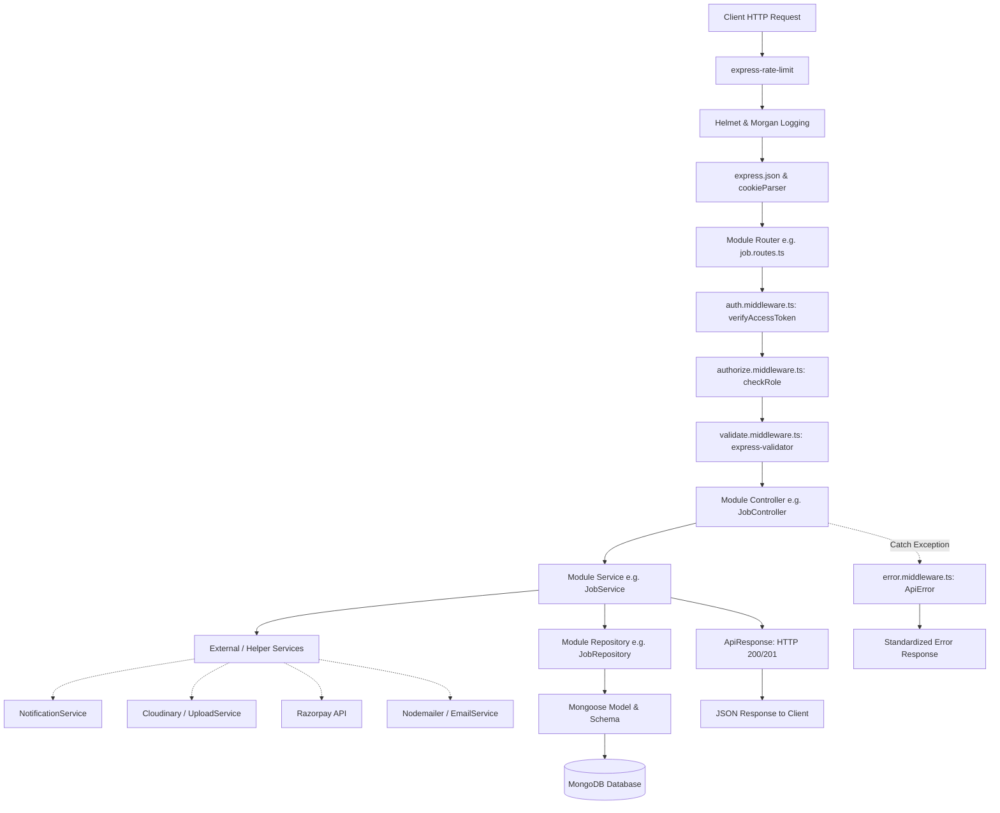
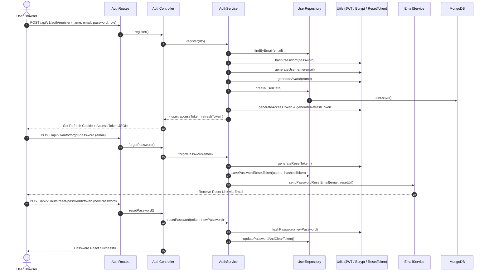
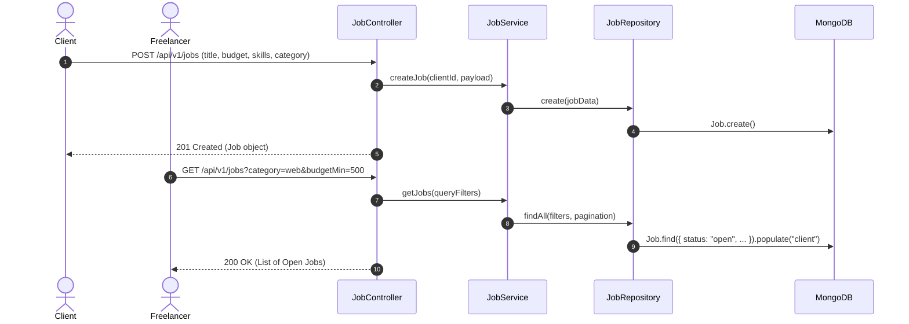
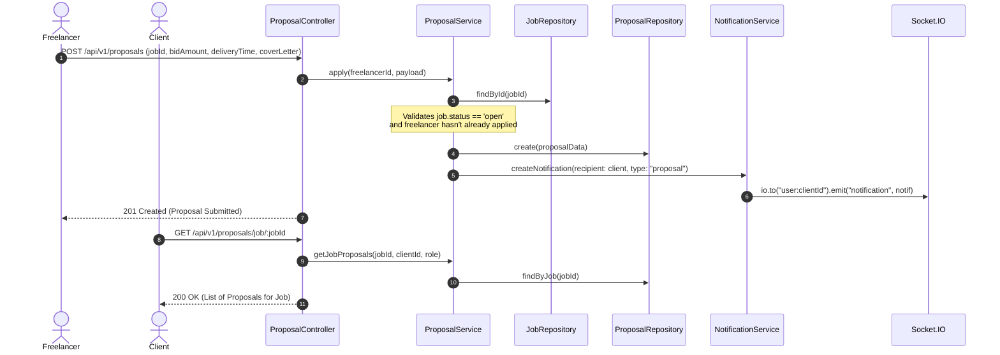
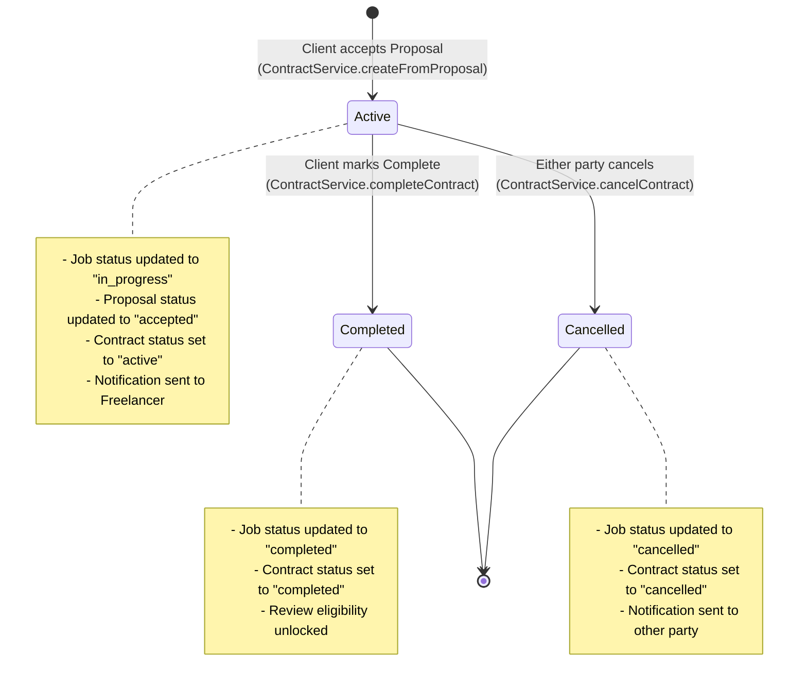
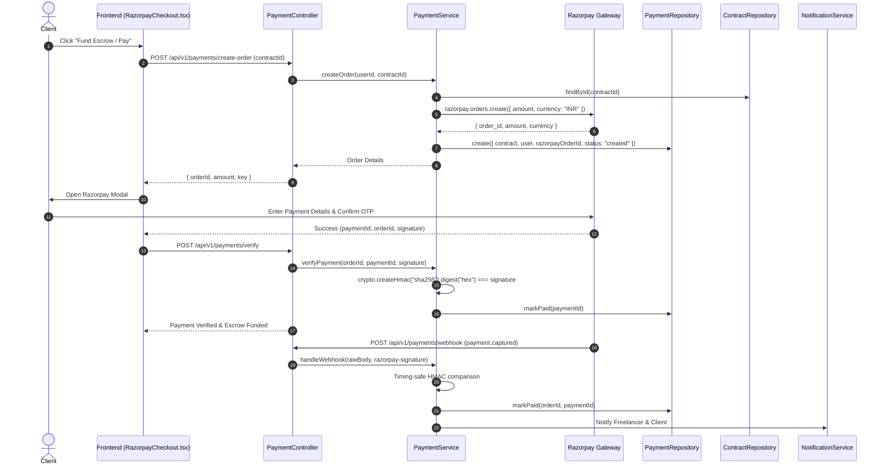
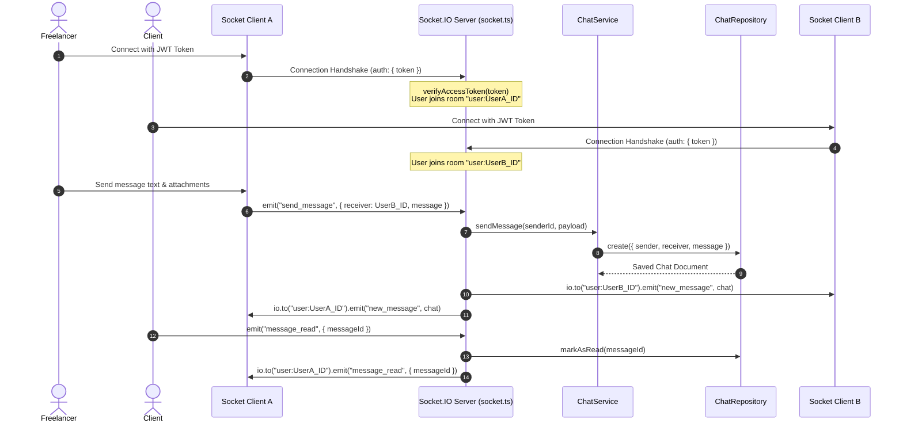
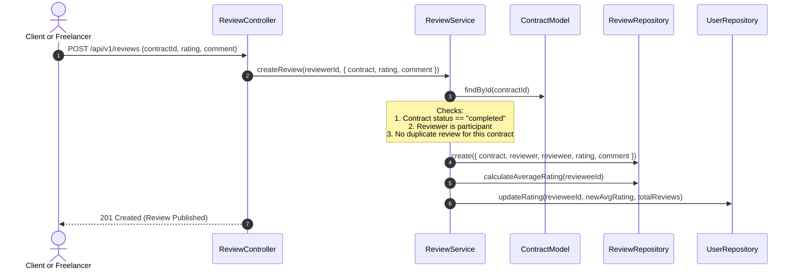
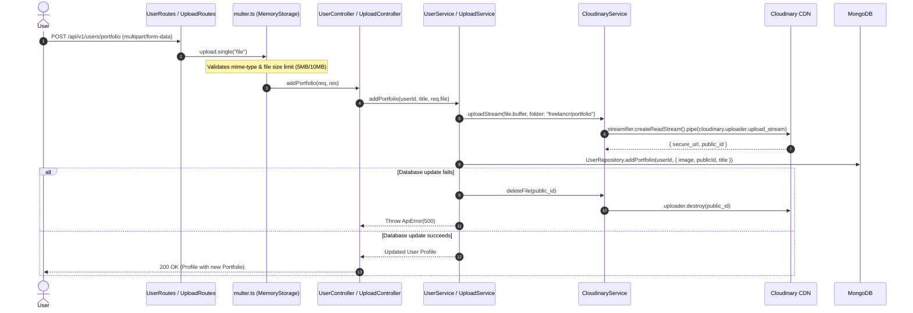

# Freelancr — Project Structure & Feature Dependency Graph

This document providd.
es a comprehensive technical overview of the **Freelancr** repository, detailing the full directory structure, architecture paradigms, database models, cross-module dependencies, and end-to-end execution flows for every core feature.

---

## 1. Project Overview & Tech Stack

Freelancr is an enterprise-grade freelance marketplace connecting clients and freelancers with escrow-style payments, real-time messaging, contract lifecycle tracking, and an administrative dashboar
### Core Stack
- **Frontend (`/client`)**: React 19, TypeScript, Vite, Redux Toolkit (auth state), TanStack Query v5 (server cache & async state), React Router v7, Tailwind CSS v4, Socket.IO Client, Axios, React Hook Form, Zod.
- **Backend (`/server`)**: Node.js, Express v5, TypeScript, MongoDB / Mongoose v9, Socket.IO v4, Razorpay SDK, Cloudinary SDK, Nodemailer, Bcrypt, JSON Web Tokens (JWT), Express-Validator, Helmet, Morgan, Express-Rate-Limit.
- **Architecture**: Modular 3-Tier Layered Architecture (`Route` -> `Middleware` -> `Controller` -> `Service` -> `Repository` -> `Model` -> `Database`).

---

## 2. Complete Repository File Structure

```
Freelancr/
│
├── .git/                                 # Git version control metadata
├── .gitignore                            # Root git ignore rules
├── README.md                             # Project overview
├── PROJECT_STRUCTURE.md                  # System architecture, file structure & dependency flows (this file)
│
├── assets/                               # Static design assets and screenshots
│
├── docs/                                 # Software design & specification documents
│   ├── 00-Vision.md                      # Product vision and core value proposition
│   ├── 01-SRS.md                         # Software Requirements Specification
│   ├── 02-Requirements.md                # Functional and non-functional requirements
│   ├── 03-User-Stories.md                # User stories for clients, freelancers, and admins
│   ├── 04-Use-Cases.md                   # System use cases and actor interactions
│   ├── 05-System-Architecture.md         # High-level architecture overview
│   ├── 06-Database-Design.md             # Schema design and indexing strategy
│   ├── 07-ER-Diagram.md                  # Entity Relationship diagrams
│   ├── 08-API-Specification.md           # REST API endpoints documentation
│   ├── 09-RBAC.md                        # Role-Based Access Control matrix
│   ├── 10-UI-Design.md                   # Design guidelines, wireframes, and tokens
│   ├── 11-Security.md                    # Security measures, JWT, CORS, rate-limiting
│   ├── 12-Testing.md                     # Test strategy and test cases
│   ├── 13-Deployment.md                  # Production build and deployment setup
│   └── 14-Project-Report.md              # Project summary report
│
├── client/                               # Frontend Single Page Application (SPA)
│   ├── .env                              # Client environment variables (VITE_API_URL, etc.)
│   ├── .gitignore                        # Frontend-specific git ignore rules
│   ├── eslint.config.js                  # ESLint configuration
│   ├── index.html                        # HTML entry template
│   ├── package.json                      # Client dependencies and npm scripts
│   ├── package-lock.json                 # Locked dependency tree
│   ├── README.md                         # Client setup instructions
│   ├── tsconfig.json                     # TypeScript root configuration
│   ├── tsconfig.app.json                 # TypeScript application configuration
│   ├── tsconfig.node.json                # TypeScript Vite/Node tooling configuration
│   ├── vite.config.ts                    # Vite build configuration (React & Tailwind plugins)
│   │
│   ├── public/                           # Static assets served directly
│   │   ├── favicon.svg                   # Site favicon
│   │   └── icons.svg                     # SVG sprite sheet / icon definitions
│   │
│   └── src/                              # Client source code
│       ├── App.tsx                       # Root React component (providers, listeners, router)
│       ├── main.tsx                      # DOM entrypoint (StrictMode, Redux Store, React Query)
│       │
│       ├── app/
│       │   └── providers.tsx             # TanStack QueryClientProvider wrapper
│       │
│       ├── components/                   # Reusable UI & domain components
│       │   ├── admin/
│       │   │   └── AdminStatCard.tsx     # Stat metric card for admin dashboard
│       │   ├── common/
│       │   │   ├── AdminRoute.tsx        # Route guard: restricts access to admin role only
│       │   │   ├── AuthInitializer.tsx   # Re-hydrates current user session on page refresh
│       │   │   ├── ProtectedRoute.tsx    # Route guard: restricts access to authenticated users
│       │   │   └── SocketProvider.tsx    # Global Socket.io listener lifecycle & auth binding
│       │   ├── contracts/
│       │   │   ├── ContractActions.tsx   # Action buttons (complete, cancel, submit review)
│       │   │   ├── ContractCard.tsx      # Contract overview card widget
│       │   │   └── ContractStatusBadge.tsx # Status pill for contracts (active, completed, cancelled)
│       │   ├── jobs/
│       │   │   ├── JobCard.tsx           # Job listing card component
│       │   │   └── JobForm.tsx           # Create / Edit job form with validation
│       │   ├── payment/
│       │   │   └── RazorpayCheckout.tsx  # Razorpay checkout script loader and modal trigger
│       │   ├── proposals/
│       │   │   └── ProposalForm.tsx      # Freelancer job proposal submission form
│       │   └── reviews/
│       │       ├── ReviewCard.tsx        # Rating card display for reviews
│       │       └── ReviewForm.tsx        # Star rating & feedback submission form
│       │
│       ├── constants/
│       │   └── index.ts                  # Client constants and configuration values
│       │
│       ├── layouts/
│       │   ├── AuthLayout.tsx            # Minimalist layout for login/register/password pages
│       │   └── MainLayout.tsx            # Core application layout (Navbar, Sidebar, Outlet, Footer)
│       │
│       ├── lib/
│       │   ├── axios.ts                  # Configured Axios instance with auth token interceptor
│       │   └── socket.ts                 # Socket.io client instance initialization
│       │
│       ├── pages/                        # Route page views
│       │   ├── AdminDashboardPage.tsx    # Admin metrics, job/user overview charts
│       │   ├── AdminJobsPage.tsx         # Admin job moderation and management view
│       │   ├── AdminUsersPage.tsx        # Admin user accounts management & status toggling
│       │   ├── AnalyticsPage.tsx         # Platform-wide revenue and contract analytics
│       │   ├── ChatPage.tsx              # Direct real-time messaging interface
│       │   ├── ContractDetailsPage.tsx   # Contract milestone, deliverables, and payment view
│       │   ├── ContractsPage.tsx         # Current user contracts list (active, past)
│       │   ├── CreateJobPage.tsx         # Client job posting creation page
│       │   ├── ForgotPasswordPage.tsx    # Password reset request page (email submission)
│       │   ├── HomePage.tsx              # Landing page and platform hero section
│       │   ├── JobDetailsPage.tsx        # Job description, requirements, and proposal submission
│       │   ├── JobProposalsPage.tsx      # Client view: list of proposals submitted to their job
│       │   ├── JobsPage.tsx              # Public/freelancer job search and filter directory
│       │   ├── LoginPage.tsx             # User login page
│       │   ├── MyJobsPage.tsx            # Client's own posted jobs manager
│       │   ├── MyProposalsPage.tsx       # Freelancer's submitted proposals manager
│       │   ├── NotFoundPage.tsx          # 404 error page
│       │   ├── ProposalDetailsPage.tsx   # Detailed proposal view
│       │   ├── RegisterPage.tsx          # Account registration page (client/freelancer)
│       │   ├── ResetPasswordPage.tsx     # Token-based password reset completion page
│       │   └── UserReviewsPage.tsx       # User public profile reviews and feedback history
│       │
│       ├── routes/
│       │   └── index.tsx                 # React Router v7 routes definition and route tree
│       │
│       ├── services/                     # HTTP API client services (calls backend /api/v1)
│       │   ├── admin.api.ts              # Admin dashboard and moderation API endpoints
│       │   ├── analytics.api.ts          # Platform analytics API endpoints
│       │   ├── api.ts                    # Common API utilities
│       │   ├── auth.api.ts               # Login, register, logout, refresh, password reset
│       │   ├── chat.api.ts               # Chat conversation and message retrieval API
│       │   ├── contracts.api.ts          # Contract retrieval, completion, and cancellation
│       │   ├── jobs.api.ts               # Job CRUD, search, and filtering endpoints
│       │   ├── proposals.api.ts          # Proposal submission, retrieval, and updates
│       │   └── reviews.api.ts            # Review creation and user review fetching
│       │
│       ├── store/                        # Redux state management
│       │   ├── hooks.ts                  # Typed hooks (`useAppDispatch`, `useAppSelector`)
│       │   ├── index.ts                  # Redux store configuration
│       │   └── slices/
│       │       └── authSlice.ts          # Auth slice (user profile, token, auth status)
│       │
│       ├── styles/
│       │   └── globals.css               # Global Tailwind CSS definitions and styles
│       │
│       ├── types/
│       │   ├── index.ts                  # Shared client TypeScript types
│       │   └── razorpay.d.ts             # Razorpay window SDK TypeScript declarations
│       │
│       └── utils/
│           └── helpers.ts                # Formatting utilities (currency, dates, strings)
│
└── server/                               # Backend REST API & WebSocket Server
    ├── .env                              # Environment variables (Mongo URI, JWT secrets, Razorpay, Cloudinary)
    ├── .env.example                      # Template for required environment variables
    ├── package.json                      # Server dependencies and scripts (tsx, build, start)
    ├── package-lock.json                 # Locked dependency tree
    ├── tsconfig.json                     # TypeScript server configuration
    ├── upload/                           # Local temporary upload directory
    │
    └── src/                              # Server source code
        ├── app.ts                        # Express application configuration (middleware, routes, error handler)
        ├── server.ts                     # HTTP server startup, DB connection, and Socket.IO initialization
        │
        ├── config/                       # Third-party service configuration
        │   ├── env.ts                    # Validated environment variables accessor
        │   ├── mail.ts                   # Nodemailer transporter configuration
        │   ├── razorpay.ts               # Razorpay client instance setup
        │   └── socket.ts                 # Socket.IO instance getter and setter
        │
        ├── database/
        │   └── connectDB.ts              # Mongoose MongoDB connection handler
        │
        ├── middleware/                   # Express HTTP middlewares
        │   ├── auth.middleware.ts        # JWT access token verification middleware
        │   ├── authorize.middleware.ts   # Role-based authorization middleware (`client`, `freelancer`, `admin`)
        │   ├── error.middleware.ts       # Global error handling middleware (converts to `ApiError`)
        │   ├── notFound.middleware.ts    # 404 Handler for undefined routes
        │   ├── rateLimit.middleware.ts   # API rate-limiting middleware (express-rate-limit)
        │   └── validate.middleware.ts    # Express-validator result validation handler
        │
        ├── modules/                      # Domain-driven modular components
        │   │
        │   ├── admin/                    # Admin moderation and platform management
        │   │   ├── admin.controller.ts   # Handles admin requests (stats, user bans, job deletion)
        │   │   ├── admin.routes.ts       # `/api/v1/admin` routes (requires `admin` role)
        │   │   ├── admin.service.ts      # Business logic for platform management
        │   │   └── admin.validation.ts   # Request validation schemas for admin actions
        │   │
        │   ├── analytics/                # Business analytics & reports
        │   │   ├── analytics.controller.ts # Analytics endpoint controller
        │   │   ├── analytics.routes.ts   # `/api/v1/analytics` routes
        │   │   └── analytics.service.ts  # Platform stats, user growth, revenue calculations
        │   │
        │   ├── auth/                     # Authentication & session management
        │   │   ├── auth.controller.ts    # Register, login, refresh, logout, password reset
        │   │   ├── auth.routes.ts        # `/api/v1/auth` routes
        │   │   ├── auth.service.ts       # Password hashing, JWT token generation, reset logic
        │   │   ├── auth.types.ts         # DTO types for auth payloads
        │   │   └── auth.validation.ts    # Validation rules for auth endpoints
        │   │
        │   ├── chat/                     # 1-to-1 Messaging and chat history
        │   │   ├── chat.controller.ts    # Chat message endpoints
        │   │   ├── chat.model.ts         # Mongoose schema for chat messages
        │   │   ├── chat.repository.ts    # Database queries for messages
        │   │   ├── chat.routes.ts        # `/api/v1/chat` routes
        │   │   ├── chat.service.ts       # Chat business logic and conversation management
        │   │   ├── chat.types.ts         # Chat interfaces and types
        │   │   └── chat.validation.ts    # Validation rules for message payloads
        │   │
        │   ├── contracts/                # Contract lifecycle (Active -> Completed / Cancelled)
        │   │   ├── contract.controller.ts # Contract endpoints handler
        │   │   ├── contract.model.ts     # Mongoose contract schema
        │   │   ├── contract.repository.ts # Contract database queries
        │   │   ├── contract.routes.ts    # `/api/v1/contracts` routes
        │   │   ├── contract.service.ts   # Contract creation, status change, and validation
        │   │   ├── contract.types.ts     # Contract entity types
        │   │   └── contract.validation.ts # Contract route input validators
        │   │
        │   ├── jobs/                     # Job listings and discovery
        │   │   ├── job.controller.ts     # Job CRUD, search, and filter controller
        │   │   ├── job.model.ts          # Mongoose schema for jobs
        │   │   ├── job.repository.ts     # Database queries for jobs with pagination & filters
        │   │   ├── job.routes.ts         # `/api/v1/jobs` routes
        │   │   ├── job.service.ts        # Job business logic & client authorization
        │   │   ├── job.types.ts          # Job entity types and DTOs
        │   │   └── job.validation.ts     # Validation rules for job operations
        │   │
        │   ├── notifications/            # In-app and real-time notifications
        │   │   ├── notification.controller.ts # Notification endpoints
        │   │   ├── notification.model.ts # Mongoose schema for notifications
        │   │   ├── notification.repository.ts # Notification database queries
        │   │   ├── notification.routes.ts # `/api/v1/notifications` routes
        │   │   ├── notification.service.ts # Notification creation & Socket dispatch
        │   │   ├── notification.types.ts # Notification types
        │   │   └── notification.validation.ts # Notification validation rules
        │   │
        │   ├── payments/                 # Razorpay payment orders, webhook, and refunds
        │   │   ├── payment.controller.ts # Payment order, verification, webhook endpoints
        │   │   ├── payment.model.ts      # Mongoose schema for payments
        │   │   ├── payment.repository.ts # Payment database queries
        │   │   ├── payment.routes.ts     # `/api/v1/payments` routes
        │   │   ├── payment.service.ts    # Razorpay order generation, HMAC verification, refunds
        │   │   ├── payment.types.ts      # Payment entity types
        │   │   └── payment.validation.ts # Validation schemas for payments
        │   │
        │   ├── proposals/                # Freelancer bids and proposals
        │   │   ├── proposal.controller.ts # Proposal submission and handling
        │   │   ├── proposal.model.ts     # Mongoose schema for proposals
        │   │   ├── proposal.repository.ts # Proposal database queries
        │   │   ├── proposal.routes.ts    # `/api/v1/proposals` routes
        │   │   ├── proposal.service.ts   # Proposal submission, update, and rejection logic
        │   │   ├── proposal.types.ts     # Proposal entity types
        │   │   └── proposal.validation.ts # Validation schemas for proposals
        │   │
        │   ├── reviews/                  # Rating and review system
        │   │   ├── review.controller.ts  # Review submission and retrieval
        │   │   ├── review.model.ts       # Mongoose schema for reviews
        │   │   ├── review.repository.ts  # Database queries for reviews
        │   │   ├── review.routes.ts      # `/api/v1/reviews` routes
        │   │   ├── review.service.ts     # Mutual review validation for completed contracts
        │   │   ├── review.types.ts       # Review entity types
        │   │   └── review.validation.ts  # Review input validation
        │   │
        │   ├── uploads/                  # File & media upload pipeline
        │   │   ├── multer.ts             # Multer memory storage and file filter configuration
        │   │   ├── upload.controller.ts  # File upload endpoint controller
        │   │   ├── upload.routes.ts      # `/api/v1/upload` routes
        │   │   └── upload.service.ts     # Cloudinary buffer upload & file deletion
        │   │
        │   └── users/                    # User profile and account management
        │       ├── user.controller.ts    # Profile view, update, resume/portfolio upload
        │       ├── user.model.ts         # Mongoose schema for users
        │       ├── user.repository.ts    # User database queries
        │       ├── user.routes.ts        # `/api/v1/users` routes
        │       ├── user.service.ts       # Profile updates, portfolio addition, account deletion
        │       ├── user.types.ts         # User entity types and interfaces
        │       └── user.validation.ts    # Validation schemas for user endpoints
        │
        ├── services/                     # Cross-cutting infrastructure services
        │   ├── cloudinary.service.ts     # Cloudinary streaming upload and deletion
        │   ├── email.service.ts          # Email templates & Nodemailer delivery
        │   └── socket.service.ts         # Socket.IO initialization, JWT auth handshake, and rooms
        │
        ├── shared/                       # Shared utility classes and helpers
        │   ├── ApiError.ts               # Custom operational error class
        │   ├── ApiResponse.ts            # Standardized API response format
        │   ├── asyncHandler.ts           # Wrapper to catch async controller errors
        │   ├── httpStatus.ts             # HTTP Status code constants
        │   ├── index.ts                  # Shared module barrel export
        │   └── logger.ts                 # Centralized console/file logger
        │
        ├── socket/                       # Socket.IO event registrations
        │   ├── event.ts                  # Socket event constant names
        │   ├── index.ts                  # Socket module export
        │   └── socket.ts                 # Socket event handlers (messaging, join rooms, disconnect)
        │
        └── utils/                        # Pure utility functions
            ├── bcrypt.ts                 # Password hashing and comparison
            ├── generateAvatar.ts         # Initial-based SVG avatar generation
            ├── generateUsername.ts       # Unique username generator from email
            ├── jwt.ts                    # Access & refresh token generation & verification
            └── resetToken.ts             # Crypto-based password reset token generator
```

---

## 3. Database Entity Relationship (ER) Graph

The system data model is built on MongoDB collections via Mongoose models. Relationships are established using MongoDB `ObjectId` references.

```mermaid
erDiagram
    USER ||--o{ JOB : "posts as Client"
    USER ||--o{ PROPOSAL : "submits as Freelancer"
    USER ||--o{ CONTRACT : "participates (Client or Freelancer)"
    USER ||--o{ PAYMENT : "initiates / receives"
    USER ||--o{ REVIEW : "writes / receives"
    USER ||--o{ NOTIFICATION : "receives"
    USER ||--o{ CHAT : "sends / receives"

    JOB ||--o{ PROPOSAL : "receives"
    JOB ||--o| CONTRACT : "spawns"

    PROPOSAL ||--o| CONTRACT : "leads to"

    CONTRACT ||--o{ PAYMENT : "funds via Escrow"
    CONTRACT ||--o{ REVIEW : "permits review on completion"

    USER {
        ObjectId _id PK
        string fullName
        string email
        string password
        string role "client | freelancer | admin"
        string username
        string avatar
        string bio
        string location
        string phone
        string[] skills
        string resume
        string resumePublicId
        Array portfolio
        boolean isVerified
        boolean isActive
        string refreshToken
    }

    JOB {
        ObjectId _id PK
        ObjectId client FK
        string title
        string description
        string category
        string[] skills
        number budget
        string budgetType "fixed | hourly"
        string experienceLevel "entry | intermediate | expert"
        string status "open | in_progress | completed | cancelled"
        number proposalsCount
    }

    PROPOSAL {
        ObjectId _id PK
        ObjectId job FK
        ObjectId freelancer FK
        string coverLetter
        number bidAmount
        number deliveryTime
        string[] attachments
        string status "pending | accepted | rejected"
    }

    CONTRACT {
        ObjectId _id PK
        ObjectId job FK
        ObjectId proposal FK
        ObjectId client FK
        ObjectId freelancer FK
        string title
        string description
        number amount
        number deliveryTime
        string status "active | completed | cancelled"
        date startDate
        date endDate
    }

    PAYMENT {
        ObjectId _id PK
        ObjectId contract FK
        ObjectId user FK
        number amount
        string currency
        string razorpayOrderId
        string razorpayPaymentId
        string razorpaySignature
        string status "created | paid | failed | refunded"
    }

    REVIEW {
        ObjectId _id PK
        ObjectId contract FK
        ObjectId reviewer FK
        ObjectId reviewee FK
        string reviewerRole "client | freelancer"
        number rating
        string comment
    }

    NOTIFICATION {
        ObjectId _id PK
        ObjectId recipient FK
        ObjectId sender FK
        string title
        string message
        string type "proposal | contract | payment | message | review | system"
        boolean isRead
    }

    CHAT {
        ObjectId _id PK
        ObjectId sender FK
        ObjectId receiver FK
        string message
        string[] attachments
        boolean isRead
    }
```



---

## 4. Backend Layered Architecture & Request Pipeline

Each request follows an enterprise 3-tier modular flow with strict separation of concerns:



---

## 5. End-to-End Feature Flows & Dependency Graphs

### 5.1 User Authentication & Session Lifecycle

Handles registration, role selection, JWT session management, automatic avatar/username creation, and password recovery.



---

### 5.2 Job Posting & Freelancer Discovery

Clients post jobs; freelancers search, filter, and view details.



---

### 5.3 Proposal Submission & Client Review Flow

Freelancers bid on open jobs; clients review proposals and trigger contract awards.



---

### 5.4 Contract Lifecycle & State Machine

When a client accepts a proposal, a legally binding contract entity is initialized, the job transitions to `in_progress`, and real-time alerts are dispatched.



#### Detailed Contract Execution Trace:
1. **Proposal Acceptance**: `ContractController.createFromProposal` -> `ContractService.createFromProposal(clientId, proposalId)`
2. **Integrity Validation**: Verifies `job.client == clientId`, `proposal.status == 'pending'`, and `job.status == 'open'`.
3. **Atomic State Updates**:
   - `ContractRepository.create({ job, proposal, client, freelancer, amount, deliveryTime, status: 'active' })`
   - `ProposalRepository.updateStatus(proposalId, 'accepted')`
   - `JobRepository.updateStatus(jobId, 'in_progress')`
4. **Push Notification**: `NotificationService.createNotification` sends socket alert to the freelancer's private room `user:<freelancerId>`.

---

### 5.5 Payment, Escrow & Webhook Settlement Flow

Freelancr integrates Razorpay for secure checkout, escrow holding, and automated webhook verification using HMAC SHA-256 signatures.



---

### 5.6 Real-Time Messaging & Socket.IO Architecture

Socket.IO enables instant 1-to-1 messaging, read receipts, and system notifications without polling.



---

### 5.7 Review & Rating Flow

Reviews can only be written after a contract is successfully marked `completed`. Clients and freelancers review each other mutually.



---

### 5.8 File Upload & Cloudinary Stream Pipeline

Handles user avatars, portfolio project screenshots, resumes (PDF/docs), and job attachments with automatic rollback cleanup on database errors.



---

## 6. Cross-Module Dependency Matrix

This matrix details which server module depends on another module's repository, service, or model:

| Calling Module | Depends On | Dependent Methods / Resources | Reason |
| :--- | :--- | :--- | :--- |
| **`contracts`** | `jobs` | `JobRepository.findById`, `JobRepository.updateStatus` | Checks job state and synchronizes job status on contract creation/completion/cancellation |
| **`contracts`** | `proposals` | `ProposalRepository.findById`, `updateStatus` | Validates proposal integrity and sets status to `accepted` |
| **`contracts`** | `notifications`| `NotificationService.createNotification` | Emits real-time alerts to counterparty on contract state changes |
| **`proposals`** | `jobs` | `JobRepository.findById` | Verifies job exists and status is `open` before accepting proposal |
| **`proposals`** | `notifications`| `NotificationService.createNotification` | Sends notification to client when new proposal is submitted |
| **`payments`** | `contracts` | `ContractRepository.findById` | Retrieves contract amount and validates participants before creating Razorpay order |
| **`payments`** | `notifications`| `NotificationService.createNotification` | Alerts freelancer when escrow payment is confirmed |
| **`reviews`** | `contracts` | `Contract.findById` | Ensures contract exists and status is `completed` before permitting review |
| **`reviews`** | `users` | `UserRepository` | Updates user aggregate rating and review count |
| **`users`** | `uploads` | `UploadService.uploadFile`, `UploadService.deleteFile` | Stores and removes avatar, resume, and portfolio images in Cloudinary |
| **`admin`** | `users`, `jobs`| `User.countDocuments`, `Job.countDocuments` | Computes platform metrics and aggregates users/jobs |
| **`analytics`** | `users`, `jobs`, `proposals`, `contracts`, `payments` | Mongoose models `.countDocuments()`, `.aggregate()` | Calculates revenue, volume, and growth rates |
| **`socket`** | `chat` | `ChatService.sendMessage` | Persists incoming real-time socket messages to the database |
| **`socket`** | `users` | `UserRepository.findById` | Verifies connecting socket user exists and is active |

---

## 7. Frontend Service-to-Backend Route Mapping

| Client Page / View | Client API Service (`/client/src/services/`) | Backend Route (`/server/src/modules/`) | Access Level |
| :--- | :--- | :--- | :--- |
| `LoginPage.tsx` | `auth.api.ts -> login()` | `POST /api/v1/auth/login` | Public |
| `RegisterPage.tsx` | `auth.api.ts -> register()` | `POST /api/v1/auth/register` | Public |
| `ForgotPasswordPage.tsx` | `auth.api.ts -> forgotPassword()` | `POST /api/v1/auth/forgot-password` | Public |
| `ResetPasswordPage.tsx` | `auth.api.ts -> resetPassword()` | `POST /api/v1/auth/reset-password/:token` | Public |
| `AuthInitializer.tsx` | `auth.api.ts -> getMe()` | `GET /api/v1/auth/me` | Authenticated |
| `JobsPage.tsx` | `jobs.api.ts -> getAllJobs(), filterJobs()` | `GET /api/v1/jobs`, `GET /api/v1/jobs/filter` | Authenticated |
| `JobDetailsPage.tsx` | `jobs.api.ts -> getJob(id)` | `GET /api/v1/jobs/:id` | Authenticated |
| `CreateJobPage.tsx` | `jobs.api.ts -> createJob(payload)` | `POST /api/v1/jobs` | Client only |
| `MyJobsPage.tsx` | `jobs.api.ts -> getMyJobs()` | `GET /api/v1/jobs/my-jobs` | Client only |
| `ProposalForm.tsx` | `proposals.api.ts -> submitProposal()` | `POST /api/v1/proposals` | Freelancer only |
| `MyProposalsPage.tsx` | `proposals.api.ts -> getMyProposals()` | `GET /api/v1/proposals/my-proposals` | Freelancer only |
| `JobProposalsPage.tsx` | `proposals.api.ts -> getJobProposals(id)` | `GET /api/v1/proposals/job/:jobId` | Client & Admin |
| `ContractsPage.tsx` | `contracts.api.ts -> getMyContracts()` | `GET /api/v1/contracts` | Authenticated |
| `ContractDetailsPage.tsx` | `contracts.api.ts -> getContract(id)` | `GET /api/v1/contracts/:id` | Participant only |
| `RazorpayCheckout.tsx` | Direct calls to `/payments/create-order` | `POST /api/v1/payments/create-order` | Client only |
| `ChatPage.tsx` | `chat.api.ts -> getConversation()`, Socket.IO | `GET /api/v1/chat/conversation/:id`, `socket.emit("send_message")` | Participant only |
| `UserReviewsPage.tsx` | `reviews.api.ts -> getUserReviews()` | `GET /api/v1/reviews/user/:userId` | Authenticated |
| `AdminDashboardPage.tsx` | `admin.api.ts -> getDashboardStats()` | `GET /api/v1/admin/dashboard` | Admin only |
| `AdminUsersPage.tsx` | `admin.api.ts -> getAllUsers(), toggleBan()` | `GET /api/v1/admin/users`, `PATCH /api/v1/admin/users/:id/status` | Admin only |
| `AdminJobsPage.tsx` | `admin.api.ts -> getAllJobs(), deleteJob()` | `GET /api/v1/admin/jobs`, `DELETE /api/v1/admin/jobs/:id` | Admin only |
| `AnalyticsPage.tsx` | `analytics.api.ts -> getOverview()` | `GET /api/v1/analytics/overview` | Admin only |

---

## 8. Development & Environment Configuration

### Environment Variables (`server/.env`)
```bash
PORT=5000
NODE_ENV=development
CLIENT_URL=http://localhost:5173
MONGO_URI=mongodb://localhost:27017/freelancr

# Authentication
JWT_ACCESS_SECRET=your_access_secret_key
JWT_REFRESH_SECRET=your_refresh_secret_key
JWT_ACCESS_EXPIRES_IN=15m
JWT_REFRESH_EXPIRES_IN=7d

# Third-Party Services
CLOUDINARY_CLOUD_NAME=your_cloud_name
CLOUDINARY_API_KEY=your_api_key
CLOUDINARY_API_SECRET=your_api_secret

RAZORPAY_KEY_ID=your_razorpay_key_id
RAZORPAY_KEY_SECRET=your_razorpay_key_secret
RAZORPAY_WEBHOOK_SECRET=your_razorpay_webhook_secret

# Email / SMTP
SMTP_HOST=smtp.mailtrap.io
SMTP_PORT=2525
SMTP_USER=your_smtp_user
SMTP_PASS=your_smtp_pass
EMAIL_FROM=no-reply@freelancr.com
```

### Environment Variables (`client/.env`)
```bash
VITE_API_URL=http://localhost:5000/api/v1
VITE_RAZORPAY_KEY_ID=your_razorpay_key_id
```

### Running Locally
1. **Server**:
   ```bash
   cd server
   npm install
   npm run dev    # Starts tsx watch on src/server.ts
   ```
2. **Client**:
   ```bash
   cd client
   npm install
   npm run dev    # Starts Vite dev server at http://localhost:5173
   ```
