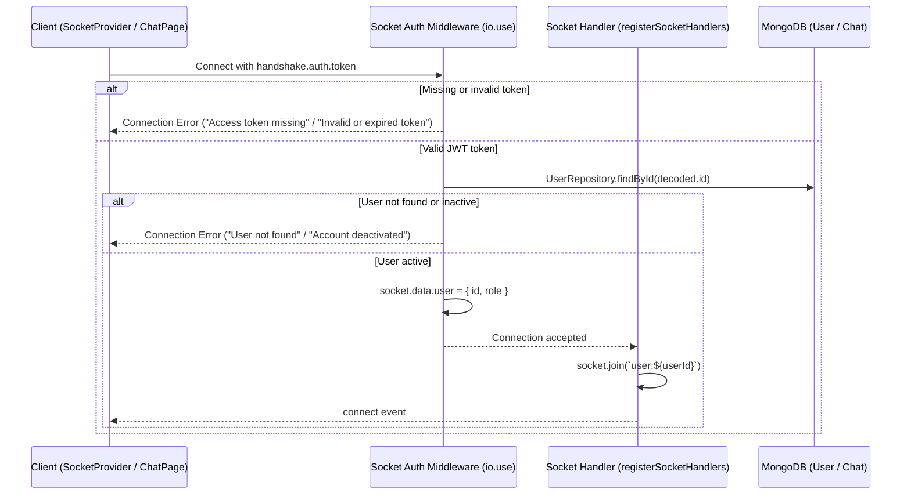

# Freelancr Real-Time & Socket.IO Baseline

> **Generated:** Baseline Capture for PRD 01  
> **Library:** Socket.IO v4 (Server: `socket.io@4.8.3`, Client: `socket.io-client@4.8.4`)  
> **Source files:**  
> - Server: `server/src/socket/event.ts`, `server/src/socket/socket.ts`, `server/src/services/socket.service.ts`, `server/src/config/socket.ts`  
> - Client: `client/src/lib/socket.ts`, `client/src/components/common/SocketProvider.tsx`, `client/src/pages/ChatPage.tsx`

---

## 1. Connection Architecture & Authentication Lifecycle



### Handshake Invariants:
1. Client initializes with `{ autoConnect: false, withCredentials: true }`.
2. Auth token is provided in `socket.auth = { token }`.
3. Server validates access token with `verifyAccessToken(token)`.
4. User record is queried to ensure `isActive === true`. Deactivated users are blocked from connecting.
5. On successful handshake, the socket automatically joins its own private room `user:${userId}`.

---

## 2. Event Registry & Constants

Defined in `server/src/socket/event.ts`:

| Event Constant | Event String Value | Direction | Server Handler Registered? | Client Usage | Description |
|---|---|---|---|---|---|
| `CONNECTION` | `"connection"` | Bi-directional | Yes (`io.on`) | Standard | Socket lifecycle connection |
| `DISCONNECT` | `"disconnect"` | Bi-directional | Yes (`socket.on`) | Standard | Socket disconnection |
| `JOIN_USER` | `"join_user"` | Client -> Server | Yes (`socket.on`) | Optional | Re-confirms membership in `user:${userId}` |
| `JOIN_CHAT` | `"join_chat"` | Client -> Server | Yes (`socket.on`) | Chat page | Joins peer chat room `chat:${otherUserId}` |
| `SEND_MESSAGE` | `"send_message"` | Client -> Server | Yes (`socket.on`) | `ChatPage.tsx` | Emits outbound message to recipient |
| `NEW_MESSAGE` | `"new_message"` | Server -> Client | Emitted via `io.to` | `ChatPage.tsx` | Pushes incoming message to sender & recipient rooms |
| `MESSAGE_READ` | `"message_read"` | Client -> Server | Defined in constants | None (Gap) | Reserved for single message read receipt |
| `MESSAGES_READ` | `"messages_read"`| Client -> Server | Defined in constants | None (Gap) | Reserved for batch messages read receipt |
| `MESSAGE_DELETED`| `"message_deleted"`| Server -> Client | Defined in constants | None (Gap) | Reserved for message deletion sync |

---

## 3. Payload Contracts & Validation

### 3.1. `send_message` (Client -> Server)
- **Payload Schema:**
  ```typescript
  {
    receiver: string;      // Valid Mongo ObjectId
    message: string;       // Non-empty string, max length 2000
    attachments?: string[]; // Array of URL strings, max 10 items
  }
  ```
- **Validation & Business Invariants:**
  - Sender must be authenticated (`socket.data.user?.id` exists).
  - `receiver` must be a valid ObjectId string.
  - `receiver !== sender` (messaging self is rejected with `"You cannot message yourself"`).
  - Message trimmed length between 1 and 2000 characters.
  - `attachments` must be an array of strings, max length 10.
  - Creates chat document via `ChatService.sendMessage()`.
  - Dispatches `new_message` to both `user:${receiverId}` and `user:${senderId}`.

### 3.2. `new_message` (Server -> Client)
- **Dispatched to:** `user:${receiverId}` and `user:${senderId}`
- **Payload Shape:**
  ```typescript
  {
    _id: string;
    sender: { _id: string; fullName: string; avatar?: string };
    receiver: { _id: string; fullName: string; avatar?: string };
    message: string;
    attachments: string[];
    isRead: boolean;
    createdAt: string;
    updatedAt: string;
  }
  ```

---

## 4. Known Discrepancies & Safety Considerations

1. **Room Scoping:** In `socket.ts`, `JOIN_CHAT` joins room `chat:${otherUserId}` rather than a deterministic pair room (e.g., `chat:${min(u1,u2)}_${max(u1,u2)}`). However, `SEND_MESSAGE` dispatches to user rooms `user:${receiverId}` and `user:${senderId}`, which avoids leaks to unintended peers in `chat:${otherUserId}`.
2. **Read Receipts:** Events `MESSAGE_READ`, `MESSAGES_READ`, and `MESSAGE_DELETED` are declared in `server/src/socket/event.ts` but lack registered server listeners in `server/src/socket/socket.ts`. HTTP fallback endpoints handle reads and deletes currently.
