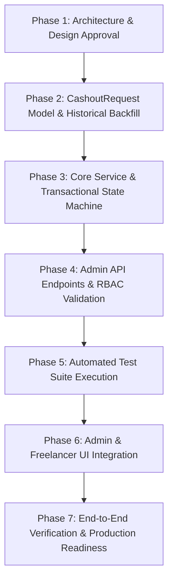

# PRD 23 — Cashout Lifecycle and Admin Settlement Management Implementation Plan

**Document Version**: 1.0.0  
**Status**: DRAFT / SPECIFICATION ONLY (Phase 1)  
**Author**: Antigravity Autonomous Security & Financial Systems Architect  
**Preceding Audit Reference**: `docs/reports/PRD22_CASHOUT_LIFECYCLE_AND_SETTLEMENT_READINESS_AUDIT.md`  
**Related Prior PRDs**: PRD 07 (Payments & Payouts), PRD 17 (Trustless Funding), PRD 21 (Platform Finance & Wallet)  
**Authority Rules**: `.agents/rules/AGENT_OPERATING_RULES.md`, `.agents/rules/ARCHITECTURE_GUARDRAILS.md`  

---

## 1. Executive Overview & Problem Statement

### 1.1. Context
In PRD 21 and PRD 22, Freelancr introduced in-app freelancer wallets and aggregate cashout reservations:
- Contract earnings are safely approved and credited to the in-app wallet via atomic ledger transactions (`wallet_credited`).
- Freelancers can request a cashout, which atomically moves funds from `availableBalanceMinor` to `reservedCashoutMinor` and creates a `cashout_requested` ledger entry.

### 1.2. The Gap Identified in PRD 22
As established by the authoritative audit in PRD 22:
1. **No Persistent Entity**: Cashout requests currently exist only as an accumulator on `wallets` and historical rows in `financialledgers`. There is no dedicated document tracking individual cashout request lifecycles.
2. **Zero Settlement Mechanism**: No service method, route, controller, or admin UI exists to disburse, complete, reject, or reverse reserved cashout funds.
3. **Indefinite Lockup**: As a result, all requested cashouts remain permanently trapped in `reservedCashoutMinor`.
4. **Historical Position**: Freelancer `mohit sharma` (`6ad3a3105e6305b53ba98cb5`) currently has ₹3,000.00 (300,000 paise) across two historical reservations locked in `reservedCashoutMinor` with zero confirmed bank disbursements.

### 1.3. PRD 23 Objective
To design a secure, auditable, and production-ready **Cashout Lifecycle & Admin Settlement Management** module that:
1. Introduces a persistent `CashoutRequest` entity with a formal state machine.
2. Safely reconciles and backfills existing historical reservations without duplicate entries, fabricated bank details, or balance drift.
3. Provides an administrative review, approval, settlement, rejection, and reconciliation console.
4. Enforces strict evidence requirements (UTR / IMPS bank reference) before any reservation can be marked settled.
5. Implements a safe reversal mechanism (`cashout_reversed`) that restores funds to `availableBalanceMinor` upon administrative rejection or verified transfer failure.
6. Keeps automated external provider transfers (Razorpay Route) disabled until verified operational readiness, providing a provider-agnostic manual settlement workflow first.

---

## 2. Architecture & Layering Design

Following `.agents/rules/ARCHITECTURE_GUARDRAILS.md`, the cashout lifecycle maintains strict separation of concerns:

```
[ Freelancer Client / Admin Client ]
               │
               ▼
   [ Central Axios Instance ]
               │ (HTTP / JSON + JWT)
               ▼
    [ Express Route Layer ]
      - /api/v1/payments/wallet/cashout (POST - Request cashout)
      - /api/v1/payments/wallet/cashouts/my (GET - Freelancer history)
      - /api/v1/payments/admin/cashouts (GET - Admin queue)
      - /api/v1/payments/admin/cashouts/:id/settle (POST - Admin settle with UTR)
      - /api/v1/payments/admin/cashouts/:id/reject (POST - Admin reject & refund)
               │
               ▼
 [ Middleware & Validation Layer ]
      - authenticate (JWT extraction)
      - authorize("freelancer" | "admin")
      - financialRateLimiter
      - Express-validator (amount, UTR format, rejection reason)
               │
               ▼
    [ Controller Layer ]
      - PaymentController (HTTP mapping, param parsing, status serialization)
               │
               ▼
      [ Service Layer ]
      - CashoutService / WalletService (ACID transactions, state machines, balance invariants)
      - AuditService (privileged mutation logging)
      - NotificationService (user alerting)
               │
               ▼
    [ Repository Layer ]
      - CashoutRequestRepository (queries, atomic status transitions)
      - WalletRepository / PayoutRepository
               │
               ▼
      [ Model Layer ]
      - CashoutRequest.model.ts (new persistent schema)
      - Wallet.model.ts (integer paise accumulators)
      - FinancialLedger.model.ts (immutable append-only financial journal)
```

---

## 3. Data Model & Entity Design

### 3.1. New Entity: `CashoutRequest` (`server/src/modules/payments/cashoutRequest.model.ts`)

```typescript
export type CashoutStatus =
  | "pending_review"    // Created by freelancer; awaiting admin inspection
  | "processing"        // Claimed by admin or locked during external transfer execution
  | "completed"         // Confirmed disbursed to external bank account with valid UTR/provider ref
  | "rejected"          // Rejected by admin; funds atomically restored to available balance
  | "failed"            // External provider permanently failed; funds restored
  | "held";             // Suspended due to fraud review, compliance flag, or dispute

export type CashoutDisbursementMethod =
  | "manual_bank_transfer"  // Admin executes external IMPS/NEFT and provides UTR proof
  | "razorpay_route";       // Deactivated in Phase 1; reserved for future provider readiness

export interface ICashoutRequest extends Document {
  user: Types.ObjectId;                  // Freelancer User ID
  wallet: Types.ObjectId;                // Wallet Document ID
  amountMinor: number;                   // Integer paise (e.g., 100000 = ₹1,000.00)
  currency: string;                      // "INR"
  status: CashoutStatus;                 // Lifecycle state
  referenceId: string;                   // Unique business reference (e.g. "cashout_<userId>_<ts>")
  disbursementMethod: CashoutDisbursementMethod;
  
  // Beneficiary details captured at request time
  beneficiarySnapshot: {
    accountHolderName: string;
    accountNumberMasked: string;         // e.g., "••••••••4821"
    accountNumberEncrypted?: string;     // For admin transfer verification
    ifscCode: string;                    // 11-character Indian Financial System Code
    bankName?: string;
  };

  // Settlement evidence (mandatory for 'completed')
  settlementEvidence?: {
    utrNumber?: string;                  // Unique Transaction Reference (IMPS/NEFT/RTGS)
    providerTransferId?: string;         // External provider transfer ID if automated
    settledAt: Date;
    settledByAdminId: Types.ObjectId;
    notes?: string;
  };

  // Rejection / Failure diagnostics
  rejectionReason?: string;
  rejectedByAdminId?: Types.ObjectId;
  rejectedAt?: Date;

  // Audit and Timestamps
  claimedAt?: Date;
  claimedByAdminId?: Types.ObjectId;
  createdAt: Date;
  updatedAt: Date;
}
```

### 3.2. Indexes on `cashoutrequests`
1. `{ referenceId: 1 }` (Unique, sparse) — Guarantees global business idempotency.
2. `{ user: 1, createdAt: -1 }` — Enables fast paginated queries for freelancer wallet history.
3. `{ status: 1, createdAt: 1 }` — Enables fast admin queue processing (FIFO review).
4. `{ "settlementEvidence.utrNumber": 1 }` (Unique, partial filter expression `{ "settlementEvidence.utrNumber": { $exists: true, $type: "string" } }`) — Prevents reusing the same bank UTR across multiple cashout settlements.

### 3.3. Freelancer User Beneficiary Extension (`server/src/modules/users/user.types.ts`)
To allow freelancers to request cashouts without re-typing bank details every time, the `User` schema will be extended with:
```typescript
payoutBankDetails?: {
  accountHolderName: string;
  accountNumber: string;       // Encrypted at rest
  accountNumberMasked: string; // e.g. "••••••••1234"
  ifscCode: string;
  bankName: string;
  isVerified: boolean;
};
```

---

## 4. State-Transition Matrix & Permitted Transitions

| Initial State | Target State | Triggering Actor | Preconditions & Requirements | Side-Effects & Financial Invariants |
| :--- | :--- | :--- | :--- | :--- |
| *(None)* | `pending_review` | Freelancer | `amountMinor > 0`, `wallet.availableBalanceMinor >= amountMinor`, valid bank details. | Atomically: `availableBalanceMinor -= amountMinor`, `reservedCashoutMinor += amountMinor`, insert `cashout_requested` ledger entry. |
| `pending_review` | `processing` | Admin | Privileged admin claims request for review. | Sets `claimedAt`, `claimedByAdminId`. Prevents concurrent admin collisions. No balance mutation. |
| `processing` / `pending_review` | `completed` | Admin | Valid UTR provided (format: alphanumeric 12-22 chars), not previously used. | Atomically: `reservedCashoutMinor -= amountMinor`, `totalWithdrawnMinor += amountMinor`, insert `cashout_paid` ledger entry, emit audit & notification. |
| `processing` / `pending_review` | `rejected` | Admin | Non-empty `rejectionReason` provided. | Atomically: `reservedCashoutMinor -= amountMinor`, `availableBalanceMinor += amountMinor`, insert `cashout_reversed` ledger entry, emit audit & notification. |
| `processing` | `held` | Admin / System | Compliance alert or suspicious activity detected. | Request suspended; funds remain in `reservedCashoutMinor`. No balance mutations. |
| `held` | `pending_review` | Admin | Compliance review resolved favorably. | Resets status to `pending_review`. Funds remain in `reservedCashoutMinor`. |
| `completed` | *(Terminal)* | None | Terminal state. | **Immutable**. Cannot be modified, deleted, refunded, or re-settled. |
| `rejected` | *(Terminal)* | None | Terminal state. | **Immutable**. Funds are already returned to `availableBalanceMinor`. |

---

## 5. Mandatory Historical State Reconciliation Strategy

### 5.1. The Current State
From PRD 22 audit findings:
- Freelancer: `mohit sharma` (`6ad3a3105e6305b53ba98cb5`)
- Wallet: `6ad3c77c4642f03865b3891e`
- Cumulative `reservedCashoutMinor`: **300,000** (₹3,000.00)
- Historical Ledger Entries:
  1. `6ad3cb3a7fd986e2fd5bda32`: ₹1,000, `referenceId: cashout_6ad3a3105e6305b53ba98cb5_1792265018323` (2026-10-17T19:23:38Z)
  2. `6ad3d0a64c31b2bd2389d35b`: ₹2,000, `referenceId: cashout_6ad3a3105e6305b53ba98cb5_1792266406200` (2026-10-17T19:46:46Z)

### 5.2. Missing Historical Information
Because PRD 21 did not collect bank details at reservation time:
- The existing two cashouts have **NO bank account number, IFSC code, or beneficiary name**.
- We **MUST NOT** fabricate fake bank details or invent external transfer references.

### 5.3. Safe Backfill / Migration Plan
We will design a standalone, idempotent reconciliation script:
1. **Query Ledger Events**: Find all `financialledgers` records with `eventType: "cashout_requested"` where no matching `CashoutRequest` document exists with that `referenceId`.
2. **Synthesize Backfill Document**:
   - `user`: `ledger.user`
   - `wallet`: `ledger.wallet`
   - `amountMinor`: `ledger.amountMinor`
   - `currency`: `ledger.currency || "INR"`
   - `referenceId`: `ledger.referenceId`
   - `status`: `"pending_review"`
   - `disbursementMethod`: `"manual_bank_transfer"`
   - `beneficiarySnapshot`:
     - `accountHolderName`: `"Historical Request (Awaiting Bank Info)"`
     - `accountNumberMasked`: `"UNSPECIFIED"`
     - `ifscCode`: `"UNSPECIFIED"`
   - `rejectionReason`: `undefined`
   - `createdAt`: `ledger.createdAt`
3. **Zero Balance Drift**:
   - The migration does **NOT** touch `wallets.availableBalanceMinor`, `wallets.reservedCashoutMinor`, or create new `financialledgers` rows.
   - It merely materializes the two historical ledger events into persistent `CashoutRequest` documents so administrators can see them in the queue.
4. **Resolution Path for Historical Requests**:
   - In the admin UI, these two items will be flagged: `Historical Reservation — Bank Details Missing`.
   - The administrator will have two safe choices:
     - **Option A (Reject & Return)**: Admin clicks "Reject & Return to Balance" with reason *"Historical cashout requires bank detail submission"*. This safely returns the ₹1,000 and ₹2,000 back to `availableBalanceMinor`, allowing the freelancer to re-request with their bank details.
     - **Option B (Manual Settle)**: If offline communication provides a verified bank UTR, the admin enters the UTR to complete the settlement.

---

## 6. API Endpoint Specification

### 6.1. Freelancer Endpoints

#### 1. `POST /api/v1/payments/wallet/cashout`
- **Auth**: `authenticate`, `authorize("freelancer")`, `financialRateLimiter`
- **Body Validation**:
  - `amount`: number > 0, max 2 decimal places.
  - `accountHolderName`: string, min 2, max 100 chars.
  - `accountNumber`: string, 9-18 digits.
  - `ifscCode`: string, 11 chars, regex `^[A-Z]{4}0[A-Z0-9]{6}$`.
  - `bankName`: optional string.
- **Behavior**:
  - Opens MongoDB session.
  - Verifies available balance.
  - Generates `referenceId: "cashout_<userId>_<Date.now()>"`.
  - Deducts `availableBalanceMinor`, increments `reservedCashoutMinor`.
  - Inserts `financialledgers` (`eventType: "cashout_requested"`).
  - Inserts `CashoutRequest` (`status: "pending_review"`).
  - Emits audit log & notification.
  - Commits transaction.
- **Response**: `201 Created` with cashout details.

#### 2. `GET /api/v1/payments/wallet/cashouts/my`
- **Auth**: `authenticate`, `authorize("freelancer")`
- **Query Params**: `page=1&limit=20&status=pending_review,completed`
- **Response**: `200 OK` with paginated list of the freelancer's own cashout requests.

---

### 6.2. Administrator Endpoints

#### 1. `GET /api/v1/payments/admin/cashouts`
- **Auth**: `authenticate`, `authorize("admin")`
- **Query Params**: `page=1&limit=50&status=pending_review&search=<userId|ref>`
- **Response**: `200 OK` with list of cashouts, enriched with freelancer user metadata and wallet status.

#### 2. `POST /api/v1/payments/admin/cashouts/:id/settle`
- **Auth**: `authenticate`, `authorize("admin")`, `financialRateLimiter`
- **Body Validation**:
  - `utrNumber`: string, 12-22 alphanumeric characters (e.g. `UTR123456789012`).
  - `notes`: optional string.
- **Behavior**:
  - Verifies cashout exists and `status === "pending_review" || status === "processing"`.
  - Verifies `utrNumber` has not been used in any existing `CashoutRequest` or `financialledgers`.
  - Opens MongoDB session.
  - Transitions `CashoutRequest` to `"completed"`, records `settlementEvidence`.
  - Mutates wallet: `wallet.reservedCashoutMinor -= amountMinor`, `wallet.totalWithdrawnMinor += amountMinor`.
  - Inserts `financialledgers` (`eventType: "cashout_paid"`, `referenceId: "settle_<cashout.referenceId>"`).
  - Emits audit log `CASHOUT_SETTLED` with admin ID and UTR.
  - Emits notification to freelancer: *"Your cashout of ₹X has been disbursed via bank transfer (UTR: Y)."*
  - Commits transaction.
- **Response**: `200 OK`.

#### 3. `POST /api/v1/payments/admin/cashouts/:id/reject`
- **Auth**: `authenticate`, `authorize("admin")`, `financialRateLimiter`
- **Body Validation**:
  - `reason`: string, min 5, max 500 chars (mandatory explanation).
- **Behavior**:
  - Verifies cashout exists and `status === "pending_review" || status === "processing" || status === "held"`.
  - Opens MongoDB session.
  - Transitions `CashoutRequest` to `"rejected"`, records `rejectionReason`.
  - Mutates wallet: `wallet.reservedCashoutMinor -= amountMinor`, `wallet.availableBalanceMinor += amountMinor`.
  - Inserts `financialledgers` (`eventType: "cashout_reversed"`, `referenceId: "reject_<cashout.referenceId>"`).
  - Emits audit log `CASHOUT_REJECTED` with admin ID and reason.
  - Emits notification to freelancer: *"Your cashout request was rejected and funds were returned to your wallet. Reason: X."*
  - Commits transaction.
- **Response**: `200 OK`.

---

## 7. Frontend UI / UX Architecture

### 7.1. Freelancer Wallet Page (`client/src/pages/FreelancerWalletPage.tsx`)
1. **Cashout Modal / Form Upgrade**:
   - Collects/confirms Account Holder Name, Bank Account Number, and IFSC code.
   - Shows IFSC validation preview (bank name lookahead).
   - Explains that transfers are reviewed and processed by platform admins.
2. **Cashout Requests Tab**:
   - Adds a dedicated sub-view or table: **Cashout Requests**.
   - Displays: Date, Amount, Status Badge (`Under Review`, `Disbursed`, `Rejected`), Bank Details (masked), UTR reference (when completed), and Rejection Reason (when rejected).

### 7.2. Admin Cashout Queue (`client/src/pages/AdminCashoutsPage.tsx` or new Tab in Admin Payouts)
1. **Information Architecture**:
   - Placed under Admin Finance Navigation (`/admin/finance/cashouts` or `/admin/cashouts`).
   - Tabs: `Pending Review` (primary queue with badge count), `Completed`, `Rejected`, `All`.
2. **Table Display**:
   - Freelancer Name & Email.
   - Requested Amount (formatted in ₹ INR).
   - Destination Bank Account & IFSC.
   - Request Timestamp & Reference ID.
   - Status Badge.
3. **Action Controls**:
   - **Confirm Settlement Button**: Opens modal requiring entry of Bank UTR / IMPS Reference Number + optional settlement notes.
   - **Reject Request Button**: Opens modal requiring mandatory rejection reason.
   - Both actions include clear confirmation warnings emphasizing that financial ledger transitions are permanent.

---

## 8. Verification & Test Strategy Matrix

| Test Suite / Category | File Target | Test Scenarios & Invariant Verification |
| :--- | :--- | :--- |
| **Cashout Request Creation** | `server/test/prd23-cashout-lifecycle.test.ts` | 1. Successfully reserves funds, creates `CashoutRequest` (`pending_review`), decrements available balance, increments reserved cashout, writes `cashout_requested` ledger.<br>2. Rejects request exceeding available balance (HTTP 400).<br>3. Rejects invalid IFSC or bank account formatting.<br>4. Rejects negative or fractional zero amount. |
| **Admin Settlement (Happy Path)** | `server/test/prd23-cashout-lifecycle.test.ts` | 1. Admin settles with valid UTR: transitions status to `completed`, decrements reserved cashout, increments total withdrawn, writes `cashout_paid` ledger.<br>2. Verifies available balance is untouched during settlement.<br>3. Emits `CASHOUT_SETTLED` audit log. |
| **Admin Rejection & Fund Reversal** | `server/test/prd23-cashout-lifecycle.test.ts` | 1. Admin rejects with reason: transitions status to `rejected`, decrements reserved cashout, increments available balance, writes `cashout_reversed` ledger.<br>2. Verifies total withdrawn is untouched during rejection.<br>3. Emits `CASHOUT_REJECTED` audit log. |
| **Idempotency & Race Conditions** | `server/test/prd23-cashout-lifecycle.test.ts` | 1. Re-settling an already completed cashout throws HTTP 409.<br>2. Re-rejecting an already rejected cashout throws HTTP 409.<br>3. Reusing an existing UTR throws HTTP 409.<br>4. Concurrent settlement and rejection attempts fail atomically via MongoDB session locking. |
| **Historical Backfill Test** | `server/test/prd23-cashout-lifecycle.test.ts` | 1. Runs reconciliation on historical records `cashout_...18323` and `cashout_...06200`: verifies two `CashoutRequest` docs are generated with zero balance drift. |
| **Regression Suites** | All 24 existing server test suites | Full test run (`npm test`) must maintain **100% pass rate** across PRD 07, PRD 14, PRD 17, and PRD 21. |

---

## 9. Rollout Phases & Execution Sequence



### Phase Details:
- **Phase 2 (Entity & Backfill)**:
  - Create `server/src/modules/payments/cashoutRequest.model.ts`.
  - Create idempotent migration script `server/src/scripts/reconcileHistoricalCashouts.ts`.
- **Phase 3 (Service Layer)**:
  - Update `WalletService.requestCashout` to write both `CashoutRequest` and `FinancialLedger`.
  - Add `CashoutService.settleCashout` and `CashoutService.rejectCashout`.
- **Phase 4 (Routes & RBAC)**:
  - Add routes and validation in `payment.routes.ts`, `payment.controller.ts`, and `payment.validation.ts`.
- **Phase 5 (Testing)**:
  - Write and pass `server/test/prd23-cashout-lifecycle.test.ts`. Run full `npm test`.
- **Phase 6 (UI Components)**:
  - Create Admin Cashout Queue page and enhance Freelancer Wallet view.
- **Phase 7 (Audit & Verification)**:
  - Verify zero balance drift and author full completion report.

---

## 10. Rollback & Contingency Plan

1. **Reversibility of Schema**:
   - `CashoutRequest` is an additive collection. If rolled back, no existing collections (`wallets`, `financialledgers`, `payouts`) are corrupted.
2. **Reversibility of Backfill**:
   - The backfill script only inserts new documents into `cashoutrequests`. If necessary, dropping or clearing `cashoutrequests` returns the database to its exact pre-PRD 23 state without balance drift.
3. **Financial Safety Guarantee**:
   - Because Phase 1 relies on manual UTR settlement and does not trigger real banking rails or API calls to Razorpay, there is zero risk of unrecoverable bank transfers or accidental double payouts.

---

## 11. Acceptance Criteria

- [ ] `CashoutRequest` entity is implemented with strict schema, types, and compound indexes.
- [ ] Historical reservations for `mohit sharma` (₹1,000 and ₹2,000) are cleanly materialized as `pending_review` documents with zero wallet balance drift.
- [ ] Freelancers can submit cashout requests with validated bank details, atomically encumbering available balance into reserved cashout.
- [ ] Admins can view pending cashouts in an administrative queue.
- [ ] Admins can settle a cashout only by providing an authoritative, unique UTR number, moving reserved funds to total withdrawn.
- [ ] Admins can reject a cashout with a mandatory reason, safely restoring reserved funds to the freelancer's available balance.
- [ ] Every transition produces an immutable `FinancialLedger` entry and an `AuditLog` entry.
- [ ] All amounts remain strictly in integer paise.
- [ ] Automated Razorpay Route transfers remain disabled until operational account readiness is proven.
- [ ] 100% of existing tests pass with zero regressions.

---

## 12. Read-Only Confirmation

**Confirmation**: *This plan is strictly a design document. No application code files, configuration files, test scripts, or database documents were modified or created during Phase 1.*
