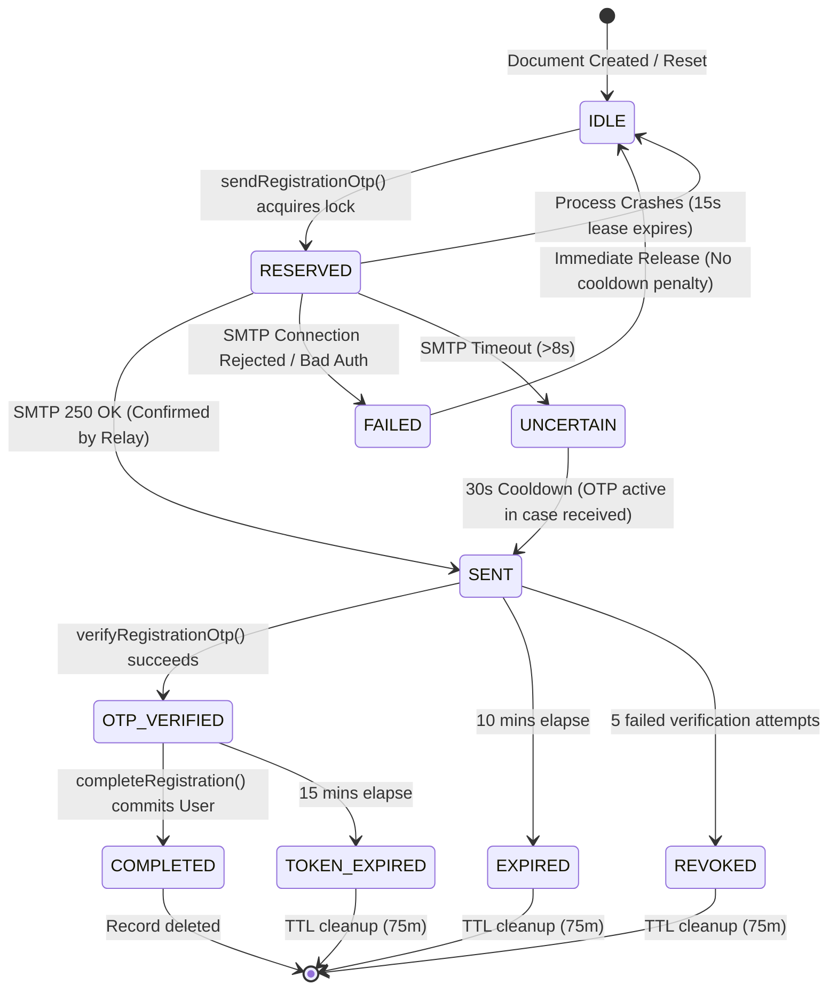

# PHASE 0C: Final Authentication Design Closure & Failure-Recovery Specification

**Status:** Final Pre-Implementation Specification  
**Mode:** Strict Read-Only Audit (Architecture & Failure-Recovery Closure)  
**Target Subsystems:** OTP Reservation & Dispatch Protocol, Atomic Token Consumption, HMAC Key Lifecycle, Real-Code Matching Verification, Owner Decisions  

---

## 1. Concurrency-Safe Resend & Dispatch Protocol

### 1.1 The Race Condition & Core Challenges
In a production system with multiple API instances and mobile/web retries:
1. Two simultaneous requests from the same user (e.g. double-click on "Resend OTP") must not both generate distinct codes and send multiple emails.
2. An attempt must not create duplicate MongoDB documents for the same `{ email, verificationType }`.
3. If an email dispatch fails due to an external SMTP network timeout or socket reset, the system must not lock the user into an unrecoverable 60-second cooldown without an OTP in their inbox, nor should it allow indefinite immediate spamming.
4. If a Node.js process crashes after reserving a dispatch but before contacting the email server, the reservation must self-heal cleanly without leaving the user permanently blocked.

### 1.2 Reservation Token & Dispatch State Design
To resolve this without extra queue infrastructure (like RabbitMQ or Redis), we implement a **Durable Reservation Pattern** directly on the `EmailVerification` collection.

#### Schema Fields for Dispatch Control:
```typescript
interface IEmailVerification {
  email: string;                          // Normalized lowercase trimmed
  verificationType: "registration";       // Primary scope
  
  // Dispatch State Machine
  dispatchStatus: "idle" | "reserved" | "sent" | "failed" | "uncertain";
  reservationId: string | null;           // UUIDv4 generated per dispatch attempt
  reservedAt: Date | null;                // When reservation was acquired
  reservationExpiresAt: Date | null;       // Short lease: reservedAt + 15 seconds (auto-recovers on crash)
  
  // Rate-Limiting & Cooldown Tracking
  resendAvailableAt: Date;                // Enforces the 60s cooldown (only committed after successful dispatch)
  hourlyWindowStart: Date;                // Window start for 1-hour quota
  dispatchCountHourly: number;            // Capped at 3 per hour
  
  // OTP Credentials & Verification State
  otpHash: string;                        // Domain-separated HMAC-SHA256 hex string
  otpExpiresAt: Date;                     // Exactly now + 10 minutes
  attemptsRemaining: number;              // Initial 5
  otpConsumedAt: Date | null;             // Timestamp of winning verification
  
  // Registration Token Handshake
  registrationTokenHash: string | null;   // Domain-separated HMAC-SHA256 hex string
  registrationTokenExpiresAt: Date | null;// now + 15 minutes
  registrationReservationId: string | null; // UUIDv4 reservation for completion
  tokenConsumedAt: Date | null;           // When account creation completes
  
  documentExpiresAt: Date;                // TTL index: now + 75 minutes
  createdAt: Date;
  updatedAt: Date;
}
```

### 1.3 Exact Atomic Database Operations for Dispatch

#### Step 1: Atomic Reservation Acquisition (`send-registration-otp`)
A dispatch request must atomically acquire the reservation lease before sending any email.

```typescript
const now = new Date();
const leaseDurationMs = 15 * 1000; // 15-second reservation lease
const leaseExpires = new Date(now.getTime() + leaseDurationMs);
const reservationId = crypto.randomUUID();

// 1. Check existing record
const existing = await EmailVerification.findOne({ email: normalizedEmail, verificationType: "registration" });

if (existing) {
  // A. Check Hourly Limit (Max 3 per hour)
  const isWithinWindow = existing.hourlyWindowStart && (now.getTime() - existing.hourlyWindowStart.getTime() < 3600000);
  if (isWithinWindow && existing.dispatchCountHourly >= 3) {
    const resetInMinutes = Math.ceil((3600000 - (now.getTime() - existing.hourlyWindowStart.getTime())) / 60000);
    throw new ApiError(HTTP_STATUS.TOO_MANY_REQUESTS, `Maximum 3 verification codes per hour reached. Please try again in ${resetInMinutes} minute(s).`);
  }

  // B. Check Cooldown (60 seconds)
  // Note: Cooldown is only enforced if the reservation has not expired
  if (existing.resendAvailableAt && existing.resendAvailableAt > now) {
    const secondsLeft = Math.ceil((existing.resendAvailableAt.getTime() - now.getTime()) / 1000);
    throw new ApiError(HTTP_STATUS.TOO_MANY_REQUESTS, `Please wait ${secondsLeft} second(s) before requesting another code.`);
  }
}

// 2. Generate candidate OTP and HMAC in memory (NOT yet visible as valid OTP)
const candidateOtp = crypto.randomInt(100000, 1000000).toString();
const candidateHash = computeOtpHmac(normalizedEmail, candidateOtp);

// 3. Atomically acquire the reservation lock
// Condition: Must either have no active reservation OR existing reservation has expired (crashed process recovery)
const updateFilter = {
  email: normalizedEmail,
  verificationType: "registration",
  $or: [
    { dispatchStatus: { $in: ["idle", "sent", "failed", "uncertain"] } },
    { reservationExpiresAt: { $lte: now } }, // Crashed process auto-recovery
    { reservationExpiresAt: null }
  ]
};

const reservationUpdate = {
  $set: {
    dispatchStatus: "reserved",
    reservationId,
    reservedAt: now,
    reservationExpiresAt: leaseExpires,
    // Stage the pending hash, but do not clear old OTP until email succeeds
    pendingOtpHash: candidateHash,
  },
  $setOnInsert: {
    email: normalizedEmail,
    verificationType: "registration",
    hourlyWindowStart: now,
    dispatchCountHourly: 0,
    attemptsRemaining: 5,
    documentExpiresAt: new Date(now.getTime() + 75 * 60 * 1000)
  }
};

const reservedDoc = await EmailVerification.findOneAndUpdate(
  updateFilter,
  reservationUpdate,
  { upsert: true, new: true }
);

if (!reservedDoc || reservedDoc.reservationId !== reservationId) {
  // Another concurrent request acquired the lock first
  throw new ApiError(HTTP_STATUS.TOO_MANY_REQUESTS, "A verification request is already in progress. Please check your email or wait a moment.");
}
```

#### Step 2: Email Delivery Attempt
With the lease secured, execute external SMTP delivery:
```typescript
let sendSuccess = false;
let deliveryUncertain = false;

try {
  // Execute Nodemailer delivery with strict 8-second timeout
  await Promise.race([
    EmailService.sendRegistrationOtpEmail(normalizedEmail, candidateOtp),
    new Promise((_, reject) => setTimeout(() => reject(new Error("SMTP_TIMEOUT")), 8000))
  ]);
  sendSuccess = true;
} catch (err: any) {
  if (err?.message === "SMTP_TIMEOUT") {
    deliveryUncertain = true; // Email might still be delivered by relay
  } else {
    sendSuccess = false; // Definite rejection (e.g. invalid recipient, SMTP auth error)
  }
}
```

#### Step 3: Atomic Commitment or Failure Release

**Case A: Confirmed SMTP Handshake Success:**
```typescript
if (sendSuccess) {
  const newHourlyCount = (reservedDoc.hourlyWindowStart && (now.getTime() - reservedDoc.hourlyWindowStart.getTime() < 3600000))
    ? reservedDoc.dispatchCountHourly + 1
    : 1;
  const newHourlyStart = (reservedDoc.hourlyWindowStart && (now.getTime() - reservedDoc.hourlyWindowStart.getTime() < 3600000))
    ? reservedDoc.hourlyWindowStart
    : now;

  await EmailVerification.updateOne(
    { _id: reservedDoc._id, reservationId }, // Guard against stale updates
    {
      $set: {
        dispatchStatus: "sent",
        otpHash: reservedDoc.pendingOtpHash, // Commit new OTP
        pendingOtpHash: null,
        otpExpiresAt: new Date(now.getTime() + 10 * 60 * 1000), // 10 mins
        attemptsRemaining: 5,
        resendAvailableAt: new Date(now.getTime() + 60 * 1000), // 60s cooldown committed
        dispatchCountHourly: newHourlyCount,
        hourlyWindowStart: newHourlyStart,
        reservationId: null,
        reservationExpiresAt: null
      }
    }
  );
  return { success: true, message: "Verification code sent." };
}
```

**Case B: Definite Failure (SMTP Rejected):**
```typescript
if (!sendSuccess && !deliveryUncertain) {
  // Immediate release: Do NOT lock 60s cooldown; allow immediate retry
  await EmailVerification.updateOne(
    { _id: reservedDoc._id, reservationId },
    {
      $set: {
        dispatchStatus: "failed",
        pendingOtpHash: null,
        reservationId: null,
        reservationExpiresAt: null
        // resendAvailableAt NOT modified, hourly count NOT incremented
      }
    }
  );
  throw new ApiError(HTTP_STATUS.SERVICE_UNAVAILABLE, "Unable to send verification email. Please verify your address and try again.");
}
```

**Case C: Delivery Uncertain (SMTP Timeout):**
```typescript
if (deliveryUncertain) {
  // Do NOT invalidate candidate OTP because it might actually arrive in user's inbox!
  // Commit the OTP so if it arrives, user can verify it, but set cooldown to 30s instead of 60s
  await EmailVerification.updateOne(
    { _id: reservedDoc._id, reservationId },
    {
      $set: {
        dispatchStatus: "uncertain",
        otpHash: reservedDoc.pendingOtpHash,
        pendingOtpHash: null,
        otpExpiresAt: new Date(now.getTime() + 10 * 60 * 1000),
        attemptsRemaining: 5,
        resendAvailableAt: new Date(now.getTime() + 30 * 1000), // Reduced 30s cooldown
        reservationId: null,
        reservationExpiresAt: null
      }
    }
  );
  return { 
    success: true, 
    message: "Verification email dispatched. Delivery may be slightly delayed; please check your inbox shortly." 
  };
}
```

---

## 2. Complete Registration-Token Consumption & Account Creation

### 2.1 The Race Condition & Failure Scenarios
1. **Double Submission:** A user submits the registration form twice in rapid succession. Both requests present the exact same `registrationToken`.
2. **Crash / Collision After Deletion:** If `EmailVerification` is deleted *before* `User.create()`, and `User.create()` fails due to an unexpected MongoDB constraint (e.g. `username` collision), the registration token is lost forever and the user is blocked.
3. **Ghost Accounts:** If `User.create()` succeeds but the server crashes before returning tokens, the user cannot re-run completion because the token was already consumed.

### 2.2 Replica-Set Environment: Single Atomic Transaction Boundary
In staging and production, Freelancr connects to a MongoDB Replica Set (or Atlas cluster) using the existing [`runInTransaction()`](file:///C:/Users/hp/OneDrive/Desktop/Freelancr/server/src/database/transaction.ts) helper.

#### Exact Transactional Implementation:
```typescript
export async function completeRegistrationWithTransaction(dto: CompleteRegistrationDto) {
  const normalizedEmail = dto.email.toLowerCase().trim();
  const tokenHash = computeRegistrationTokenHmac(dto.registrationToken);

  return runInTransaction(async (session) => {
    // 1. Atomically consume the registration token within the transaction
    const verification = await EmailVerification.findOneAndUpdate(
      {
        email: normalizedEmail,
        verificationType: "registration",
        registrationTokenHash: tokenHash,
        tokenConsumedAt: null,
        registrationTokenExpiresAt: { $gt: new Date() }
      },
      {
        $set: { tokenConsumedAt: new Date() }
      },
      { session, new: true }
    );

    if (!verification) {
      throw new ApiError(HTTP_STATUS.BAD_REQUEST, "Invalid, expired, or already used registration session.");
    }

    // 2. Check if user already exists
    const existing = await User.findOne({ email: normalizedEmail }).session(session);
    if (existing) {
      throw new ApiError(HTTP_STATUS.CONFLICT, "An account with this email already exists.");
    }

    // 3. Generate Username with Collision Resolution
    const usernameBase = normalizedEmail.split("@")[0].replace(/[^a-zA-Z0-9]/g, "") || "user";
    let username = `${usernameBase}${Math.floor(1000 + Math.random() * 9000)}`;
    while (await User.findOne({ username }).session(session)) {
      username = `${usernameBase}${Math.floor(1000 + Math.random() * 9000)}`;
    }

    // 4. Hash Password
    const hashedPassword = await hashPassword(dto.password);

    // 5. Create User Document
    const createdUsers = await User.create(
      [
        {
          fullName: dto.fullName.trim(),
          username,
          email: normalizedEmail,
          password: hashedPassword,
          role: dto.role,
          isVerified: true,              // Email ownership proven via OTP
          isActive: true,
          authProvider: "local",
          onboardingStatus: "pending",   // Explicitly marked for new users
          skills: [],
        }
      ],
      { session }
    );

    const user = createdUsers[0];

    // 6. Delete the verification record only upon committed user creation
    await EmailVerification.deleteOne({ _id: verification._id }).session(session);

    // 7. Issue JWT Tokens
    const accessToken = generateAccessToken({ id: user._id, role: user.role });
    const refreshToken = generateRefreshToken({ id: user._id });

    await User.findByIdAndUpdate(user._id, { refreshToken }, { session });

    return { user, accessToken, refreshToken };
  });
}
```

### 2.3 Standalone / Test Environment Fallback (Non-Replica Set)
When running tests or local development against a standalone MongoDB instance where transactions are unavailable:
1. **Atomic Token Lease (`registrationReservationId`):**
   ```typescript
   const leaseId = crypto.randomUUID();
   const tokenDoc = await EmailVerification.findOneAndUpdate(
     {
       email: normalizedEmail,
       verificationType: "registration",
       registrationTokenHash: tokenHash,
       tokenConsumedAt: null,
       registrationTokenExpiresAt: { $gt: new Date() },
       $or: [
         { registrationReservationId: null },
         { registrationReservationExpiresAt: { $lte: new Date() } } // Crash lease recovery
       ]
     },
     {
       $set: {
         registrationReservationId: leaseId,
         registrationReservationExpiresAt: new Date(Date.now() + 15000) // 15s lease
       }
     },
     { new: true }
   );

   if (!tokenDoc) {
     throw new ApiError(HTTP_STATUS.BAD_REQUEST, "Registration token invalid, expired, or currently processing.");
   }
   ```
2. **Execute User Creation:**
   - Attempt `User.create(...)`.
3. **Success:**
   - Delete `EmailVerification` record atomically: `EmailVerification.deleteOne({ _id: tokenDoc._id, registrationReservationId: leaseId })`.
4. **Failure (Rollback):**
   - If `User.create` throws (e.g. username collision or validation error):
     ```typescript
     await EmailVerification.updateOne(
       { _id: tokenDoc._id, registrationReservationId: leaseId },
       { $set: { registrationReservationId: null, registrationReservationExpiresAt: null } }
     );
     ```
   - This releases the token immediately, allowing the user to correct their input without losing email verification!

---

## 3. Concurrency Test Specifications for OTP & Registration

| Test ID | Test Scenario | Execution Environment | Exact Assertion Contract |
| :--- | :--- | :--- | :--- |
| **TC-CONC-01** | **Five simultaneous correct OTP submissions** | In-memory MongoDB / Real Mongoose | Trigger `Promise.all()` of 5 requests with correct OTP. **Exactly 1** returns HTTP 200 with `registrationToken`. Exactly 4 return HTTP 400 (`Verification session expired or already used`). Verify `attemptsRemaining` decremented by 1. |
| **TC-CONC-02** | **Simultaneous incorrect OTP submissions** | Real Mongoose | Trigger 3 simultaneous incorrect OTP requests when `attemptsRemaining: 5`. Verify all 3 are processed. Final `attemptsRemaining` is exactly `2`. None receive tokens. |
| **TC-CONC-03** | **Correct OTP races with Incorrect OTP** | Real Mongoose | Dispatch 1 correct and 2 incorrect requests simultaneously. If correct wins: returns token; incorrect return 400. If incorrect runs first: decrements attempts, but correct still succeeds if attempts > 0. |
| **TC-CONC-04** | **Competition for the 5th (final) attempt** | Real Mongoose | Set `attemptsRemaining: 1`. Send 2 incorrect OTP requests simultaneously. Exactly 1 decrements to 0 and revokes code. Both receive error. Subsequent attempt is blocked. |
| **TC-CONC-05** | **Expired OTP Verification** | Unit with fast-forward timers | Fast-forward 10m 1s. Attempt OTP verification. Returns HTTP 400. Document `otpExpiresAt` check prevents consumption. |
| **TC-CONC-06** | **Consumed OTP Replay** | Real Mongoose | Attempt verification with OTP after `otpConsumedAt` is set. Fails immediately. Token cannot be re-issued. |
| **TC-CONC-07** | **Simultaneous Account Creation with 1 Token** | Replica Set (`runInTransaction`) | 2 simultaneous `complete-registration` calls with identical token. Exactly 1 creates user document and returns HTTP 201. Exactly 1 receives HTTP 400. Total `User` collection count increases by exactly 1. |
| **TC-CONC-08** | **Process Crash Lease Recovery** | Unit / Real Mongoose | Acquire reservation, set `reservationExpiresAt: Date.now() - 1000`. Next dispatch request successfully acquires reservation and proceeds without error. |

*Note: Tests TC-CONC-01, 02, 03, 04, and 07 require real MongoDB atomic query evaluation (e.g. `mongodb-memory-server` or local MongoDB instance) because repository mocks cannot simulate atomic MongoDB locking semantics.*

---

## 4. Dispatch and Email Failure State Machine



### State Transition Rules:
1. **Cooldown Consumption:** `resendAvailableAt = now + 60s` is written **only upon transition to `SENT` or `UNCERTAIN`**. It is NEVER written in `RESERVED` or `FAILED`.
2. **Hourly Quota Consumption:** `dispatchCountHourly` increments **only upon transition to `SENT`**.
3. **No Phantom Codes:** If in `UNCERTAIN`, the staged OTP is committed to `otpHash`. If the email actually arrived in the user's inbox 5 seconds later, they can enter the code and succeed.

---

## 5. Complete HMAC & Secret Lifecycle Design

### 5.1 Cryptographic Separation of Keys
OTPs have low entropy ($10^6$ combinations, 6 digits). Registration tokens have high entropy ($2^{256}$ combinations, 32 bytes CSPRNG hex). To prevent cross-protocol collision or differential analysis:

```typescript
// Explicit domain strings
const OTP_DOMAIN_KEY = "Freelancr-HMAC-Domain:OTP-Verification:v1";
const REG_TOKEN_DOMAIN_KEY = "Freelancr-HMAC-Domain:Registration-Token:v1";

export const computeOtpHmac = (email: string, otp: string): string => {
  // Hash includes email to bind OTP strictly to recipient address
  return crypto
    .createHmac("sha256", env.OTP_HMAC_SECRET)
    .update(`${OTP_DOMAIN_KEY}|${email.toLowerCase().trim()}|${otp}`)
    .digest("hex");
};

export const computeRegistrationTokenHmac = (token: string): string => {
  return crypto
    .createHmac("sha256", env.OTP_HMAC_SECRET)
    .update(`${REG_TOKEN_DOMAIN_KEY}|${token}`)
    .digest("hex");
};
```

### 5.2 Secret Configuration & Environment Isolation
- In `server/src/config/env.ts`:
  ```typescript
  OTP_HMAC_SECRET:
    process.env.NODE_ENV === "production"
      ? requiredEnv("OTP_HMAC_SECRET")
      : (process.env.OTP_HMAC_SECRET || "development-insecure-otp-secret-must-not-be-in-prod-12345"),
  ```
- **Never Reuse JWT Secrets:** `OTP_HMAC_SECRET` is strictly decoupled from `JWT_ACCESS_SECRET` and `JWT_REFRESH_SECRET`.
- **Fail-Fast Server Boot:** In `production`, if `OTP_HMAC_SECRET` is missing, `requiredEnv()` immediately throws during module initialization, preventing unsafe startup.

### 5.3 Key Rotation Protocol
If `OTP_HMAC_SECRET` is rotated in production:
- Outstanding active OTPs (< 10 mins) and registration sessions (< 15 mins) will fail hash matching.
- Affected users simply see: *"Verification session expired. Please request a new code."*
- Because registration sessions are short-lived (max 15 mins), no database migration is required during secret rotation.

---

## 6. Real-Code MatchScoreService Verification

### 6.1 Inspecting Actual Source Files
- **Scoring Engine:** [`server/src/modules/jobs/matchScore.service.ts`](file:///C:/Users/hp/OneDrive/Desktop/Freelancr/server/src/modules/jobs/matchScore.service.ts)
- **Model:** [`server/src/modules/jobs/job.model.ts`](file:///C:/Users/hp/OneDrive/Desktop/Freelancr/server/src/modules/jobs/job.model.ts)
- **Repository:** [`server/src/modules/jobs/job.repository.ts`](file:///C:/Users/hp/OneDrive/Desktop/Freelancr/server/src/modules/jobs/job.repository.ts)
- **Integration Test:** [`server/test/prd05-discovery-trust.test.ts`](file:///C:/Users/hp/OneDrive/Desktop/Freelancr/server/test/prd05-discovery-trust.test.ts)

### 6.2 Formula Verification & Fallback Integrity
The 5 transparent dimensions implemented in `matchScore.service.ts`:
1. **Skills (40 points):** `(matchedCount / jobSkills.length) * 40`. If job has no skills, awards 40 points.
2. **Experience (20 points):** Ranks `entry: 1, intermediate: 2, expert: 3`. If `userRank >= jobRank` -> 20 pts. 1 gap -> 12 pts. 2 gap -> 6 pts. Default fallback user rank = `intermediate` (2).
3. **Category (15 points):** If `freelancer.preferredCategories` has match -> 15 pts. No match -> 6 pts. Default if empty -> 12 pts.
4. **Budget (15 points):** If `jobBudget >= minBudget` -> 15 pts. Else `Math.max(4, Math.round((jobBudget / minBudget) * 15))`. Default if minBudget empty -> 15 pts.
5. **Preferences (10 points):** If `freelancer.remoteOnly` and `job.isRemote` -> 10 pts. Else 3 pts. Default if not remoteOnly -> 10 pts.

### 6.3 Fresher Isolation & Profile Consumers
- **Freshers:** In the proposed onboarding schema, freshers set `isFresher: true` and `experienceLevel: "entry"`.
  - In `MatchScoreService`, `experienceLevel: "entry"` evaluates to rank 1. If an entry-level job requires `entry`, it receives `20/20` full experience credit!
  - `projects: [{ title, description, isAcademic: true }]` does NOT get mapped to `employmentHistory`. Professional employment remains empty, preserving data integrity.
- **Existing Consumers:**
  - `user.skills`: Kept as `[String]` synced from `skillsWithLevel`.
  - `user.bio`: Directly reused for summary.
  - `user.portfolio`: Unchanged image array.
  - Result: Zero breaking changes for existing job search, proposal submission, contract creation, and public profile views.

---

## 7. Resolution of Outstanding Product Decisions (Awaiting Owner Approval)

### Decision A: Test Email Transport
- **Proposed Decision:** Use an **in-memory Nodemailer mock spy** (`nodemailer.createTransport({ streamTransport: true })` or a custom mock service) during `NODE_ENV === "test"`.
- **Consequences:**
  - Fast, deterministic execution of tests in local and CI environments without network latency or external rate limits.
  - Allows tests to directly inspect dispatched email subject, recipient, and plaintext/HTML body (e.g. asserting OTP code format) without external mailboxes.

### Decision B: Legacy Freelancer Onboarding Banner
- **Proposed Decision:** Display a **dismissible, non-blocking notification banner** on `/dashboard` for legacy freelancers whose `onboardingStatus` is unassigned.
- **Consequences:**
  - Legacy freelancers retain full, uninterrupted access to their dashboards, proposals, and active contracts.
  - Dismissing the banner hides it for that browser session (via `sessionStorage`).
  - An optional persistent profile badge ("Profile 40% Complete — Boost Matches") remains in the sidebar until they update their profile.

### Decision C: Password Policy
- **Proposed Decision:** Standardize on **Minimum 8 characters, at least 1 uppercase letter, 1 lowercase letter, 1 digit, and 1 special character** (`@$!%*?&`).
- **Consequences:**
  - Aligns registration validation (`auth.validation.ts`), password reset (`resetPasswordValidation`), and change password (`changePasswordValidation`) into one unified regular expression.
  - Mitigates credential stuffing while maintaining standard industry usability.

---

## 8. Final Implementation Readiness Matrix

| Phase 1 Subsystem | Status | Core Requirements & Ready State |
| :--- | :--- | :--- |
| **1. OTP Schema & Indexes** | **Ready for implementation** | `EmailVerification` model with TTL on `documentExpiresAt`, compound unique index on `{ email, verificationType }`. |
| **2. OTP Dispatch Protocol** | **Ready for implementation** | Durable reservation pattern, 15s crash lease, 60s cooldown, 3/hr limit, no lock on SMTP failure. |
| **3. OTP Verification** | **Ready for implementation** | Single atomic conditional update with HMAC match in filter; atomic attempt decrementing. |
| **4. Registration-Token Lifecycle** | **Ready for implementation** | 15m expiry, CSPRNG 256-bit token, domain-separated HMAC, single-use consumption. |
| **5. Account Creation** | **Ready for implementation** | `runInTransaction` replica-set commit with standalone lease fallback. User verified atomically. |
| **6. Email Delivery** | **Ready for implementation** | Timeout handling (8s), distinguishing reject vs timeout, sanitized logging. |
| **7. Environment Configuration** | **Ready for implementation** | `OTP_HMAC_SECRET` in `env.ts` with dev fallback and fail-fast production requirement. |
| **8. Freelancer Profile Schema** | **Ready for implementation** | Additive fields, no default `pending` breaking legacy users, fresher academic project support. |
| **9. Client Profile Schema** | **Ready for implementation** | Additive company fields, zero impact on existing client records. |
| **10. Onboarding APIs** | **Ready for implementation** | `PUT /api/users/onboarding/freelancer` and `PUT /api/users/onboarding/client` with express-validator. |
| **11. Frontend Registration** | **Ready for implementation** | 3-step stateful UI (Email/Role -> OTP -> Password), Google Sign-In untouched. |
| **12. Frontend Onboarding** | **Ready for implementation** | `FreelancerOnboardingPage` with Fresher toggle and `ClientOnboardingPage`. |
| **13. Legacy-User Routing** | **Ready for implementation** | Grandfathering in `ProtectedRoute.tsx` and `resolveUserOnboardingStatus`. |
| **14. Google OAuth Continuity** | **Ready for implementation** | Existing verified Google flow bypassed from OTP; linked accounts protected. |
| **15. Match-Score Integration** | **Ready for implementation** | Normalization helper passes full profile to existing `MatchScoreService`. |
| **16. Automated Tests** | **Ready for implementation** | Concurrency, cooldown, token consumption, and regression test suites specified. |
| **17. Owner Decisions A, B, C** | **Requires owner approval** | Test mock transport, dismissible legacy banner, standardized password policy. |

---

## 9. Exact Files Likely to Change in Phase 1

### New Files to Be Created:
1. `server/src/modules/auth/emailVerification.model.ts` (Mongoose schema, TTL indexes, dispatch state)
2. `server/src/utils/otp.ts` (Domain-separated HMAC calculation, CSPRNG code/token generation)
3. `server/test/auth-otp-lifecycle.test.ts` (Comprehensive concurrency and lifecycle tests)
4. `server/test/freelancer-onboarding.test.ts` (Fresher toggle, profile validation, and match score tests)
5. `client/src/pages/FreelancerOnboardingPage.tsx` (5-step progressive onboarding wizard)
6. `client/src/pages/ClientOnboardingPage.tsx` (Streamlined client profile setup)

### Existing Files Likely to Be Modified:
1. `server/src/config/env.ts` (Add `OTP_HMAC_SECRET`)
2. `server/src/modules/auth/auth.types.ts` (DTOs for OTP send/verify and registration completion)
3. `server/src/modules/auth/auth.validation.ts` (Validation for OTP codes, registration tokens, standardized password)
4. `server/src/modules/auth/auth.service.ts` (Implement reservation dispatch, atomic verification, and transactional creation)
5. `server/src/modules/auth/auth.controller.ts` (Controller handlers for OTP endpoints)
6. `server/src/modules/auth/auth.routes.ts` (Mount `/send-registration-otp`, `/verify-registration-otp`, update `/register`)
7. `server/src/services/email.service.ts` (Add `sendRegistrationOtpEmail` with branded template)
8. `server/src/modules/users/user.model.ts` (Add extended profile fields without breaking defaults)
9. `server/src/modules/users/user.types.ts` (TypeScript interfaces for onboarding profile)
10. `server/src/modules/users/user.validation.ts` (Validation rules for onboarding endpoints)
11. `server/src/modules/users/user.service.ts` (Onboarding update handlers)
12. `server/src/modules/users/user.controller.ts` (Controller handlers for onboarding)
13. `server/src/modules/users/user.routes.ts` (Mount onboarding routes)
14. `server/src/modules/jobs/job.repository.ts` (Map extended profile fields to `MatchScoreService`)
15. `client/src/services/auth.api.ts` (Client API bindings for OTP endpoints and onboarding)
16. `client/src/pages/RegisterPage.tsx` (Stepper UI for OTP verification and password creation)
17. `client/src/components/common/ProtectedRoute.tsx` (Onboarding route guard and legacy grandfathering)
18. `client/src/routes/index.tsx` (Mount onboarding routes)
19. `client/src/store/slices/authSlice.ts` (Track onboarding completion)

---

## 10. Audit Checklist & Final Confirmation

- [x] **Strict Read-Only Mode Maintained:** No application source files, tests, configurations, or environments were modified.
- [x] **No Overwriting:** No existing PRD, report, or documentation file was modified or deleted.
- [x] **No Secrets Exposed:** All environment variables and secret handles referenced abstractly.
- [x] **Git Status:**
  ```text
  On branch main
  Your branch is up to date with 'origin/main'.
  nothing to commit, working tree clean
  ```
- [x] **Single New Deliverable:** Only `docs/reports/PHASE0C_AUTHENTICATION_FINAL_DESIGN.md` was created.
- [x] **Owner Decisions Identified:** Decisions A (Test email mock), B (Legacy banner persistence), and C (Password regex) are documented and awaiting owner approval.

**STOP CONDITION MET:** The Phase 1 design is now fully closed, hardened, and awaiting explicit owner approval before implementation.

