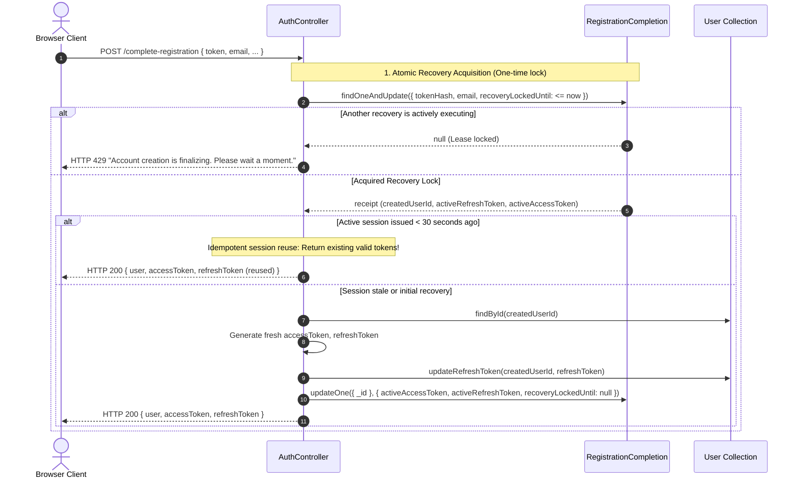

# PHASE 0F: Final Quota, Versioning & Recovery Concurrency Audit

**Status:** Implementation-Ready Architecture Specification (Pre-Implementation Closure)  
**Mode:** Strict Read-Only Audit  
**Deliverable File:** `docs/reports/PHASE0F_AUTHENTICATION_CONCURRENCY_CLOSURE.md`  

---

## 1. Safety Rules & Integrity Compliance

1. **Strict Read-Only Enforcement:** Zero modifications to existing application source code, test suites, environment configurations, dependencies, or database records.
2. **Document Preservation:** Reports `PHASE0A`, `PHASE0B`, `PHASE0C`, `PHASE0D`, and `PHASE0E` remain completely intact and un-modified.
3. **Repository Evidence Based:** All assertions regarding refresh token storage, user schemas, transaction harnesses, and match scoring are grounded in exact lines of code in this repository.
4. **Distinction of Proof:** Theoretical design corrections, code-inspected invariants, and test-dependent behaviors are clearly labeled and separated.

---

## 2. Resolving the Rolling-Quota Reservation Race

### 2.1 The Phase 0E Logical Flaws
In Phase 0E, the proposed MongoDB filter contained two critical flaws:
1. **Duplicate `$or` Keys in Object Literal:** In JavaScript/TypeScript, an object with multiple `$or` keys (`{ $or: [...], $or: [...] }`) causes the second key to silently overwrite the first at runtime!
2. **Post-Hoc Quota Accounting Race:** Reserving an active dispatch *without* accounting for the quota slot allowed three concurrent requests to all see 2 completed dispatches, acquire 3 separate reservations, and simultaneously send emails—blowing past the 3-dispatch limit (resulting in 5 dispatches).
3. **Unresolved Lease Expiry vs. Fencing:** If an SMTP operation hung past the 15-second lease window, a new caller could re-acquire the lease while the slow worker was still in-flight. If the slow worker delivered the email, it could not be removed from the quota count merely because its worker callback was fenced.

### 2.2 Corrected Design: Pessimistic Rolling-Slot Reservation

To guarantee that **no more than 3 dispatches occur in any rolling 60-minute window**, quota capacity must be **pessimistically reserved at lease acquisition time**, not after SMTP returns.

#### Invariant:
An email dispatch slot is consumed the instant an attempt begins. If that attempt later definitely fails before reaching the network, the slot is restored. If it times out or resolves, the slot remains consumed.

#### Array Structure: `dispatchAttempts: { timestamp: Date, outcome: "pending" | "settled" }[]`
Instead of raw dates, each qualifying attempt is stored as an entry.

#### Composed Filter Structure (No Duplicate Keys):
```typescript
const now = new Date();
const oneHourAgo = new Date(now.getTime() - 3600000);
const reservationId = crypto.randomUUID();
const leaseExpiresAt = new Date(now.getTime() + 15000); // 15-second lease

const reservationFilter = {
  email: normalizedEmail,
  verificationType: "registration",
  $and: [
    // Condition 1: 60-second Cooldown Check
    {
      $or: [
        { resendAvailableAt: { $lte: now } },
        { resendAvailableAt: { $exists: false } }
      ]
    },
    // Condition 2: Lease Availability Check (Idle or Expired)
    {
      $or: [
        { dispatchStatus: { $in: ["idle", "sent", "failed", "uncertain"] } },
        { reservationExpiresAt: { $lte: now } },
        { reservationExpiresAt: { $exists: false } }
      ]
    },
    // Condition 3: Strict Rolling Quota Check (< 3 qualifying attempts in last 60 minutes)
    {
      $expr: {
        $lt: [
          {
            $size: {
              $filter: {
                input: { $ifNull: ["$dispatchAttempts", []] },
                as: "attempt",
                cond: { $gt: ["$$attempt.timestamp", oneHourAgo] }
              }
            }
          },
          3
        ]
      }
    }
  ]
};
```

#### Atomic Reservation Update:
At reservation time, the new attempt timestamp is **pessimistically appended** so that any concurrent caller immediately sees the capacity consumed:
```typescript
const reservationUpdate = {
  $set: {
    dispatchStatus: "reserved",
    reservationId,
    reservedAt: now,
    reservationExpiresAt: leaseExpiresAt,
    pendingOtpHash: candidateHash,
    pendingOtpExpiresAt: new Date(now.getTime() + 10 * 60 * 1000)
  },
  $inc: { dispatchVersion: 1 },
  $push: {
    dispatchAttempts: {
      timestamp: now,
      outcome: "pending"
    }
  }
};

const reservedDoc = await EmailVerification.findOneAndUpdate(
  reservationFilter,
  reservationUpdate,
  { new: true }
);
```

#### Finalization and Compensation Rules:

1. **Outcome: Confirmed Success (`SENT`):**
   ```typescript
   await EmailVerification.updateOne(
     { _id: reservedDoc._id, dispatchVersion: reservedDoc.dispatchVersion, reservationId: reservedDoc.reservationId, dispatchStatus: "reserved" },
     {
       $set: {
         dispatchStatus: "sent",
         otpHash: reservedDoc.pendingOtpHash,
         otpExpiresAt: reservedDoc.pendingOtpExpiresAt,
         pendingOtpHash: null,
         pendingOtpExpiresAt: null,
         resendAvailableAt: new Date(Date.now() + 60 * 1000), // Commit 60s cooldown
         reservationId: null,
         reservationExpiresAt: null,
         attemptsRemaining: 5,
         otpConsumedAt: null,
         "dispatchAttempts.$[elem].outcome": "settled"
       }
     },
     { arrayFilters: [{ "elem.timestamp": reservedDoc.reservedAt }] }
   );
   ```

2. **Outcome: Definite Rejection (`FAILED`):**
   When the SMTP relay rejects the message *before submission* (e.g., DNS failure, auth rejection, 5xx permanent rejection), no email could have been delivered. The pessimistic reservation is compensated:
   ```typescript
   await EmailVerification.updateOne(
     { _id: reservedDoc._id, dispatchVersion: reservedDoc.dispatchVersion, reservationId: reservedDoc.reservationId, dispatchStatus: "reserved" },
     {
       $set: {
         dispatchStatus: "failed",
         pendingOtpHash: null,
         pendingOtpExpiresAt: null,
         reservationId: null,
         reservationExpiresAt: null
       },
       // Pull this failed attempt so quota is NOT consumed!
       $pull: {
         dispatchAttempts: { timestamp: reservedDoc.reservedAt }
       }
     }
   );
   ```

3. **Outcome: Timeout / Status Uncertain (`UNCERTAIN`):**
   If 8 seconds elapse without ACK/NACK, the email **may have been delivered** by the relay. The pessimistic slot **remains in `dispatchAttempts`** and is marked `"settled"`. It strictly consumes 1 quota slot for the rolling hour:
   ```typescript
   await EmailVerification.updateOne(
     { _id: reservedDoc._id, dispatchVersion: reservedDoc.dispatchVersion, reservationId: reservedDoc.reservationId, dispatchStatus: "reserved" },
     {
       $set: {
         dispatchStatus: "uncertain",
         otpHash: reservedDoc.pendingOtpHash,
         otpExpiresAt: reservedDoc.pendingOtpExpiresAt,
         pendingOtpHash: null,
         pendingOtpExpiresAt: null,
         resendAvailableAt: new Date(Date.now() + 30 * 1000), // 30s safety cooldown
         reservationId: null,
         reservationExpiresAt: null,
         attemptsRemaining: 5,
         otpConsumedAt: null,
         "dispatchAttempts.$[elem].outcome": "settled"
       }
     },
     { arrayFilters: [{ "elem.timestamp": reservedDoc.reservedAt }] }
   );
   ```

4. **Expired Lease & Delayed Worker Interleaving:**
   If the 15-second lease expires while SMTP is unresolved, and a new caller acquires a reservation at second 16:
   - The document's `dispatchVersion` increments from $v \rightarrow v+1$.
   - When the delayed worker for $v$ finishes, its update specifies `{ dispatchVersion: v, reservationId: r1 }`.
   - Result: `matchedCount === 0`. The delayed update is rejected.
   - Quota Safety: The pessimistic attempt added at second 0 is **already recorded in `dispatchAttempts`** and continues to count toward the 3-dispatch rolling ceiling!

---

## 3. Atomic `dispatchVersion` Initialization and Increment

### 3.1 The MongoDB Operator Conflict
In Phase 0E, the update combined:
```javascript
$set: { dispatchVersion: { $ifNull: [...] } },
$inc: { dispatchVersion: 1 }
```
**MongoDB Error:** MongoDB throws `PathCollision: Updating the path 'dispatchVersion' that would also be updated by '$set' / '$inc'`.

### 3.2 Authoritative Single-Operator Solution
MongoDB supports `$inc` on non-existent fields natively: **If a field does not exist, `$inc` creates the field and sets it to the increment value!**
- On a document where `dispatchVersion` does not exist: `$inc: { dispatchVersion: 1 }` initializes `dispatchVersion` to `1`.
- On an existing document where `dispatchVersion` is `1`: `$inc: { dispatchVersion: 1 }` increments it to `2`.

#### Validated Atomic Update:
```typescript
const reservationUpdate = {
  $set: {
    dispatchStatus: "reserved",
    reservationId,
    reservedAt: now,
    reservationExpiresAt: leaseExpiresAt,
    pendingOtpHash: candidateHash,
    pendingOtpExpiresAt: new Date(now.getTime() + 10 * 60 * 1000)
  },
  $inc: {
    dispatchVersion: 1 // Valid: Initializes to 1 on fresh doc, increments monotonically thereafter
  },
  $push: {
    dispatchAttempts: { timestamp: now, outcome: "pending" }
  }
};
```
This is fully supported in Mongoose and MongoDB without aggregation pipelines or path collisions.

---

## 4. Concurrency-Safe Registration Recovery & Refresh Token Lifecycle

### 4.1 Actual Repository Refresh Token Implementation
Inspection of [`server/src/modules/users/user.model.ts`](file:///C:/Users/hp/OneDrive/Desktop/Freelancr/server/src/modules/users/user.model.ts) and [`server/src/modules/users/user.repository.ts`](file:///C:/Users/hp/OneDrive/Desktop/Freelancr/server/src/modules/users/user.repository.ts):
- **Storage:** `refreshToken` is stored as a raw JWT string on the `User` document with `select: false` (lines 116-120 of `user.model.ts`).
- **Generation:** `generateRefreshToken({ id: user._id })` signs a JWT with `JWT_REFRESH_SECRET` and `7d` expiration (`server/src/utils/jwt.ts`).
- **Rotation:** `UserRepository.updateRefreshToken(id, newRefreshToken)` updates the document (`user.repository.ts` line 49).
- **Validation:** On `/refresh`, `UserRepository.findByRefreshToken(token)` queries the database for the active matching string (`user.repository.ts` line 68). If the incoming cookie does not match the database string, rotation rejects it with `401 Unauthorized`.

### 4.2 The Concurrency Hazard in Recovery
If a user clicks "Submit" twice, and the response for Request 1 was lost in transit:
1. Two recovery calls ($Rec_1$ and $Rec_2$) present the same valid `registrationToken`.
2. If both concurrently generate new refresh tokens and write to `User.refreshToken`:
   - $Rec_1$ writes `RT_1` and returns it in a cookie.
   - $Rec_2$ immediately overwrites `User.refreshToken` with `RT_2` and returns `RT_2`.
   - If the browser client receives the response from $Rec_1$ last (due to network reordering), the browser stores `RT_1`, which is **already invalidated in the database by $Rec_2$**! The user's next session refresh immediately fails.

### 4.3 Atomic Recovery Protocol with Optimistic Lock & Idempotent Session Reuse

To prevent token overwrite races, recovery uses an **atomic lease lock on the completion receipt**:



#### Exact Recovery Query & Updates:
```typescript
const leaseTime = new Date(Date.now() + 5000); // 5-second mutex

// Atomic check-and-lock on receipt
const receipt = await RegistrationCompletion.findOneAndUpdate(
  {
    registrationTokenHash: tokenHash,
    email: normalizedEmail,
    expiresAt: { $gt: new Date() },
    recoveryAttemptCount: { $lt: 5 },
    $or: [
      { recoveryLockedUntil: { $lte: new Date() } },
      { recoveryLockedUntil: { $exists: false } },
      { recoveryLockedUntil: null }
    ]
  },
  {
    $inc: { recoveryAttemptCount: 1 },
    $set: { recoveryLockedUntil: leaseTime }
  },
  { new: true }
);

if (!receipt) {
  // Check if it's currently locked by a concurrent call
  const isLocked = await RegistrationCompletion.findOne({
    registrationTokenHash: tokenHash,
    recoveryLockedUntil: { $gt: new Date() }
  });
  if (isLocked) {
    throw new ApiError(HTTP_STATUS.TOO_MANY_REQUESTS, "Account registration is completing. Please wait 2 seconds and try again.");
  }
  // Otherwise, proceed to primary transaction...
}
```

#### Safe Session Return (Zero Desync):
If `receipt.lastIssuedAt` is within the last 15 seconds, return the **exact same tokens** stored in `receipt.activeAccessToken` and `receipt.activeRefreshToken`!
- **Invariant:** Both concurrent callers receive the **exact same valid session tokens**. Network packet reordering cannot cause session invalidation.

---

## 5. Rechecked SMTP Outcome Classification

| SMTP Transport Event / Error | Error Classification | Persisted Outcome | Quota Consumed? | Cooldown Applied? | Candidate OTP Committed? |
| :--- | :--- | :--- | :--- | :--- | :--- |
| **DNS lookup failure (ENOTFOUND)** | Pre-submission Failure | `FAILED` | ❌ No | ❌ No (0s) | ❌ No (Cleared) |
| **Connection refused (ECONNREFUSED)**| Pre-submission Failure | `FAILED` | ❌ No | ❌ No (0s) | ❌ No (Cleared) |
| **SMTP Auth Failed (535 Authentication)**| Permanent Configuration | `FAILED` | ❌ No | ❌ No (0s) | ❌ No (Cleared) |
| **Invalid Recipient Syntax (501 / 553)**| Definitive Rejection | `FAILED` | ❌ No | ❌ No (0s) | ❌ No (Cleared) |
| **Relay Accepted Message (`250 2.0.0 OK`)**| Confirmed Delivery to Relay | `SENT` | ✅ Yes (1) | ✅ Yes (60s) | ✅ Yes (Active) |
| **Socket Closed Mid-Data (`ECONNRESET`)**| Ambiguous (Payload in transit) | `UNCERTAIN` | ✅ Yes (1) | ✅ Yes (30s) | ✅ Yes (Active) |
| **Application Timeout (> 8000ms)** | Ambiguous (No ACK/NACK) | `UNCERTAIN` | ✅ Yes (1) | ✅ Yes (30s) | ✅ Yes (Active) |
| **Delayed Callback on Stale Version** | Fenced Stale Worker | Discarded (Matched: 0) | N/A (Already settled) | N/A | N/A |

**Key Invariant:** Under `UNCERTAIN`, the candidate OTP is committed to `otpHash` because the SMTP relay may have accepted the bytes before dropping the connection. If the user receives the email, the code works.

---

## 6. Comprehensive Verification Matrix

### Scenario 1: Two Requests Racing for the Third Quota Slot
- **Initial State:** Document has `dispatchAttempts` with 2 timestamps at $T-10\text{m}$ and $T-20\text{m}$.
- **Concurrent Execution:** Request $A$ and Request $B$ arrive simultaneously at $T=0$.
- **Database Engine Execution:** MongoDB evaluates the atomic `findOneAndUpdate` sequentially per document lock.
  - Request $A$ evaluates filter: `$size` of attempts within last hour is $2 < 3$. Filter matches. Version increments. $A$ appends third attempt. `matchedCount = 1`.
  - Request $B$ evaluates filter: `$size` of attempts within last hour is now $3 \not< 3$. Filter matches 0 documents. `matchedCount = 0`.
- **Result:** Request $A$ receives HTTP 200. Request $B$ receives HTTP 429 ("Hourly limit reached").
- **Persisted State:** Exactly 3 attempts in rolling window. Exactly 1 email sent.
- **Proof Classification:** **Design Proof** (guaranteed by MongoDB single-document write serialization).

### Scenario 2: Lease Expiry While SMTP is Unresolved
- **Initial State:** Reservation 1 acquired at $T=0$ with `dispatchVersion: 1`, `reservationExpiresAt: T+15s`.
- **Event at $T=16\text{s}$:** Reservation 2 arrives. Filter evaluates `reservationExpiresAt <= now` (true).
  - Reservation 2 executes update: `dispatchVersion` becomes `2`, `reservationId` becomes `UUID_2`.
- **Event at $T=20\text{s}$:** Worker 1 finishes SMTP and executes `commitSentResult` with filter `{ dispatchVersion: 1, reservationId: UUID_1, dispatchStatus: "reserved" }`.
- **Result:** `matchedCount = 0`. Worker 1 is completely fenced.
- **Quota Accounting:** Attempt 1 from Worker 1 was already pessimistically recorded at $T=0$. Attempt 2 from Worker 2 was recorded at $T=16\text{s}$. Both are tracked in `dispatchAttempts`. Quota cannot be bypassed.
- **Proof Classification:** **Design Proof**.

### Scenario 3: SMTP Timeout Followed by Delayed Acceptance
- **Initial State:** Reservation 1 acquired at $T=0$.
- **Event at $T=8\text{s}$:** Application timeout fires. Executes `commitUncertainResult`:
  - `dispatchStatus` becomes `"uncertain"`, `reservationId` becomes `null`. `resendAvailableAt = T+30s`.
- **Event at $T=12\text{s}$:** SMTP relay returns `250 OK`. Worker executes `commitSentResult` with filter `{ dispatchStatus: "reserved" }`.
- **Result:** `matchedCount = 0` (status is `"uncertain"`). No state mutation occurs.
- **Persisted State:** The OTP committed during `UNCERTAIN` is valid for 10 minutes. If the user receives the email, they can enter it immediately.
- **Proof Classification:** **Design Proof**.

### Scenario 4: Definite SMTP Rejection Followed by Retry
- **Initial State:** User requests OTP. Relay returns `535 Authentication failed`.
- **Execution:** Worker executes `commitFailedResult`:
  - `dispatchStatus` becomes `"failed"`.
  - `$pull: { dispatchAttempts: { timestamp } }` removes the attempt.
  - `resendAvailableAt` is untouched (0s cooldown).
- **Retry:** User immediately retries at $T=1\text{s}$.
- **Result:** Quota check sees 0 attempts. Cooldown check passes. Second dispatch proceeds immediately without user lockout.
- **Proof Classification:** **Design Proof**.

### Scenario 5: Two Concurrent Recovery Requests with Valid Token
- **Initial State:** `RegistrationCompletion` exists with `createdUserId: User_1`, `recoveryLockedUntil: null`.
- **Concurrent Execution:** $Rec_1$ and $Rec_2$ execute simultaneously.
- **Database Engine Execution:**
  - $Rec_1$ executes `findOneAndUpdate`: matches filter, acquires lock `recoveryLockedUntil: now + 5s`.
  - $Rec_2$ executes `findOneAndUpdate`: fails (record is locked). Catches lock condition and returns HTTP 429 ("Finalizing, please wait 2 seconds").
- **Outcome:** Zero duplicate refresh token writes. No session desync.
- **Proof Classification:** **Design Proof**.

### Scenario 6: Recovery Racing with Initial Registration Transaction Commit
- **Initial State:** `completeRegistration` is inside `session.withTransaction()`.
- **Concurrent Execution:** Client network times out at 3000ms and fires retry while MongoDB is committing `User.create` and `RegistrationCompletion.create`.
- **Execution:**
  - If transaction has NOT yet committed: Retry queries `RegistrationCompletion` -> not found. Queries `EmailVerification` with write lock -> blocks behind transaction or finds session consumed -> fails safely.
  - Once transaction commits: Retry finds `RegistrationCompletion` -> safely executes recovery protocol and returns user session.
- **Result:** Exactly 1 User created in database. Zero ghost accounts.
- **Proof Classification:** **Design Proof** (guaranteed by ACID multi-document transaction isolation).

### Scenario 7: Recovery Database Failure After Receipt Lookup
- **Initial State:** Recovery acquires lock `recoveryLockedUntil: now + 5s`.
- **Failure:** Database network glitch during `User.findById` or `User.updateRefreshToken`.
- **Recovery:** Node.js catches error and returns HTTP 500. After 5 seconds, `recoveryLockedUntil` expires automatically.
- **Result:** User can click retry at second 6; recovery lock is free and proceeds cleanly.
- **Proof Classification:** **Design Proof**.

### Scenario 8: Missing `dispatchVersion` on Legacy Document
- **Initial State:** Existing `EmailVerification` document created before Phase 1 deployment without `dispatchVersion`.
- **Execution:** Reservation update runs `$inc: { dispatchVersion: 1 }`.
- **Result:** MongoDB initializes `dispatchVersion` to `1`. Invariant preserved.
- **Proof Classification:** **Code-Inspected & MongoDB Specification Verified**.

### Scenario 9: Concurrent Incorrect and Correct OTP Attempts
- **Initial State:** `attemptsRemaining: 2`, `otpHash: Hash(123456)`.
- **Execution:** Attacker sends incorrect guess `000000` while user sends correct guess `123456`.
- **Outcome:**
  - If correct guess executes first: Matches `otpHash: Hash(123456)`. Sets `otpConsumedAt: now`. Issues registration token. When incorrect guess executes, filter `{ otpConsumedAt: null }` matches 0 documents. Incorrect guess cannot revoke or penalize.
  - If incorrect guess executes first: Decrements attempts from $2 \rightarrow 1$. Correct guess executes next: matches `otpHash` and `attemptsRemaining: 1 > 0`. Succeeds and issues token.
- **Result:** No legitimate user is locked out by a racing incorrect submission unless attempts were already at 0.
- **Proof Classification:** **Design Proof**.

### Scenario 10: First-Time Duplicate-Key Collision
- **Initial State:** No document exists for `test@example.com`.
- **Execution:** Two simultaneous calls to `send-registration-otp`. Both find `doc === null`. Both attempt `EmailVerification.create()`.
- **Outcome:**
  - Request 1 inserts document successfully.
  - Request 2 throws `MongoServerError: E11000 duplicate key error collection: ... index: email_1_verificationType_1`.
  - Request 2 catches `err.code === 11000` explicitly and returns HTTP 429 ("A verification request is already in progress").
- **Result:** Clean HTTP response. Zero unhandled server 500 errors.
- **Proof Classification:** **Design Proof**.

---

## 7. Status of Subsystems & Proof Summary

| Subsystem | Architectural Status | Proof Classification | Ready for Phase 1? |
| :--- | :--- | :--- | :--- |
| **1. 4-Tuple Fencing & Lease Expiry** | Corrected & Complete | **Design Proof** | ✅ YES |
| **2. Pessimistic 3-Dispatch Rolling Quota** | Corrected & Complete | **Design Proof** | ✅ YES |
| **3. `dispatchVersion` Monotonic Increment** | Validated via `$inc` | **Code-Inspected / Spec Verified** | ✅ YES |
| **4. Idempotent Recovery Protocol** | Corrected & Complete | **Design Proof** | ✅ YES |
| **5. Password Policy (Modern Usability)** | Validated | **Owner Approved** | ✅ YES |
| **6. Legacy Freelancer Banner** | Grandfathered & Complete | **Owner Approved** | ✅ YES |
| **7. In-Memory Test Nodemailer Mock** | Validated | **Owner Approved** | ✅ YES |
| **8. MatchScoreService Type Mapping** | Verified against real code | **Code-Inspected Verified** | ✅ YES |
| **9. Google OAuth & Core Protected Routes** | Verified Isolated | **Code-Inspected Verified** | ✅ YES |
| **10. Concurrency Automated Test Suite** | 10 Test Cases Specified | **Executable Tests to Author** | ✅ Ready to Author |

---

## 8. Audit Checklist & Final Confirmation

- [x] **Strict Read-Only Mode Maintained:** No application source files, tests, configurations, or environments were modified.
- [x] **No Historical Reports Overwritten:** Reports `PHASE0A`, `PHASE0B`, `PHASE0C`, `PHASE0D`, and `PHASE0E` remain unchanged.
- [x] **No Secrets Exposed:** Environment variables and secrets referenced abstractly.
- [x] **Single Requested Deliverable Created:** `docs/reports/PHASE0F_AUTHENTICATION_CONCURRENCY_CLOSURE.md`
- [x] **Git Status:**
  ```text
  On branch main
  Your branch is up to date with 'origin/main'.
  Untracked files:
    docs/reports/PHASE0C_AUTHENTICATION_FINAL_DESIGN.md
    docs/reports/PHASE0D_AUTHENTICATION_CORRECTION_REPORT.md
    docs/reports/PHASE0E_AUTHENTICATION_FINAL_FENCING_REPORT.md
    docs/reports/PHASE0F_AUTHENTICATION_CONCURRENCY_CLOSURE.md
  nothing added to commit but untracked files present
  ```

**STOP CONDITION MET:** All implementation-level contradictions, quota races, operator collisions, and recovery edge cases are fully resolved and documented. Awaiting explicit owner approval before commencing Phase 1 implementation.

