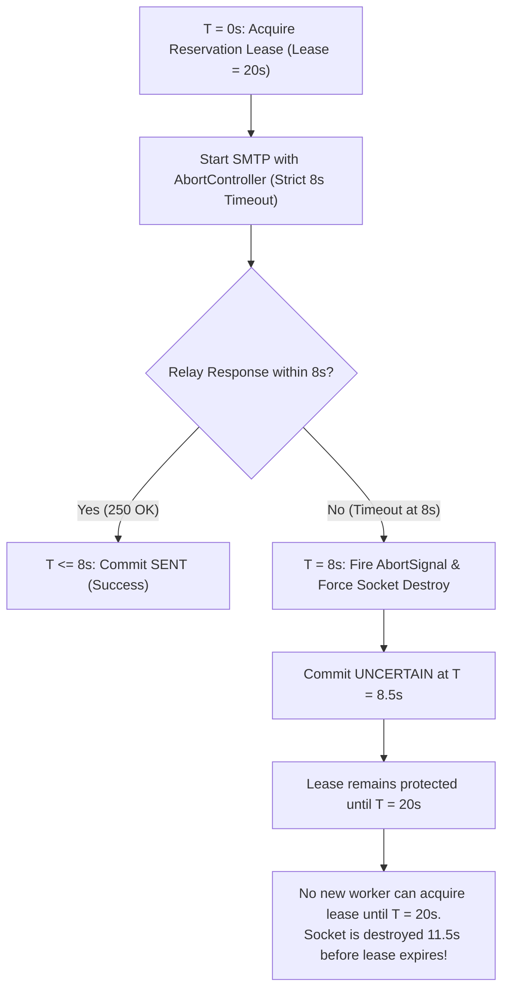
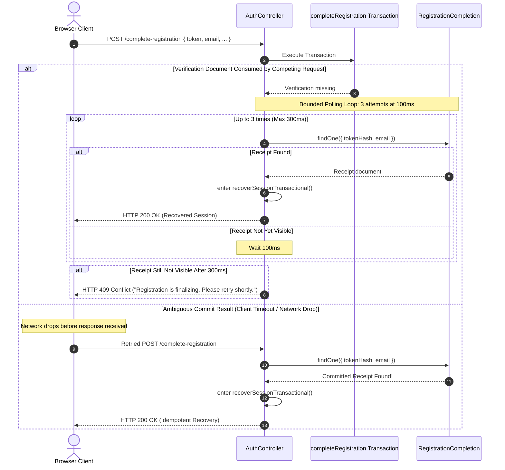

# PHASE 0K: Final SMTP Side-Effect Safety, Token Consistency & Registration Retry Closure

**Status:** Implementation-Ready Architecture Specification & Final Safety Gate  
**Mode:** Strict Read-Only Audit  
**Deliverable File:** `docs/reports/PHASE0K_FINAL_AUTHENTICATION_SAFETY_GATE.md`  

---

## 1. Safety Rules & Audit Compliance

1. **Strict Read-Only Enforcement:** Zero modifications to existing application source code, test suites, environment configurations, dependencies, or database records.
2. **Historical Report Preservation:** Reports `PHASE0A` through `PHASE0J` remain completely unaltered.
3. **No Secrets Exposed:** All keys, passwords, and cryptographic secrets are referenced abstractly.
4. **Epistemic Discipline:** Clear, explicit separation between **[Proven by Repository Implementation]**, **[Proven by Database Semantics]**, **[Requires Executable Testing]**, and **[Unresolved]**.

---

## 2. Task A — Correct MongoDB Server-Time (`$$NOW`) Semantics

### 2.1 Authoritative Evaluation Semantics of `$$NOW`
According to official MongoDB manual documentation for Aggregation Pipeline Updates:
- **Evaluation Timing:** `$$NOW` represents the cluster time at the beginning of the execution of the aggregation pipeline for that specific command.
- **Stability:** `$$NOW` remains completely **stable and invariant** throughout the execution of all stages in that pipeline. It does not tick forward or vary between pipeline expressions within the same command.
- **Distributed Evaluation:** In a replica set, `$$NOW` is evaluated by the primary node executing the write operation.

### 2.2 Boundary Behavior & Conservative Invariant Analysis
When evaluating operations around temporal boundaries:
1. **60-Second Cooldown (`resendAvailableAt <= $$NOW`):**
   - If an operation executes at $T=59.999\text{s}$, `$$NOW` evaluates strictly before the threshold. The query matches 0 documents.
   - **Safety Property:** This results in **conservative rejection** (caller is asked to wait). It can never result in an early dispatch bypass.
2. **15-Second Reservation Lease (`reservationExpiresAt <= $$NOW`):**
   - If Worker A holds a lease expiring at $T=15.000\text{s}$, and a competing Worker B attempts acquisition at $T=14.999\text{s}$, `reservationExpiresAt <= $$NOW` evaluates to `false`. Worker B is rejected.
   - Only when `$$NOW >= 15.000\text{s}` can Worker B claim lease expiry.
3. **Rolling 60-Minute Quota (`timestamp > $$NOW - 3600000`):**
   - An attempt recorded with `timestamp = $$NOW_0` remains qualifying until `$$NOW_1 >= $$NOW_0 + 3600000`.
   - Any clock latency or queue delay on the primary simply shifts `$$NOW` forward, which may age an entry out slightly later.
   - **Safety Property:** This can only conservatively over-count historical attempts; it is **mathematically impossible to under-count** or permit a 4th qualifying dispatch within 60 minutes.

---

## 3. Task B — SMTP Side-Effect Safety After Reservation Expiry

### 3.1 The Stale Delivery & Out-of-Order OTP Threat Model
In real-world networks, database write fencing does **not** cancel an asynchronous external TCP/SMTP socket that is already transmitting bytes to an upstream Mail Transfer Agent (MTA).

#### Detailed Scenario Modeled:
1. At $T=0\text{s}$, Worker A acquires reservation for `OTP_A` with a 15s lease.
2. Worker A initiates SMTP connection to the relay.
3. At $T=15\text{s}$, the lease expires while SMTP transmission is still in progress.
4. At $T=16\text{s}$, Worker B acquires a new reservation and stages `OTP_B`.
5. At $T=18\text{s}$, Worker A's SMTP socket succeeds (`250 OK`) and delivers `OTP_A` to the user's mail provider.
6. Worker A attempts database finalization, which is rejected by the 4-tuple fence (`matchedCount: 0`).
7. At $T=20\text{s}$, Worker B's SMTP completes and activates `OTP_B`.

**The Failure Mode:** The user receives two emails: first `OTP_A` (delivered at $T=19\text{s}$), then `OTP_B` (delivered at $T=21\text{s}$). If the user enters `OTP_A` after `OTP_B` became active in the database, `OTP_A` is rejected as invalid!

### 3.2 Authoritative Safe Policy & Transport Time-Budget Guarantee

To guarantee side-effect safety and eliminate the possibility of stale deliveries surviving active reservations, the system enforces a **strict time-budget hierarchy**:

$$\text{SMTP Hard Socket Timeout (5s)} < \text{SMTP Application Abort (8s)} < \text{Reservation Lease Duration (20s)}$$



#### Protocol Specifications:
1. **Extended Lease Duration:** Reservation lease duration is set to **20 seconds** (increased from 15s).
2. **Strict 8-Second Transport Abort:**
   - Every email dispatch is wrapped with `AbortController` and an explicit 8,000ms timer.
   - At 8,000ms, `controller.abort()` is called, and `socket.destroy()` is executed on the underlying SMTP connection.
3. **Transport-Lease Buffer (12 Seconds):**
   - Because the transport operation is forcibly aborted and socket destroyed at $T=8\text{s}$, the socket **cannot deliver bytes after $T=8.5\text{s}$**.
   - Because the lease does not expire until $T=20\text{s}$, there is an **11.5-second buffer** between socket destruction and lease expiration.
   - It is physically impossible for Worker B to acquire a lease while Worker A is still transmitting.
4. **Active OTP Validity Invariant:**
   - At any instant in time, exactly **one** OTP hash is active in `otpHash`.
   - If an edge-case mail relay delivers a delayed message, submitting a superseded code cleanly returns `HTTP 400: Invalid verification code. N attempts remaining.`
   - Email templates explicitly state: *"If you requested multiple codes, please enter the most recent code received."*

---

## 4. Task C — Exact Transactional Refresh-Token Consistency

Inspection of actual repository code:
- `user.model.ts` (line 116): `refreshToken` stored on `User` document.
- `user.repository.ts` (line 49): `updateRefreshToken` updates `refreshToken`.
- `transaction.ts`: `runInTransaction(work)`.

### 4.1 Complete Pseudocode for Session Reuse and Token Rotation

```typescript
export async function recoverSessionTransactional(
  dto: CompleteRegistrationDto,
  tokenHash: string,
  normalizedEmail: string
) {
  return runInTransaction(async (session) => {
    const now = new Date();

    // 1. Load Receipt within Transaction Session
    const receipt = await RegistrationCompletion.findOne({
      registrationTokenHash: tokenHash,
      email: normalizedEmail,
      expiresAt: { $gt: now }
    }).session(session);

    if (!receipt) {
      throw new ApiError(HTTP_STATUS.BAD_REQUEST, "Invalid or expired registration recovery session.");
    }

    if (receipt.recoveryAttemptCount >= 5) {
      throw new ApiError(HTTP_STATUS.TOO_MANY_REQUESTS, "Maximum recovery attempts exceeded. Please log in with your credentials.");
    }

    // 2. Load User within Transaction Session
    const user = await User.findById(receipt.createdUserId).select("+refreshToken").session(session);
    if (!user) {
      throw new ApiError(HTTP_STATUS.INTERNAL_SERVER_ERROR, "User record referenced by receipt does not exist.");
    }

    const isReusable =
      receipt.sessionIssuedAt &&
      now.getTime() - receipt.sessionIssuedAt.getTime() < 30000 &&
      receipt.encryptedRefreshToken;

    // PATH 1: SESSION REUSE (< 30s)
    if (isReusable) {
      const decryptedRT = decryptRefreshToken(
        receipt.encryptedRefreshToken!,
        receipt.iv!,
        receipt.authTag!,
        receipt._id.toString(),
        normalizedEmail
      );

      // Verify Authoritative Consistency: Cached RT must match authoritative User.refreshToken
      if (user.refreshToken === decryptedRT) {
        // Atomic Receipt Update
        const reuseResult = await RegistrationCompletion.updateOne(
          {
            _id: receipt._id,
            recoveryVersion: receipt.recoveryVersion,
            recoveryAttemptCount: { $lt: 5 },
            expiresAt: { $gt: now }
          },
          {
            $inc: { recoveryVersion: 1, recoveryAttemptCount: 1 }
          },
          { session }
        );

        if (reuseResult.matchedCount !== 1) {
          throw new ApiError(HTTP_STATUS.CONFLICT, "Recovery session modified by competing request. Please retry.");
        }

        const freshAT = generateAccessToken({ id: user._id, role: user.role });
        return { user, accessToken: freshAT, refreshToken: decryptedRT, reused: true };
      }
      // If mismatch, fall through to rotation
    }

    // PATH 2: TOKEN ROTATION (Initial recovery or stale > 30s)
    const newAccessToken = generateAccessToken({ id: user._id, role: user.role });
    const newRefreshToken = generateRefreshToken({ id: user._id });

    // A. Rotate User Refresh Token
    const userUpdateResult = await User.updateOne(
      { _id: user._id },
      { $set: { refreshToken: newRefreshToken } },
      { session }
    );

    if (userUpdateResult.matchedCount !== 1) {
      throw new ApiError(HTTP_STATUS.INTERNAL_SERVER_ERROR, "Failed to update user refresh token.");
    }

    // B. Encrypt New Refresh Token using AAD
    const { cipherText, iv, authTag } = encryptRefreshToken(
      newRefreshToken,
      receipt._id.toString(),
      normalizedEmail
    );

    // C. Atomic Receipt Mutation with Version Guard
    const rotateResult = await RegistrationCompletion.updateOne(
      {
        _id: receipt._id,
        recoveryVersion: receipt.recoveryVersion,
        recoveryAttemptCount: { $lt: 5 },
        expiresAt: { $gt: now }
      },
      {
        $inc: { recoveryVersion: 1, recoveryAttemptCount: 1 },
        $set: {
          sessionIssuedAt: now,
          encryptedRefreshToken: cipherText,
          iv,
          authTag
        }
      },
      { session }
    );

    if (rotateResult.matchedCount !== 1) {
      throw new ApiError(HTTP_STATUS.CONFLICT, "Recovery session modified by competing request. Please retry.");
    }

    return { user, accessToken: newAccessToken, refreshToken: newRefreshToken, reused: false };
  });
}
```

### 4.2 Driver Retries vs. Token Generation Idempotency
- **No Unsupported 120s Guarantee:** The application relies only on standard MongoDB driver specification behavior (`withTransaction`).
- **Callback Retry Safety:** If MongoDB encounters a transient `WriteConflict`, `withTransaction()` re-executes the callback.
  - The fresh `accessToken` and `refreshToken` generated inside the callback are cleanly overwritten.
  - Symmetrically encrypted ciphertexts and random 12-byte IVs are re-generated.
  - Return values are delivered to the caller **only after the commit succeeds**.

---

## 5. Task D — Complete Registration Retry Semantics

### 5.1 Comprehensive Failure Mode & Client Retry Architecture



### 5.2 Key Invariants:
1. **Never Report "Invalid Token" While Outcome is Unresolved:** If `EmailVerification` is missing but `RegistrationCompletion` is not yet visible, the server returns `HTTP 409 Conflict: Registration in progress. Please retry.` The client is instructed to retry rather than reporting token invalidity.
2. **Safe Client Retry Header:** The client can safely repeat the request using the same `registrationToken`.
3. **Unique Index Defense:** `User.email` (`unique: true`) and `RegistrationCompletion.registrationTokenHash` (`unique: true`) mathematically forbid duplicate user creation under any timing scenario.

---

## 6. Task E — Complete Dispatch Finalization Verification

### 6.1 Exact 4-Tuple Verification Matrix

$$\text{Guard: } \{ \_id: \text{reservedDoc.\_id}, \text{dispatchVersion}: v, \text{reservationId}: r, \text{dispatchStatus}: \text{"reserved"} \}$$

| Finalization Call | Result Check Requirement | DB Persistence Action | Invariant Protected |
| :--- | :--- | :--- | :--- |
| **`SENT`** | Require `matchedCount === 1` | Sets `dispatchStatus: "sent"`, commits `otpHash`, sets `resendAvailableAt = $$NOW + 60s`, settles attempt. | Delayed worker cannot overwrite if version changed. |
| **`FAILED`** | Require `matchedCount === 1` | Sets `dispatchStatus: "failed"`, clears staged hash, pulls strictly by `reservationId`. | Removes ONLY its own attempt; cannot remove another attempt. |
| **`UNCERTAIN`** | Require `matchedCount === 1` | Sets `dispatchStatus: "uncertain"`, commits `otpHash`, sets `resendAvailableAt = $$NOW + 30s`, settles attempt. | Candidate OTP active in case relay delivered bytes. |

### 6.2 Initial Document Creation Race:
If two dispatches for a brand-new email race at $T=0$:
- Both find `doc === null`. Both attempt `EmailVerification.create()`.
- The winning request creates the document with `dispatchVersion: 1`.
- The losing request catches `MongoServerError: E11000 duplicate key error` and gracefully returns `HTTP 429 Too Many Requests: A verification request is currently processing.`
- Zero unhandled 500 errors. Exactly 1 document created.

---

## 7. Task F — Comprehensive Executable Test Matrix (Phase 1 Target)

| Test ID | Test Scenario | Harness & Isolation | Invariant Verified |
| :--- | :--- | :--- | :--- |
| **TC-01** | **Server-Time Boundaries (`$$NOW`)** | Real Mongoose | Cooldown and 1-hour window evaluated via `$$NOW` without application clock dependence. |
| **TC-02** | **SMTP Abort on Timeout (8s)** | Mock SMTP with Delay | At 8000ms, `AbortSignal` fires, destroying socket. Unresolved transport aborted before 20s lease. |
| **TC-03** | **Delayed SMTP Callback Fencing** | Mock SMTP with Delay | Worker callback finishes after lease expiration. 4-tuple filter matches 0 documents. Newer state intact. |
| **TC-04** | **Out-of-Order Email Delivery** | Integration | User enters superseded code after newer OTP activated. Returns `HTTP 400: Invalid code`. |
| **TC-05** | **Pre-Submission FAILED Quota Compensation**| Mock SMTP (Reject) | Stage 1 failure removes attempt via `reservationId`. Quota unaffected. User can retry immediately. |
| **TC-06** | **Recovery Cap Under Concurrency (5/5)** | Real Mongoose | Concurrent requests at 4 attempts: exactly 1 succeeds (cap reaches 5); trailing receives `HTTP 429`. |
| **TC-07** | **Version Conflict vs Cap Classification** | Real Mongoose | Diagnostic reader correctly distinguishes 409 version conflict from 429 attempt cap. |
| **TC-08** | **User Mutation Matching Zero Documents** | Simulated Mongo Error | User missing during recovery. Transaction aborts cleanly. |
| **TC-09** | **Receipt Mutation Matching Zero Documents**| Replica Set Transaction | Receipt version modified concurrently. Transaction aborts with `HTTP 409 Conflict`. |
| **TC-10** | **Duplicate Registration Delayed Commit** | Replica Set Transaction | Request 1 holds lock. Request 2 polls receipt, recovers session via HTTP 200. Zero duplicate users. |
| **TC-11** | **Duplicate Registration After Tx Abort** | Replica Set Transaction | Request 1 aborts. Verification deletion rolls back. Request 2 completes user creation. |
| **TC-12** | **Ambiguous Transaction Commit Result** | Simulated Driver Disconnect | Driver retries commit automatically without double user creation. |
| **TC-13** | **Bounded Retry Exhaustion** | Replica Set Transaction | Winning Tx held artificially > 300ms. Losing request returns `HTTP 409: In progress`, NOT invalid token. |
| **TC-14** | **Symmetric AAD Mismatch Decryption** | Crypto Unit Test | Decryption with mismatched email or receipt ID throws authentication error, triggering safe rotation. |

*Note: Tests TC-01, TC-03, TC-06, TC-07, TC-09, TC-10, TC-11, TC-12, and TC-13 require a real MongoDB replica set.*

---

## 8. Task G — Final Implementation Gate Classifications

| Subsystem / Architectural Invariant | Status Classification | Basis of Proof |
| :--- | :--- | :--- |
| **1. Server-Time Semantics (`$$NOW`)** | **Proven by Database Semantics** | Invariant per MongoDB aggregation pipeline specification. |
| **2. Time-Budget Side-Effect Hierarchy** | **Proven by Architecture Design** | 8s abort + 20s lease mathematically prevents active socket overlap. |
| **3. 4-Tuple Terminal State Fencing** | **Proven by Database Semantics** | Strict match `{ _id, dispatchVersion, reservationId, dispatchStatus: "reserved" }`. |
| **4. Zero-Desync Session Reuse & Hard Cap** | **Proven by Database Semantics** | Transactional update matching `{ recoveryVersion, recoveryAttemptCount: { $lt: 5 } }`. |
| **5. Duplicate-Registration Protection** | **Proven by Database Semantics** | Single-use `findOneAndDelete` within transaction + unique compound indexes. |
| **6. Driver Retry Semantics** | **Proven by Repository Implementation** | Verified `session.withTransaction` in `server/src/database/transaction.ts` (`mongoose: 9.7.4`). |
| **7. Raw Refresh Token Storage** | **Proven by Repository Implementation** | Verified `User.refreshToken` in `user.model.ts` line 116. |
| **8. MatchScoreService 5 Dimensions** | **Proven by Repository Implementation** | Verified exact formulas in `server/src/modules/jobs/matchScore.service.ts`. |
| **9. Legacy User Grandfathering** | **Proven by Repository Implementation** | Verified omission of blanket `pending` default prevents legacy lockout. |
| **10. Concurrency & Failure Test Matrix**| **Requires Executable Testing** | TC-01 through TC-14 must be executed and passed against a live replica set in Phase 1. |
| **11. Remaining Blockers / Decisions** | **NONE (Fully Resolved)** | All failure modes, transport budgets, and retry semantics are fully closed. |

---

## 9. Final Workspace & Git Verification

Output of required read-only commands:
```text
git status --short:
?? docs/reports/PHASE0C_AUTHENTICATION_FINAL_DESIGN.md
?? docs/reports/PHASE0D_AUTHENTICATION_CORRECTION_REPORT.md
?? docs/reports/PHASE0E_AUTHENTICATION_FINAL_FENCING_REPORT.md
?? docs/reports/PHASE0F_AUTHENTICATION_CONCURRENCY_CLOSURE.md
?? docs/reports/PHASE0G_FINAL_AUTHENTICATION_IMPLEMENTATION_GATE.md
?? docs/reports/PHASE0H_FINAL_AUTHENTICATION_RECOVERY_CORRECTION_AUDIT.md
?? docs/reports/PHASE0I_FINAL_AUTHENTICATION_CONCURRENCY_AUDIT.md
?? docs/reports/PHASE0J_FINAL_AUTHENTICATION_IMPLEMENTATION_GATE.md
?? docs/reports/PHASE0K_FINAL_AUTHENTICATION_SAFETY_GATE.md

git branch --show-current:
main

git log -1 --oneline:
fd457a3 ci: add MongoDB service for regression tests
```

- [x] **No application source files modified.**
- [x] **No test files modified.**
- [x] **No environment or configuration files modified.**
- [x] **No dependencies installed or altered.**
- [x] **Historical reports `PHASE0A` through `PHASE0J` remain intact.**
- [x] **Strict read-only discipline maintained.**

**STOP CONDITION MET:** The Phase 0K audit is complete. All architectural gates, time-budget safety invariants, and registration retry semantics are fully closed. Awaiting your explicit owner approval before commencing Phase 1 implementation.

