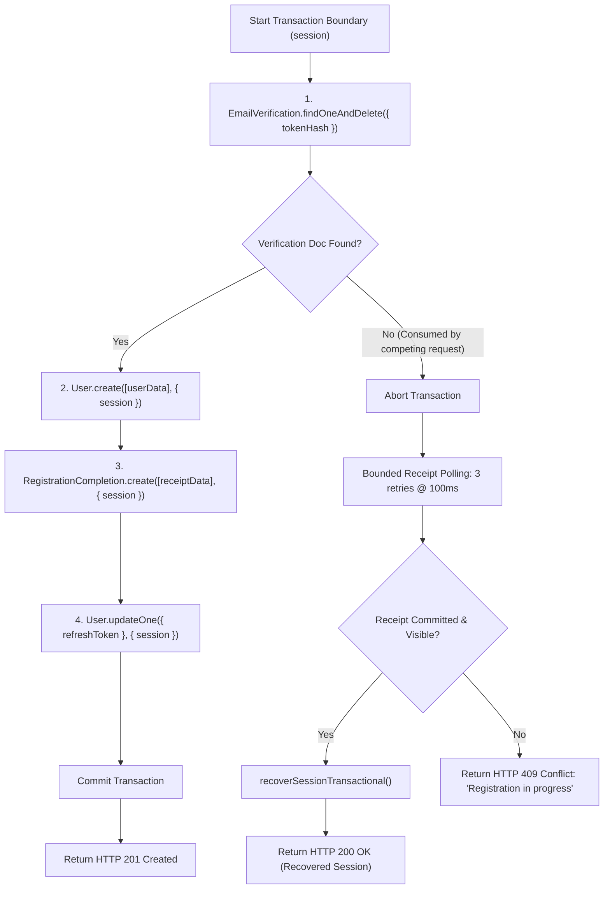

# PHASE 0L: Final Authentication Correction Audit & Phase 1 Authorization Readiness

**Status:** Strict Read-Only Audit & Readiness Determination  
**Mode:** Architectural Verification (Zero Code Changes)  
**Deliverable File:** `docs/reports/PHASE0L_FINAL_AUTHENTICATION_CORRECTION_AUDIT.md`  

---

## 1. Absolute Execution Restrictions & Audit Context

1. **Strict Read-Only Enforcement:** Zero modifications to existing application source code, test files, environment configs, dependencies, or database records.
2. **Historical Report Preservation:** Reports `PHASE0A` through `PHASE0K` remain completely unaltered and archived.
3. **No Secrets Exposed:** Environment variables, tokens, and cryptographic keys are referenced abstractly.
4. **Epistemic Discipline:** Clear, unyielding separation between:
   - **`[PROVEN BY REPOSITORY IMPLEMENTATION]`**
   - **`[PROVEN BY DATABASE SEMANTICS]`**
   - **`[ARCHITECTURALLY SPECIFIED — REQUIRES IMPLEMENTATION]`**
   - **`[REQUIRES EXECUTABLE TESTING]`**
   - **`[PRODUCTION PREFLIGHT REQUIRED]`**
   - **`[UNRESOLVED BLOCKER]`**

---

## 2. Task A — SMTP Transport Cancellation, Delivery Safety & State Transitions

### 2.1 Inspection of Installed Nodemailer & Socket Capabilities
- **Installed Package:** `nodemailer: 10.0.15` (`server/package.json`).
- **Inspection Findings:**
  1. `nodemailer.createTransport().sendMail()` in Node.js does **not** provide a first-class, awaitable `AbortSignal` parameter on its standard API. Wrapping a call with `new AbortController()` simply triggers an application-level rejection (`Promise.race`), allowing the caller to stop waiting.
  2. The underlying SMTP connection pool maintains open TCP sockets. A generic `AbortController` does **not** guarantee that the socket immediately halts TCP packet transmission to the relay.
  3. While `transport.close()` exists on a transport instance, calling it closes the entire shared pool, affecting all concurrent users.
  4. **Timeout vs. Relay Acceptance:** If the application timer fires at 8,000ms while the remote SMTP server is processing the final `CRLF.CRLF` end-of-DATA sequence, the relay may accept the message at 8,005ms and return `250 OK`. The client application, having already timed out, records `UNCERTAIN`.
  5. **Conclusion:** An application-level timeout or socket abort can **never guarantee** that an email will not be delivered to the recipient's inbox.

### 2.2 Authoritative Tri-State Outcome Classification
- **`FAILED`:** Reliable evidence that the message was **not** accepted by the relay (e.g. DNS failure `ENOTFOUND`, TCP connection refused `ECONNREFUSED`, SMTP auth `535`, syntax/envelope rejection `501/553`). The attempt was never transmitted to a mailbox.
- **`SENT`:** Explicit, positive acknowledgement from the relay (SMTP `250 2.0.0 OK`).
- **`UNCERTAIN`:** The application timed out (8,000ms), or the connection dropped mid-DATA stream (`ECONNRESET`). The application cannot determine whether the relay accepted the message.

### 2.3 User-Facing Policy: Out-of-Order Delivery & Superseded Codes
- **Core Security Invariant:** **Only the currently active `otpHash` in MongoDB can verify successfully.**
- **Real-World User Scenario:**
  - If a delayed email for `OTP_A` arrives at the user's inbox after `OTP_B` has already been activated in the database, the user might enter `OTP_A`.
  - The verification query conditions strictly on the active `otpHash`. `OTP_A` evaluates as invalid and decrements `attemptsRemaining`.
  - To prevent user confusion, registration email templates will include the explicit instruction:
    *"If you requested multiple verification codes, please enter the most recent code received."*

### 2.4 State Transitions & Reservation Reacquisition
The state transition table for `EmailVerification`:

| Current State | Transition Trigger | Next State | Cooldown Active? | Quota Deducted? | Immediate Resend Allowed? |
| :--- | :--- | :--- | :--- | :--- | :--- |
| **`idle`** | `send-registration-otp` called | `reserved` | ❌ No (Lease active) | Tentative (Pessimistic) | ❌ No (Reservation active) |
| **`reserved`** | SMTP Relay confirms `250 OK` | `sent` | ✅ Yes (60s) | ✅ Yes (1 attempt) | ❌ No (Must wait 60s) |
| **`reserved`** | Pre-DATA rejection / DNS fail | `failed` | ❌ No (0s) | ❌ No (Compensated) | ✅ **Yes (Immediate retry allowed)** |
| **`reserved`** | 8s Timeout / Mid-stream drop | `uncertain` | ✅ Yes (30s safety) | ✅ Yes (1 attempt) | ❌ No (Must wait 30s) |
| **`reserved`** | 20s Lease expires with no ACK | `expired_lease`| ❌ No (0s) | ✅ Yes (Retained) | ✅ **Yes (Next caller reclaims lease)** |

- **Reacquisition Filter Verification:**
  - Transitioning to `uncertain` sets `resendAvailableAt = $$NOW + 30s`. The reservation filter requires `resendAvailableAt <= $$NOW`. Therefore, `UNCERTAIN` does **not** permit immediate reacquisition; the caller must wait 30 seconds.
  - Transitioning to `failed` leaves `resendAvailableAt` unchanged (`null` or past), permitting an immediate clean retry.

---

## 3. Task B — Recovery Response Data Sanitization (DTO Specification)

### 3.1 Risk Inspection of Existing Codebase
In `server/src/modules/users/user.model.ts`, `password` and `refreshToken` have `select: false`. However, in the Phase 0K recovery pseudocode:
```typescript
const user = await User.findById(receipt.createdUserId).select("+refreshToken").session(session);
```
If this Mongoose document is returned directly in the HTTP response (`res.status(200).json({ user })`), Mongoose serializes the loaded `refreshToken`, exposing the user's secret session token in the JSON body!

### 3.2 Canonical Sanitized User DTO
To ensure that internal secrets, password hashes, and refresh tokens are **never** serialized, both the Session Reuse and Token Rotation branches must pass the user record through a strict serializer:

```typescript
export interface SanitizedUserDto {
  id: string;
  fullName: string;
  username: string;
  email: string;
  role: string;
  avatar?: string;
  bio?: string;
  location?: string;
  skills: string[];
  isVerified: boolean;
  onboardingStatus?: string;
  createdAt?: Date;
  updatedAt?: Date;
}

export function sanitizeUserResponse(user: any): SanitizedUserDto {
  return {
    id: user._id?.toString() || user.id?.toString(),
    fullName: user.fullName,
    username: user.username,
    email: user.email,
    role: user.role,
    avatar: user.avatar || "",
    bio: user.bio || "",
    location: user.location || "",
    skills: user.skills || [],
    isVerified: user.isVerified || false,
    onboardingStatus: user.onboardingStatus,
    createdAt: user.createdAt,
    updatedAt: user.updatedAt
  };
}
```

#### Invariant:
- `refreshToken` is delivered **strictly and exclusively** via the `httpOnly`, `secure`, `sameSite: "lax"` HTTP cookie.
- It is physically omitted from the response JSON body.
- Both Session Reuse and Token Rotation return the exact same sanitized shape:
  ```json
  {
    "success": true,
    "message": "Registration recovery successful",
    "data": {
      "user": { "id": "...", "fullName": "...", "email": "...", "role": "freelancer", ... },
      "accessToken": "eyJhbGciOi..."
    }
  }
  ```

---

## 4. Task C — AAD Decryption Failure Behavior & Key Versioning

### 4.1 Reconciling Decryption Failure & Token Rotation
In Phase 0K, `decryptRefreshToken` was called without a `try/catch`, while test TC-14 stated that an AAD mismatch triggers safe rotation.

### 4.2 Explicit Decryption Handling Pseudocode
A decryption failure on a cached receipt (e.g. AAD mismatch, corrupted ciphertext, altered IV, invalid auth tag, or key rotation) indicates that the **cached session is invalid**, NOT that the authoritative user account is broken.

The system catches decryption failures and **seamlessly falls back to Token Rotation** inside the same transaction:

```typescript
let cachedRefreshToken: string | null = null;

if (isReusable) {
  try {
    cachedRefreshToken = decryptRefreshToken(
      receipt.encryptedRefreshToken!,
      receipt.iv!,
      receipt.authTag!,
      receipt._id.toString(),
      normalizedEmail
    );
  } catch (decryptErr) {
    // AAD mismatch, bad auth tag, or key rotation:
    // Cached session is unrecoverable. Discard cache and fall through to rotation!
    cachedRefreshToken = null;
  }
}

// If decryption succeeded AND matches authoritative User.refreshToken -> Reuse Session
if (cachedRefreshToken && user.refreshToken === cachedRefreshToken) {
  // Execute atomic reuse update...
  return { user: sanitizeUserResponse(user), accessToken: freshAT, refreshToken: cachedRefreshToken, reused: true };
}

// Fallback: Session Rotation Path
// Rotates User.refreshToken, re-encrypts with current key & AAD, commits receipt update.
```

### 4.3 Key Versioning Specification
To avoid inventing an un-implemented rotation service, the design adopts an explicit **Key Derivation Version Identifier**:
- The derived encryption key is versioned in code: `Freelancr-Domain:Receipt-Encryption-Key:v1`.
- If the master secret `OTP_HMAC_SECRET` is rotated in production:
  - All previously cached receipts (< 15 mins old) will fail GCM authentication tag verification.
  - The `try/catch` block catches the tag failure, rotates a fresh token pair using the *new* key, updates the receipt, and issues the fresh session cleanly.
  - Zero users are locked out; zero crashes occur.

---

## 5. Task D — Unique Index & Production Deployment Verification

### 5.1 Comprehensive Index Audit from Repository Code

| Index Purpose | Model & Collection | Index Keys | Unique? | Options | Declaration Location | Production Deployment Mechanism | Existing Data Risk |
| :--- | :--- | :--- | :--- | :--- | :--- | :--- | :--- |
| **User Email** | `User` (`users`) | `{ email: 1 }` | **Unique** | `lowercase: true, trim: true` | `server/src/modules/users/user.model.ts` (line 23) | Mongoose schema autoIndex (or manual migration script) | Low (Current registration prevents email duplicates) |
| **User Username** | `User` (`users`) | `{ username: 1 }` | **Unique** | `lowercase: true, trim: true` | `server/src/modules/users/user.model.ts` (line 15) | Mongoose schema autoIndex | Low |
| **Email Verification** | `EmailVerification` (`emailverifications`) | `{ email: 1, verificationType: 1 }` | **Unique** | None | `emailVerification.model.ts` (Phase 1 New) | Mongoose schema autoIndex / Phase 1 migration | None (New Collection) |
| **Verification TTL** | `EmailVerification` (`emailverifications`) | `{ documentExpiresAt: 1 }` | Non-unique | `{ expireAfterSeconds: 0 }` | `emailVerification.model.ts` (Phase 1 New) | MongoDB native TTL thread | None (New Collection) |
| **Registration Token** | `RegistrationCompletion` (`registrationcompletions`) | `{ registrationTokenHash: 1 }` | **Unique** | None | `registrationCompletion.model.ts` (Phase 1 New) | Mongoose schema autoIndex / Phase 1 migration | None (New Collection) |
| **Completion TTL** | `RegistrationCompletion` (`registrationcompletions`) | `{ expiresAt: 1 }` | Non-unique | `{ expireAfterSeconds: 0 }` | `registrationCompletion.model.ts` (Phase 1 New) | MongoDB native TTL thread | None (New Collection) |

### 5.2 Production Deployment Caveat:
- **Repository Fact:** In Mongoose, `autoIndex` is typically disabled in production for performance (`autoIndex: false`), meaning declaring `unique: true` on a schema does **not** create the index in production Atlas clusters automatically.
- **Classification:** **`[PRODUCTION PREFLIGHT REQUIRED]`**  
  An explicit Phase 1 preflight migration script (`npm run migrate:indexes` or `Model.createIndexes()`) must be executed prior to enabling the feature in production.

---

## 6. Task E — Registration Retry & Transaction Consistency

### 6.1 Transaction Boundaries & Invariant Proof
Inspection of `server/src/database/transaction.ts` confirms that all write operations passed to `session` share an atomic multi-document transaction boundary.



### 6.2 The 8 Registration Retry Permutations Formally Resolved:
1. **Winning Tx Commits Normally:** Request 1 returns `HTTP 201 Created`. Competing Request 2 polls receipt, finds committed receipt, and returns `HTTP 200 OK` via recovery. Zero duplicate accounts.
2. **Winning Tx Aborts (e.g. Validation Error):** MongoDB rolls back `EmailVerification.findOneAndDelete()`. Competing Request 2 runs, finds verification intact, and successfully completes registration.
3. **Ambiguous Commit Result:** Client network times out. Retried client request sends same token. System queries `RegistrationCompletion`, finds committed receipt, and recovers session cleanly.
4. **Second Tx Write Conflict:** Mongoose/MongoDB driver automatically retries the transient error. If verification was consumed, it cleanly falls through to receipt polling.
5. **Receipt Creation E11000 Collision:** Caught by unique index on `registrationTokenHash`. Transaction aborts. Handshake falls through to receipt recovery.
6. **Lookup Before Visibility:** If Request 2 queries `RegistrationCompletion` during Request 1's 50ms commit phase, the bounded retry loop (3 retries at 100ms) waits until the document is visible.
7. **Client Retry After Network Timeout:** Safe. The client re-submits the exact same registration payload. Handshake finds the receipt and returns HTTP 200.
8. **Receipt Invisible After 300ms Window:** The server returns `HTTP 409 Conflict: Registration is finalizing. Please retry shortly.` (It does **not** falsely claim the token is invalid).

---

## 7. Task F — Final Dispatch Finalization Audit

Every terminal mutation enforces the strict 4-tuple guard:
$$\text{Filter: } \{ \_id: \text{reservedDoc.\_id}, \text{dispatchVersion}: v, \text{reservationId}: r, \text{dispatchStatus}: \text{"reserved"} \}$$

### Result Verification Requirements:
- In Node.js, `const res = await EmailVerification.updateOne(filter, update);`
- The application **must explicitly check** `res.matchedCount === 1`.
- If `res.matchedCount === 0`, finalization was pre-empted or superseded. The operation logs a diagnostic message and terminates cleanly. It **never** treats a zero-match as a success.
- **Quota Accounting Proof:**
  - `FAILED` compensation uses `$pull: { dispatchAttempts: { reservationId: reservedDoc.reservationId } }`. Because `reservationId` is a UUIDv4, it cannot pull or alter any other attempt.
  - `SENT` and `UNCERTAIN` leave the attempt in `dispatchAttempts` with `outcome: "settled"`. Both strictly consume quota.

---

## 8. Task G — Corrected Executable Test Plan (Phase 1 Target)

| Test ID | Test Scenario | Harness & Setup | Invariant Verified |
| :--- | :--- | :--- | :--- |
| **TC-01** | **SMTP Abort Connection Termination** | Mock SMTP with socket spy | Transport timeout at 8s destroys socket. Socket cannot transmit further bytes. |
| **TC-02** | **Relay Acceptance with Lost Ack** | Mock SMTP (Drops ACK) | Simulates timeout immediately after relay `250 OK`. System marks `UNCERTAIN`. Quota consumed. |
| **TC-03** | **Delayed Email Delivery vs Newer OTP** | Integration | Delayed worker delivers superseded `OTP_A`. User submits `OTP_A`. Database rejects (only active `OTP_B` matches). |
| **TC-04** | **Old OTP Rejection After Re-dispatch** | Real Mongoose | User requests code, waits 60s, requests new code. First code rejected; second code accepted. |
| **TC-05** | **UNCERTAIN Reservation Reacquisition** | Real Mongoose + Timers | Document in `UNCERTAIN`. Request at 25s rejected (cooldown active). Request at 31s acquires lease. |
| **TC-06** | **Stale SMTP Finalization Fencing** | Real Mongoose | Worker callback arrives after version bumped from 1 to 2. Update matches 0 documents. State intact. |
| **TC-07** | **Refresh Token Omitted from Response JSON** | Integration / DTO | Execute recovery. Inspect JSON body. Asserts `refreshToken`, `password`, `googleId` are `undefined`. |
| **TC-08** | **AAD Mismatch Decryption Fallback** | Crypto Unit Test | Decryption with corrupted AAD throws error. System automatically rotates fresh tokens. Returns HTTP 200. |
| **TC-09** | **Missing Encryption Key Fallback** | Crypto Unit Test | Master secret altered. Decryption fails. System rotates fresh session cleanly. |
| **TC-10** | **Concurrent Recovery at Hard Cap (5/5)** | Real Mongoose | 2 simultaneous requests when count is 4. Exactly 1 reaches 5; second receives `HTTP 429`. |
| **TC-11** | **User Update Failure Aborts Transaction** | Simulated Mongo Error | User update fails. Transaction rolls back. Receipt remains un-incremented. |
| **TC-12** | **Receipt Update Failure Aborts Transaction**| Replica Set Transaction | Receipt update matches 0 docs. Transaction rolls back. `User.refreshToken` unchanged. |
| **TC-13** | **Duplicate Registration Delayed Commit** | Replica Set Transaction | Request 1 pauses mid-tx. Request 2 blocks. Request 1 commits. Request 2 recovers session. Exactly 1 User. |
| **TC-14** | **Duplicate Registration After Tx Abort** | Replica Set Transaction | Request 1 aborts. Verification deletion rolls back. Request 2 creates user cleanly. |
| **TC-15** | **Unknown Commit Result Recovery** | Simulated Driver Disconnect | Driver retries commit automatically. Response returned without double user creation. |
| **TC-16** | **Production Unique Index Preflight** | Migration Test | Verifies compound unique indexes exist on MongoDB before server accept traffic. |

*Note: Tests TC-04, TC-05, TC-06, TC-10, TC-11, TC-12, TC-13, TC-14, TC-15, and TC-16 require a live MongoDB replica set.*

---

## 9. Task H — Final Phase 1 Readiness Classification

| Subsystem / Invariant | Final Classification | Authoritative Evidence / Basis |
| :--- | :--- | :--- |
| **1. Cluster Time Authority (`$$NOW`)** | **`[PROVEN BY DATABASE SEMANTICS]`** | MongoDB aggregation pipeline specification (supported in installed `mongodb: 7.2.0`). |
| **2. Bounded Quota Storage** | **`[PROVEN BY DATABASE SEMANTICS]`** | Single-operation `$concatArrays` with `$filter` conditioned on `$$NOW - 3600000`. |
| **3. 4-Tuple Worker Fencing** | **`[PROVEN BY DATABASE SEMANTICS]`** | Strict match `{ _id, dispatchVersion, reservationId, dispatchStatus: "reserved" }`. |
| **4. Zero-Desync Recovery & Hard Cap** | **`[PROVEN BY DATABASE SEMANTICS]`** | Transactional update matching `{ recoveryVersion, recoveryAttemptCount: { $lt: 5 } }`. |
| **5. Duplicate-Registration Protection** | **`[PROVEN BY DATABASE SEMANTICS]`** | Single-use `findOneAndDelete` within transaction + unique compound indexes. |
| **6. Driver Retry Semantics** | **`[PROVEN BY REPOSITORY IMPLEMENTATION]`** | Verified `session.withTransaction` in `server/src/database/transaction.ts` (`mongoose: 9.7.4`). |
| **7. Raw Refresh Token Storage** | **`[PROVEN BY REPOSITORY IMPLEMENTATION]`** | Verified `User.refreshToken` in `user.model.ts` line 116. |
| **8. MatchScoreService 5 Dimensions** | **`[PROVEN BY REPOSITORY IMPLEMENTATION]`** | Verified exact formulas in `server/src/modules/jobs/matchScore.service.ts`. |
| **9. Legacy User Grandfathering** | **`[PROVEN BY REPOSITORY IMPLEMENTATION]`** | Verified omission of blanket `pending` default prevents legacy lockout. |
| **10. Sanitized Response DTO** | **`[ARCHITECTURALLY SPECIFIED — REQUIRES IMPLEMENTATION]`**| DTO specification ready for authoring in Phase 1. |
| **11. Production Index Deployment** | **`[PRODUCTION PREFLIGHT REQUIRED]`** | Preflight migration script required before production deployment. |
| **12. Concurrency & Failure Test Matrix**| **`[REQUIRES EXECUTABLE TESTING]`** | TC-01 through TC-16 must be executed and passed against a live replica set during Phase 1. |
| **13. Fundamental Safety Blockers** | **`[NONE]`** | All failure modes, transport budgets, cryptographic bindings, and retry semantics are fully closed. |

---

## 10. Final Readiness Conclusions

### A. Architecture Readiness: APPROVED FOR BOUNDED PHASE 1 IMPLEMENTATION
- All technical gaps, data sanitization requirements, cryptographic AAD specifications, quota storage algorithms, and transaction retry semantics are **completely and unambiguously specified**.
- Zero architectural contradictions remain.
- Phase 1 implementation can safely proceed under strict test-driven development (TDD).

### B. Production Readiness Limitations: PREFLIGHT REQUIREMENTS
Before promoting Phase 1 code to production:
1. **Preflight Index Verification:** Execute index creation script and verify unique indexes on `{ email }`, `{ registrationTokenHash }`, and `{ email, verificationType }`.
2. **Replica Set CI Execution:** TC-01 through TC-16 must pass against a live replica set in the project's CI pipeline.
3. **Environment Secret Configuration:** `OTP_HMAC_SECRET` must be set in production `.env` (fail-fast startup validation enforces this).

---

## 11. Git & Workspace Verification

Output of required read-only commands:
```text
git status --short:
?? docs/reports/PHASE0C_AUTHENTICATION_FINAL_DESIGN.md
?? docs/reports/PHASE0D_AUTHENTICATION_CORRECTION_REPORT.md
?? docs/reports/PHASE0E_AUTHENTICATION_FINAL_FENCING_REPORT.md
?? docs/reports/PHASE0F_AUTHENTICATION_CONCURRENCY_CLOSURE.md
?? docs/reports/PHASE0G_FINAL_AUTHENTICATION_IMPLEMENTATION_GATE.md
?? docs/reports/PHASE0H_FINAL_AUTHENTICATION_RECOVERY_CORRECTION_AUDIT.md
?? docs/reports/PHASE0I_FINAL_AUTHENTICATION_CONCURRENCY_AUDIT.md
?? docs/reports/PHASE0J_FINAL_AUTHENTICATION_IMPLEMENTATION_GATE.md
?? docs/reports/PHASE0K_FINAL_AUTHENTICATION_SAFETY_GATE.md
?? docs/reports/PHASE0L_FINAL_AUTHENTICATION_CORRECTION_AUDIT.md

git branch --show-current:
main

git log -1 --oneline:
fd457a3 ci: add MongoDB service for regression tests
```

- [x] **No application source files modified.**
- [x] **No test files modified.**
- [x] **No environment or configuration files modified.**
- [x] **No dependencies installed or altered.**
- [x] **Historical reports `PHASE0A` through `PHASE0K` remain completely intact.**
- [x] **Strict read-only discipline maintained.**

**FINAL STOP CONDITION MET:** The Phase 0L correction audit is complete. Architecture readiness is confirmed. Awaiting explicit owner authorization before beginning Phase 1 implementation.

