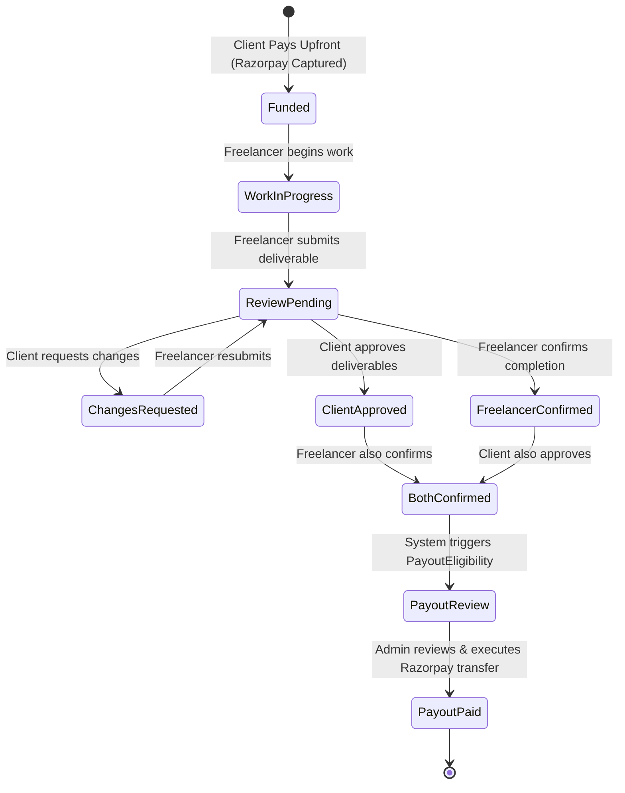

# PRD 17 Baseline and Flow Map: Trustless Contract Funding, Dual-Party Completion, and Controlled Freelancer Payouts

**Document Version:** 1.0.0  
**Date:** 2026-10-17  
**Status:** Completed Baseline Analysis (Stage A & B)  
**Author:** Antigravity AI  

---

## 1. Executive Summary

This document maps the baseline implementation of contract creation, funding, work completion, and payout execution in Freelancr against the non-negotiable security and financial invariants defined in **PRD 17**.

Freelancr possesses strong underlying foundations:
- Integer minor units (paise) for money calculations.
- Authoritative server-side Razorpay order creation and HMAC-SHA256 signature verification.
- Durable webhook deduplication via `ProcessedWebhook`.
- Multi-document transactions using `runInTransaction`.
- Double-entry commission ledger accounting (`CommissionLedgerService`).
- Strict payout eligibility engine (`PayoutEligibilityService`) preventing release if there are unresolved disputes or refunds.
- Unified sidebar navigation (PRD 16) and an existing Admin Payouts console (`/admin/payouts`).

However, three primary architectural and workflow gaps exist in the current implementation:
1. **Premature Contract Activation**: When a client accepts a proposal via `ContractService.createFromProposal`, the contract is created directly in `status: "active"` and `job.status` transitions to `in_progress` without waiting for verified upfront funding.
2. **Unilateral Completion**: `ContractService.completeContract` can be called unilaterally by the client once milestones are marked completed. There is no formalized requirement for both the freelancer and client to confirm completion independently before payout eligibility triggers.
3. **Frontend Funding Disconnect**: In `JobProposalsPage.tsx`, proposal acceptance simply navigates to `/contracts/{contractId}`. There is no immediate Razorpay checkout prompt, nor clear UI state indicating that client funding is held awaiting completion.

---

## 2. Existing vs. Required State Machines

### 2.1 Contract & Funding Lifecycle

| Lifecycle Stage | Existing Behavior | Target PRD 17 Behavior |
|---|---|---|
| **Proposal Acceptance** | Contract created with `status: "active"`, job becomes `in_progress`. | Contract created with `fundingStatus: "pending_funding"` and `status: "active"` (or pending state). Immediate Razorpay order initialized. |
| **Client Checkout** | Manual visit to contract detail / payment section to pay milestone or contract. | Client prompted immediately upon proposal acceptance to fund the contract. Order amount authoritative from accepted proposal. |
| **Payment Verification** | `PaymentService.verifyPayment` updates payment to `paid` and creates commission ledger entry. Contract funding state untouched. | Authoritative verification (via signature check or webhook) updates contract `fundingStatus: "funded"`. Work officially begins. |
| **Unfunded Protection** | Freelancer can submit deliverables even if client has not paid. | Freelancer cannot submit work or claim completion if contract is not verified `funded`. |

### 2.2 Dual-Party Work Completion Protocol

### 2.3 State Invariants & Role Matrix

| Action | Allowed Actor | Required Preconditions | Server Action |
|---|---|---|---|
| **Accept Proposal** | Job Owner (Client) | Job `open`, Proposal `submitted` | Atomic creation of Contract (`fundingStatus: "pending_funding"`). |
| **Fund Contract** | Contract Client | Contract `fundingStatus: "pending_funding"` | Generate Razorpay order for exact proposal price in paise. On verify, set `fundingStatus: "funded"`. |
| **Submit Deliverable** | Contract Freelancer | Contract `fundingStatus: "funded"`, not disputed | Record submission, transition deliverable to `submitted`. |
| **Approve Deliverable / Review** | Contract Client | Deliverable `submitted`, Contract `funded` | Set `clientApprovedAt: Date` on contract/submission. |
| **Confirm Completion** | Contract Freelancer | Deliverables approved or ready, Contract `funded` | Set `freelancerConfirmedAt: Date` on contract. |
| **Trigger Payout Eligibility** | System (Automatic) | Both `clientApprovedAt` & `freelancerConfirmedAt` set; no open disputes/refunds | Transition `Payout.status` to `"eligible"`. Notify Admin. |
| **Admin Payout Review & Execution** | Authorized Admin | Payout is `"eligible"` | Admin clicks Approve & Execute on `/admin/payouts`. Calls payment gateway with idempotency key. Sets `paid` upon verified transfer. |

---

## 3. Financial Invariants & Accounting Rules

1. **Paise Precision**: All contract prices, fees, gateway charges, and payouts use integer minor units (paise). Float math is forbidden.
2. **Platform Commission**: Standard 10% platform fee recorded into `CommissionLedgerEntry` upon funding.
3. **No Premature Payout**: Payout status is `"pending"` until all completion conditions (dual confirmation, verified funding, 0 active disputes) are met, at which point it becomes `"eligible"`.
4. **Idempotent Payout Execution**: Every payout execution generates a unique idempotency key (`payout_{payoutId}_{attempt}`). Double execution returns the existing transfer details.
5. **Fail-Closed on Provider Error**: If provider payout fails or times out, state transitions to `"failed"` or remains `"processing"`, never `"paid"` until confirmed by provider response or webhook.

---

## 4. Implementation Plan (Stages C, D, E)

1. **Schema Enhancements**:
   - Add `fundingStatus: "pending_funding" | "funded"` to `Contract` model.
   - Add `freelancerConfirmedAt?: Date` and `clientApprovedAt?: Date` to `Contract` model.
2. **Backend Services & Routes**:
   - Update `ContractService.createFromProposal` to set `fundingStatus: "pending_funding"`.
   - Update `PaymentService.verifyPayment` and Razorpay Webhook to update `contract.fundingStatus = "funded"` and notify freelancer that funding is secured.
   - Add endpoint `POST /api/v1/contracts/:id/confirm-completion` for freelancer.
   - Add endpoint `POST /api/v1/contracts/:id/approve-completion` for client.
   - When both confirmations exist, set `contract.status = "completed"` and call `PayoutEligibilityService` to make payout `eligible`.
3. **Frontend Integration**:
   - `JobProposalsPage.tsx`: on proposal acceptance, automatically open Razorpay checkout dialog for the client to fund immediately.
   - `ContractDetailsPage.tsx`:
     - Show clear banner: "Pending Upfront Funding" vs "Funded (In Platform Hold)".
     - Show dual completion status pills (Client Approval: Pending/Done, Freelancer Confirmation: Pending/Done).
     - Add Freelancer "Confirm Completion" and Client "Approve Completion" action buttons.
   - `/admin/payouts`: ensure contracts awaiting admin payout review appear cleanly with financial breakdown.
4. **Automated Testing**:
   - Write comprehensive unit & integration tests in `server/test/prd17-trustless-funding-completion.test.ts`.
   - Ensure 100% clean builds for client and server.
